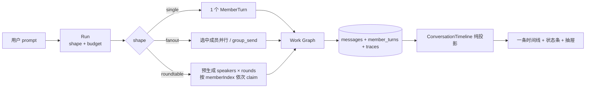
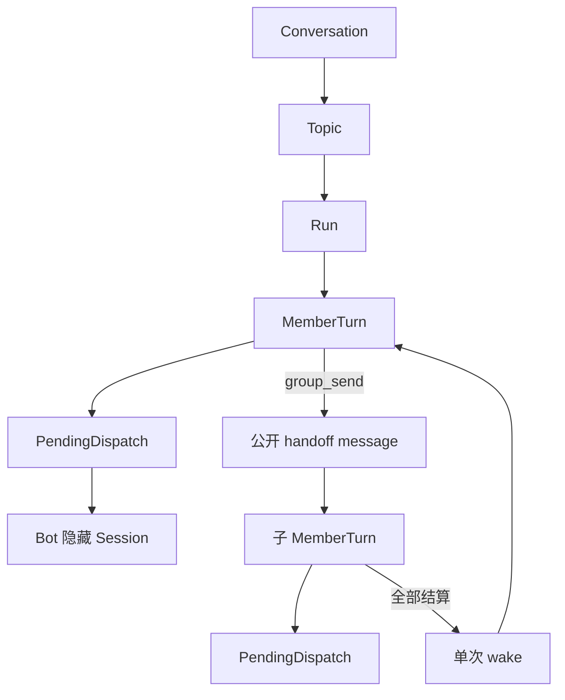
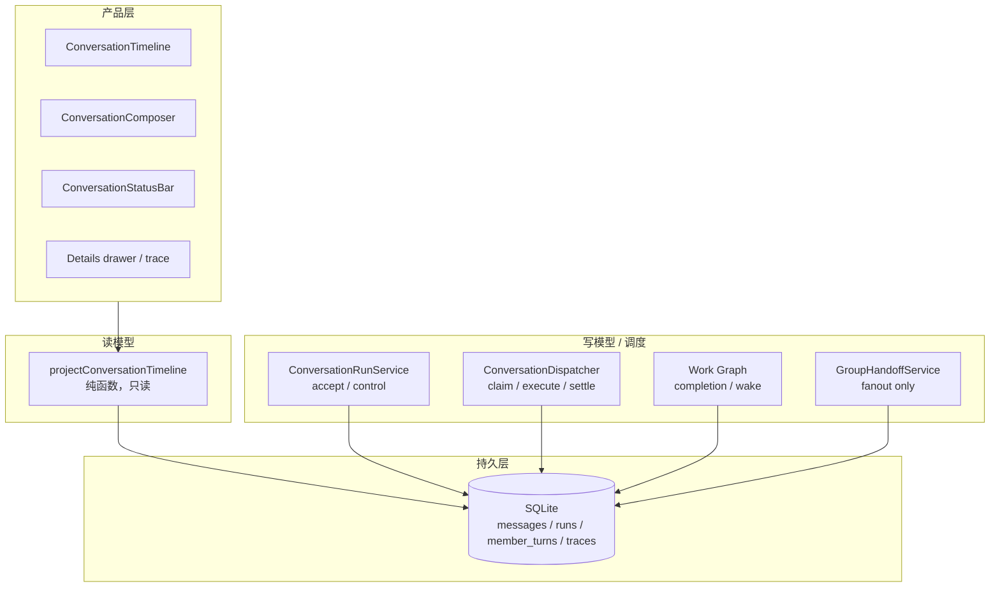
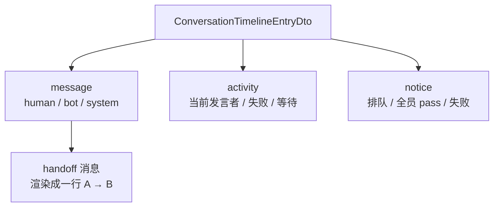

# xacpx Bot 会话与群聊协作：目标架构与技术方案

- 日期：2026-11-06
- 状态：提案；P0 后端圆桌已实现（2026-11-07，#546，main `8d660cf7`）；P1「一条时间线」未实现；trace 抽屉 P1a–P1c 已实现（#544/#545）；P2 公共记忆已实现（#541–#543）。
- 范围：Direct Bot 会话、Group 群聊、Run / MemberTurn 调度、Web 交互
- 目标：一个简约的会话界面，一组可证明的协作语义；Direct 与 Group 不再是两套产品
- 前置阅读：`docs/research/2026-11-06-bot-group-collaboration-benchmark.md`

---

## 0. 决策摘要

1. **保留“一次用户请求 = 一个 Run”**。不新增 Room 表，不新增 Round 表，不新增第二个 scheduler。
2. **给 Run 增加 `shape`**：`single`（Direct）、`fanout`（Lead 派活 / 多成员并行）、`roundtable`（依次讨论）。
3. **圆桌在 accept 时预生成 `rounds × speakers` 个 MemberTurn**。顺序由 `memberIndex` 和 claim 资格共同保证，不靠内存游标，不靠 wake 链。
4. **圆桌禁止 `group_send`**。递归派活只属于 fanout。这条边界让圆桌的完成条件保持为“所有预生成 turn 终态”，不需要重新证明 work graph。
5. **`(pass)` 是圆桌专属的显式弃权**：MemberTurn 仍以 `completed` 结束，但不写公开消息，也不作为完成证据。空文本不是 pass，按失败处理。
6. **Lead 模式与 fanout 原样复用**：`group_send` → 子 MemberTurn → 全部结算后单次 wake，不动现有 work graph。
7. **UI 收成一条时间线、一个输入框、一条状态条、一个详情抽屉**。删除 target 下拉、dispatch 卡片、成员 trace 气泡和双份 transcript。
8. **读模型统一为 `ConversationTimeline`**：消息、成员活动、handoff、轮次状态都由一个纯投影产生；`messages.member_turn_id` 提供精确归属，替代客户端的 `sourceTurn` 猜测。
9. **不借用 DS-Bot 的 15 秒让出和群内插话**。它们需要“一个 Run 被多个用户消息共同推进”，会破坏当前一次请求一个 Run 的审计边界。要借的是它的房间感：一条日志、一个发言位、过程可见。



---

## 1. 目标与非目标

### 1.1 目标

- 用户在 Direct 和 Group 里看到同一种对话：自己的消息、Bot 的消息、正在说话的 Bot、被折叠的协作动作。
- 用户默认只需发消息。需要指定人时用 `@`；需要大家依次发表意见时点“讨论”。不再先选 target 再发。
- Lead 可以像现在一样派活、等待子结果、汇总；这条链路不变。
- 多成员讨论时按顺序发言，后来者能看到前面人的公开消息；无话可说可以弃权。
- 所有顺序、弃权、失败、暂停、取消、重启都能从 SQLite 行重新推导。
- UI 不再自己推断“这条回复属于哪个 turn”“这个卡片代表哪一轮”。

### 1.2 非目标

- 不实现跨用户共享房间。Room 仍是某个用户/频道的 Topic。
- 不实现运行中插话。用户的新消息进入队列，成为下一个 Run；不在当前 Run 内注入。
- 不把 Bot 文本里的 `@` 变成副作用路由。结构化 target 和 `group_send` 仍是唯一派活入口。
- 不实现自动轮询的多人圆桌。`automatic` 仍只属于 fanout 路由，不能和 roundtable 组合。
- 不为 UI 新建事件总线或第二张时间线表。

---

## 2. 现状：内核正确，读模型分裂

### 2.1 写模型已经是一条清楚的链



关键事实：

- `ConversationRun` 持有预算、暂停、取消、generation、profile snapshot；`MemberTurnRecord` 持有 batch、memberIndex、attempt、origin、assignment、失败证据；`pending_dispatches` 持有 lease 和 claim 状态。
- `conversation-work-graph.ts` 从这些行推导 Run 的完成条件，包括“还有活跃 turn”“还在等子 assignment”“欠一次 wake”“wake 未决”。
- `group_send` 的 handoff 消息、子 turn、wake reservation 在同一个事务里落盘；wake 只物化一次。
- `member_turn_traces` 保存过程，支持刷新、重连、重启回放。

### 2.2 六个摩擦

| 摩擦 | 证据 | 后果 |
|---|---|---|
| 两套 transcript | `DirectBotPane.vue` 用 `ConversationMessageList.vue`；`GroupPane.vue` 用 `GroupTranscript.vue` 和 `projectGroupTranscript()` | 同一个 Run 在两个面板上可能有不同的归属、轮次和流式替换时机 |
| 归属靠猜 | `resolveMemberOwner()` 用 `sourceTurn.turnId` 与 `source_turn_id` 匹配，失败后退化成“同一 Bot 唯一候选” | handoff、重试、同 Bot 多轮时可能挂错消息 |
| 轮次靠猜 | `dispatchGroups` 按 `handoff.senderMemberTurnId` 重组；客户端再拼 dispatch 卡片 | 轮次不是 durable 概念，重启后只能重建近似视图 |
| 交互控制太多 | `GroupComposer.vue` 有常驻 target 下拉、成员勾选、everyone、automatic | 用户每次说话先做一次路由配置；界面像控制台 |
| 过程与结果混在一起 | `GroupDispatchRow`、`GroupAgentTurnRow`、`GroupWorkingRow` 同时出现 | 主时间线被卡片和 trace 气泡切碎；看不到“谁在说” |
| 顺序没有一等表达 | 目标只有 members / everyone / automatic；同批 MemberTurn 并行 | 想让大家依次发言，只能靠 prompt 或 UI 假分组 |

这些不是皮肤问题。写模型只有一份，读模型有三份推断，最后一定会在某个重连、取消、重试路径上分叉。

---

## 3. 设计原则与候选选择

### 3.1 采用的原则

- **模型先行**：把“这次协作是什么形状”写进 `Run.shape`，不要把它散在 `routingState`、`dependsOn`、UI 分组里。
- **先减后加**：先删 target 下拉、dispatch 卡片、双 transcript，再加圆桌。
- **边界纪律**：模型输出在 dispatcher 解析；SQLite 只接收显式 `speechOutcome`；UI 只读投影。
- **最小读者负担**：一个人类请求仍是一个 Run；一个新概念（shape）解释三种协作。
- **不造第二事实源**：顺序由 MemberTurn 行和 claim 谓词决定，不新增 Round 表。
- **可证明完成**：圆桌不能递归派活；否则完成条件会变成“模型是否停止递归”。

### 3.2 三个候选

| 候选 | 核心 | 优点 | 致命问题 |
|---|---|---|---|
| A. Run-centric | Run 加 `shape`；圆桌预生成所有 MemberTurn；claim 顺序 | 不新增聚合；复用 work graph；圆桌/pass 可证明 | 需要处理 pass、空文本、失败尾部、target 解析、消息归属 |
| B. Room + Round | 新增 `rounds` / `round_decisions`；`RoundCoordinator` 决定谁发言 | 能表达跨 Run 的 wave；统一 automatic | 两张新表和一个协调器；wave Run 的 request message 身份未定义；`writeRunOutcome` 不是唯一终态写点；还要保留 handoff 选择权，实际仍是两个选择入口 |
| C. Event timeline | 不新增表；把现有行投影为时间线；一条 UI | 读模型统一；归属和分页可测试 | 没有协作语义；不能解决“谁下一位、谁 pass”；只改 UI 不够 |

评审打分（1–5）：

| 维度 | A | B | C |
|---|---:|---:|---:|
| 交互简约 | 5 | 3 | 5 |
| 协作吞吐与控制 | 5 | 3 | 1 |
| 持久化/恢复正确性 | 4 | 3 | 4 |
| 读者负担/迁移成本 | 4 | 2 | 4 |
| 复用现有机制 | 5 | 2 | 4 |
| 可实现性 | 4 | 2 | 3 |
| **合计** | **27** | **15** | **21** |

### 3.3 结论：A 为骨架，C 为读模型，B 只借“Room 是读模型”这一点

- 采用 A 的 Run 扩展、预生成圆桌、claim 顺序、pass。
- 采用 C 的单一时间线、`member_turn_id` 归属、精确分页和不丢证据规则。
- 采用 B 的一句话：Room 就是 Topic 的读模型，不建表；Direct 是单参与者特例。
- 拒绝 B 的 `rounds` 表、`round_decisions` 表、`RoundCoordinator`。理由不是“新东西一定坏”，而是它没有带来本方案需要的协作语义，却引入第二套协调状态和迁移成本。

---

## 4. 目标架构

### 4.1 分层



- **调度所有权**：`ConversationDispatcher` 只 claim；`ConversationRunService` 只做 accept/control 事务；`WorkGraph` 只判定完成；`GroupHandoffService` 只处理 fanout 的公开派活。
- **读模型所有权**：`projectConversationTimeline()` 只读 durable 行，不持 `SqlDriver`，不写库，不决定谁发言。
- **UI 所有权**：只渲染投影和 live 覆盖层，不再计算归属和轮次。

### 4.2 Room / Round 的定义

- **Room = ConversationTopic 的读模型**。字段来自 `ConversationRecord`、`ConversationTopic` 和消息，不落新表。
- **Round = `(runId, roundIndex)` 的投影**，不是 durable 实体。`Run.shape=roundtable` 时，`roundIndex` 存在于 MemberTurn 上；其他 shape 只有一轮。
- **RoundStrip**：只有多发言人时显示一行摘要，不是卡片，不是独立消息。

### 4.3 不变量

1. 一个用户 prompt 只产生一个 Run。
2. 只有 `runs.state`、`member_turns.state`、`pending_dispatches` 能证明执行结果；时间线不能。
3. 圆桌的 MemberTurn 全部在 accept 事务中生成；顺序由持久行决定。
4. 圆桌的 MemberTurn 不能 `group_send`，不能产生子工作项。
5. Pass 不写消息，不算完成证据，但仍是一条终态 MemberTurn。
6. Direct 与 Group 读同一个时间线 DTO、用同一个 composer；差异只在 `RoomView.participants`。
7. Live 文本只是覆盖层，不写模型；持久消息到达后立即消失。

---

## 5. 领域模型与持久化

### 5.1 类型

```ts
// src/conversations/conversation-types.ts
export type ConversationShape = "single" | "fanout" | "roundtable";
export type MemberTurnSpeechOutcome = "message" | "pass";

export interface ConversationRun {
  id: string;
  // ...existing fields...
  shape: ConversationShape;        // 新 Run 必写
  rounds?: number;                 // 仅 roundtable
  leadBotId?: string;              // 仅 roundtable：开场者快照
}

export interface MemberTurnRecord {
  // ...existing fields...
  roundIndex?: number;             // 1-based；仅 roundtable
  speakerIndex?: number;           // 轮内 0-based；仅 roundtable
  speechOutcome?: MemberTurnSpeechOutcome; // terminal 时写
}
```

`MemberTurnOrigin` 增加 `"roundtable"`。`AcceptRequestInput` 增加 `shape`、`rounds`、`leadBotId`；`AcceptMemberInput` 增加 `roundIndex`、`speakerIndex`。`CompleteExecutionInput` 增加 `speechOutcome`。

### 5.2 关键选择：不要复用 `batch` 表示轮次

圆桌的所有 turn 仍放在 **batch 1**，`memberIndex` 按全局发言顺序递增。`roundIndex` 只用于 UI 和 claim 顺序校验。

原因：

- `runs.activeBatch` 目前不是为圆桌推进的；把 `batch=roundIndex` 会让 `aggregateRunAfterMemberTerminal` 只看到当前轮，可能在还有后续轮时提前完成。
- `failedBotIds` / quarantine 的更新条件带 `member.batch === activeBatch`；复用 batch 会让后续轮失败漏记。
- 所有圆桌 turn 同属一个 batch，批次结算天然等到最后一位；完成判定仍走 work graph。

`memberIndex` 是持久的发言顺序；`roundIndex` / `speakerIndex` 是可读的分组。

### 5.3 SQLite

```sql
ALTER TABLE runs ADD COLUMN shape TEXT NOT NULL DEFAULT 'fanout';
ALTER TABLE runs ADD COLUMN rounds INTEGER;
ALTER TABLE runs ADD COLUMN lead_bot_id TEXT;

ALTER TABLE member_turns ADD COLUMN round_index INTEGER;
ALTER TABLE member_turns ADD COLUMN speaker_index INTEGER;
ALTER TABLE member_turns ADD COLUMN speech_outcome TEXT;

ALTER TABLE messages ADD COLUMN member_turn_id TEXT;

CREATE UNIQUE INDEX IF NOT EXISTS idx_member_roundtable_position
  ON member_turns(run_id, round_index, speaker_index)
  WHERE round_index IS NOT NULL AND speaker_index IS NOT NULL;

CREATE INDEX IF NOT EXISTS idx_member_run_order
  ON member_turns(run_id, member_index);

CREATE INDEX IF NOT EXISTS idx_messages_member_turn
  ON messages(member_turn_id);
```

`shape` 默认 `fanout` 只服务于旧行读取；新 accept 必须显式写 `single` / `fanout` / `roundtable`。Direct 的 `acceptDirectPrompt` 必须传 `shape:"single"`，否则新 Direct Run 会读成 fanout。

上限：

- `MAX_ROUNDTABLE_ROUNDS = 3`
- `MAX_ROUNDTABLE_MEMBER_TURNS = 24`
- 圆桌至少 2 位发言人，最多 24 个 turn；`rounds × speakers` 不得超过 24。
- 超过上限 fail closed，不截断。

### 5.4 消息归属

`messages.member_turn_id` 是公开消息与物理执行的精确连接。它必须写在**所有** bot / handoff 消息插入点：

| 插入点 | 归属 |
|---|---|
| `acceptPublicHandoff` 的 handoff 消息 | `handoff.senderMemberTurnId` |
| `completeExecution` 的正常回复 | 当前 `member.id` |
| `persistSealedMemberEvidence` 的密封证据 | 当前 `member.id` |
| `settleCancelBatch` 的结算消息 | 当前 `member.id` |
| `reconcileLateResult` 的迟到结果 | 当前 `member.id` |
| 人类请求消息 | `NULL` |

现有 `promptRequestId` / `sourceTurn.turnId` 的精确 join 保留为旧行回退；新行不再依赖它。回填只在唯一匹配时写：

```sql
UPDATE messages
SET member_turn_id = (
  SELECT mt.id FROM member_turns mt
  WHERE mt.run_id = messages.run_id
    AND mt.source_turn_id = json_extract(messages.source_turn_json, '$.turnId')
)
WHERE member_turn_id IS NULL
  AND json_valid(source_turn_json)
  AND (SELECT COUNT(*) FROM member_turns mt
       WHERE mt.run_id = messages.run_id
         AND mt.source_turn_id = json_extract(messages.source_turn_json, '$.turnId')) = 1;

-- handoff 消息的归属来自 envelope，不靠 sourceTurn
UPDATE messages
SET member_turn_id = json_extract(handoff_json, '$.senderMemberTurnId')
WHERE member_turn_id IS NULL
  AND json_valid(handoff_json)
  AND json_extract(handoff_json, '$.senderMemberTurnId') IS NOT NULL;
```

删除 `ConversationMessage.recipients`。它只有类型声明，没有持久化或读取方。

---

## 6. 调度

### 6.1 Accept

```ts
// 纯规划，不写库
const plan = planRoundtable({
  botIds: target.botIds,       // caller order；UI 把 lead 放第一
  rounds: target.rounds ?? 1,
  leadBotId: group.leadBotId,
});

// 写库
acceptRequest({
  shape: "roundtable",
  rounds: plan.rounds,
  leadBotId: plan.leadBotId,
  primaryMember: plan.turns[0],
  members: plan.turns.slice(1),
  maxMemberTurns: plan.turns.length,
  // ...
});
```

`planRoundtable` 生成 `rounds × speakers` 个 turn，按 round-major 顺序：

```text
r1s0, r1s1, r1s2, r2s0, r2s1, r2s2, ...
memberIndex = 0,1,2,3,4,5
roundIndex = 1,1,1,2,2,2
speakerIndex = 0,1,2,0,1,2
```

`pending_dispatches` 同样预生成。没有内存队列，没有后续 accept。

### 6.2 Claim 顺序

现有 claim 谓词已有 `m.batch, m.member_index` 排序。圆桌多加一条 floor：

```sql
AND m.round_index IS NOT NULL
AND NOT EXISTS (
  SELECT 1 FROM member_turns earlier
  WHERE earlier.run_id = m.run_id
    AND earlier.round_index IS NOT NULL
    AND earlier.member_index < m.member_index
    AND earlier.state IN ('queued', 'dispatched', 'running')
)
```

这条谓词不是“按 batch 等”，而是“前一位没有终态，后一位不能开始”。它保证：

- 同一轮内严格顺序；
- 上一轮最后一位未结束，下一轮第一位不能抢跑；
- 前一位失败/取消/跳过都已终态，后一位可以继续（是否继续由失败策略决定，见 6.5）；
- 重启后只看行，不需要恢复游标。

### 6.3 Pass

圆桌 turn 正常完成后，dispatcher 在写库前判断：

```ts
const speech = parseRoundtableSpeech(result.text);
// { outcome: "message", content } | { outcome: "pass" } | { outcome: "empty" }
```

- 精确 `(pass)`（trim 后，大小写不敏感）→ `speechOutcome:"pass"`。
- 空文本 → **失败**，`failExecution(reason="empty-speech")`。不把模型沉默伪装成主动弃权。
- 其他文本 → `speechOutcome:"message"`，正常插入消息。

`completeExecution` 的 pass 分支：

```ts
if (input.speechOutcome === "pass") {
  if (run.shape !== "roundtable" || member.roundIndex === undefined) {
    throw new ConversationError("invalid_speech_outcome", "pass is roundtable-only");
  }
  // 必须在 cancelled / indeterminate / terminal 围栏之后
  UPDATE member_turns
    SET state = 'completed', speech_outcome = 'pass',
        source_turn_id = ?, finished_at = ?
    WHERE id = ?;
  UPDATE runs SET consumed_member_turns = consumed_member_turns + 1 WHERE id = ?;
  finishDispatchForMemberTurn(member.id, now);
  return aggregateRunAfterMemberTerminal(...); // 不插入 messages
}
```

Pass 不写公开消息，不计入 `sawCompletion`，但保留 trace 和终态行。`GroupHandoffService.readResult` 必须过滤 `speechOutcome === "pass"`，不能把 skip 列成已完成 assignment。

### 6.4 完成

圆桌强制走 work graph，不管 `followupRedispatch` 开关：

```ts
const useGraph = (this.followupRedispatch || run.shape === "roundtable")
  && run.mode === "explicit";
```

`buildWaitingGraph` 只改一处：

```ts
sawCompletion: group.some((turn) =>
  turn.state === "completed" && turn.speechOutcome !== "pass")
```

所有 turn 终态后：

- 至少一位真正发言 → `completed`，reason `members-completed`。
- 全部 pass → `completed`，reason `roundtable-no-speech`；UI 显示“本轮无人补充”。
- 有不可观察失败 → `failed`，失败优先于 cancelled。
- indeterminate → 沿用现有封存路径，优先于一切。

`writeRunOutcome` 在圆桌已无活跃/等待工作、且所有成员 `speechOutcome==="pass"` 时，把 reason 覆盖为 `roundtable-no-speech`；它只改 reason，不改 state，也不写消息。

`batch` 仍是 1，`activeBatch` 不变；`aggregateRunAfterMemberTerminal` 在第一位完成后看到同批还有 queued 成员，保持 running；最后一位完成后 classify；因为 work graph 还会看到后续轮次，不会提前结束。

### 6.5 失败、取消、暂停、重启

| 事件 | 行为 |
|---|---|
| 某位发言失败 | 同一事务内把 `memberIndex` 更大的、尚未开始的 queued/dispatched turn 标为 `cancelled`；Run 最终 `failed` |
| indeterminate | 沿用现有整 Run 封存；不能再 claim 任何后置 turn |
| Stop all | 沿用 `cancelRun`；所有未终态 turn 取消；不产生后续发言 |
| 单成员 Stop | 圆桌不支持 scoped stop，API 返回 `roundtable_scoped_stop_unsupported`；UI 只提供 Stop all |
| 暂停 | 只写 Run 的 pause 字段；已预生成 turn 不动；resume 后 claim floor 继续 |
| 崩溃/重启 | 所有 turn、order、pass 已在 SQLite；lease 恢复后重新 claim；没有内存状态可丢 |
| 预算 | `maxMemberTurns = 总 turn 数`；圆桌本身不会中途耗尽；失败尾部不计 consumed |

### 6.6 Lead 模式 vs 圆桌

| | Lead / fanout | Roundtable |
|---|---|---|
| 入口 | 普通消息；默认发给 lead | 输入框“讨论” |
| 调度 | lead 先答；lead 可以 `group_send` | 所有选中成员按顺序各说一次 |
| 并行 | 同一批成员可并行 | 严格串行 |
| 递归 | 允许，现有 handoff/wake | 禁止 |
| 适合 | 做事、分工、验证 | 评审、方案比较、风险讨论 |
| 结束 | work graph 等所有子任务和 wake | 所有预生成 turn 终态 |
| 上下文 | lead 看到已有公开结果 | 后一位看到前一位的公开消息 |

两种模式共享同一套 Run/MemberTurn 存储，不共享递归语义。用户看到的是一个选择：“让 Lead 主持”或“讨论”。不是两套产品。

---

## 7. 协作协议与上下文

### 7.1 Prompt

在 `src/bots/collaboration-prompt.ts` 增加一个稳定契约：

```ts
export const GROUP_ROUNDTABLE_CONTRACT = [
  "You are speaking once in a sequential Group discussion.",
  "Read the public messages above. Build on earlier speakers; do not repeat them.",
  "Add only new analysis, a concrete decision, or a named risk.",
  "Do not call group_send or group_read_result. Do not assign work.",
  "Reply with exactly one public message.",
  "If you have nothing material to add, reply exactly: (pass)",
].join("\n");
```

Lead fanout 继续使用 `GROUP_COLLABORATION_CONTRACT`，不改它的规则。

### 7.2 `group_send` 的边界

- `SqliteConversationStore.acceptPublicHandoff` 载入 Run 后检查 `run.shape === "roundtable"`，直接抛 `handoff_from_roundtable_refused`。
- `conversation-dispatcher.ts` 在构造圆桌 prompt 时使用 roundtable contract，并优先不暴露 group 工具；服务端拒绝是第二道门。
- `GroupHandoffService.readResult` 过滤 pass，避免把讨论 skip 当成已完成 assignment。
- 这保证圆桌没有子工作项、没有 wake、没有环；完成条件保持简单。

### 7.3 上下文

- 圆桌第 `r` 轮第 `i` 位只看到已经发生的公开消息；未来消息还不存在，天然不会泄漏。
- 在同一位的 turn 开始前，`frozenGroupTranscript` 仍走现有精确消息 id 窗口；不扩大到整个 Topic。
- Pass 没有消息，不进入后续上下文；后续成员只知道“有人跳过”来自 RoundStrip，不来自伪消息。
- 工具调用和过程留在 trace，不进入公开时间线；需要时从详情抽屉查看。

### 7.4 为什么不做运行中插话

DS-Bot 的用户消息会立即进入房间并可能改变当前轮。这要求一个 Run 能被多个用户消息推进，且这些消息要参与已有 turn 的上下文和授权。xacpx 当前一个 Run 绑定一个 `requestMessageId`，`requestSnapshotMatches` 也依赖这个绑定。把插话塞进来会重写授权、预算、恢复和审计。本方案明确：

- 用户新消息在 Topic 中排队，成为下一个 Run；
- UI 在用户消息下显示“排队”；
- 状态条显示当前 Run；
- 这是产品取舍，不是能力缺失。

### 7.5 借什么，不借什么

| 机制 | 来源 | 采用 |
|---|---|---|
| 一条房间日志、作者身份、连续消息 | DS-Bot / Grok | 是；`ConversationTimeline` |
| 普通消息交给 Lead，`@` 指定成员 | DS-Bot / xacpx | 是；默认 lead，@ 产生 structured target |
| 有序全员发言 | DS-Bot / Grok | 是；roundtable + claim floor |
| 无话可说跳过 | Grok | 是；`(pass)`，不写消息 |
| 过程可见、流式预览 | DS-Bot / Grok | 是；live 覆盖层，trace 保留证据 |
| 派活树、结果回收、单次 wake | xacpx | 是；fanout 原样保留 |
| Stop all、失败原因、审批 | DS-Bot / xacpx | 是；状态条 + 详情抽屉 |
| 15 秒让出、运行中插话 | DS-Bot | 否；破坏一请求一 Run 的审计边界 |
| 隐藏轮转、无 durable 任务图 | Grok | 否；顺序必须能从 SQLite 重建 |
| 共用成员私聊 Session | DS-Bot / Grok | 否；保留 Group×Topic×Bot 隔离 |


---

## 8. 交互架构

### 8.1 一条时间线



- 人类消息：右侧气泡。
- Bot 消息：左侧头像 + 名字 + 流式文本；完成后是普通气泡。
- Handoff：不单独成卡，收在发送者消息下面，一行“A → B · 任务摘要”；点开抽屉看原文。
- 当前发言者：如果还没有最终消息，显示一个 live 气泡；文本来自 trace 流，不写库。
- 失败/排队/全员 pass：一行轻量 notice；失败带原因，不藏在卡片里。
- Trace、预算、路由原因：右侧/底部详情抽屉；主时间线不出现。

### 8.2 RoundStrip

只有多发言人 Run 才显示：

```text
第 1 轮 · 2/4 已发言 · 1 跳过 · Bob 正在说        [Stop]
```

不是一张卡，不占多行；移动端同一行，必要时换行。Direct 和单成员 fanout 不显示。

### 8.3 Composer

```text
┌──────────────────────────────────────────────┐
│ @  讨论   Message Ada…                    ↑  │
└──────────────────────────────────────────────┘
```

- Direct：固定唯一 Bot，不显示 target。
- Group 默认：无 target，服务端解析为 lead；占位符写“Message Lead”。
- `@`：复用现有 mention 菜单；选中成员后发送 `members` target，并行。
- `@everyone`：保留并行 everyone；不悄悄改成圆桌。
- “讨论”：发送 `roundtable` target；有 `@` 选择时用选中成员，否则用所有启用成员。v1 固定 1 轮；`rounds` 字段留给 API/后续设置。
- 移除：常驻 target 下拉、成员勾选、每次发送的 automatic 开关。automatic 变成 Group 设置，不是每条消息的模式。
- 发送中再发：durable accept 排队；消息下方显示“排队”。不新造状态。

### 8.4 详情与 trace

- 点击 Bot 消息的 meta、头像或状态条 → 打开同一个详情抽屉。
- 抽屉包含：这次 Run 的成员、状态、失败原因、trace、审批、预算。
- 删除主时间线上的 per-member trace 气泡和 dispatch 卡。
- trace 抽屉执行中固定一条 **Live Stack**（最近 2–3 条，最新在上），下方保留时间顺序的全量过程；取消“超过 N 步自动折叠”，展开状态由抽屉层持有。详见 `docs/design/2026-11-06-trace-drawer-live-feed.md`。
- 群聊只公开发言：最终回复、可选 `group_say`、`group_send` handoff；trace text 不再自动进群。最终回复由 runtime 兜底发布。公共记忆按 Bot 投影群公开消息到 Direct prompt，默认单向群→私聊。详见 `docs/design/2026-11-06-public-memory-projection.md`。
- Stop all 在状态条；fanout 的单成员 Stop 在抽屉；圆桌不提供单成员 Stop。

### 8.5 线框

```text
┌──────────────────────────────────────────────┐
│ 产品组   Lead: Ada   Topic: 登录重构      ⋯  │
├──────────────────────────────────────────────┤
│ 你  09:41                                    │
│ 登录重构先看并发和回滚，大家给意见。          │
│                                              │
│ Ada  Lead                                    │
│ 先拆两条：会话锁和 token 回滚。              │
│ ┌ Ada → Bob · 检查会话锁 ──────────────┐     │
│                                              │
│ Bob  Reviewer · 正在说                       │
│ 这里有一个 TOCTOU……                          │
│                                              │
│ Cara  Tester · 旁听                          │
├──────────────────────────────────────────────┤
│ ● Bob 正在说 · 1/3 已发言 · 1 跳过   [Stop]  │
│ @  讨论   Message Ada…                  ↑    │
└──────────────────────────────────────────────┘
```

---

## 9. 读模型

### 9.1 投影规则

`src/conversations/conversation-timeline.ts` 是纯函数，输入是已经加载的行，不持 SQL：

```ts
projectConversationTimeline({
  messages,          // 当前页，按 seq
  runs,              // 页内消息涉及的 Run + 非终态 Run
  memberTurns,       // 页内 Run 的成员
  liveTurnsByMember, // 客户端覆盖层；服务端投影可选忽略
})
```

规则：

1. 每条消息按 `messages.seq` 出现一次；Bot 消息通过 `member_turn_id` 精确归属。
2. Handoff 消息是普通 message，UI 按 `handoff` 渲染成一行；不另造条目。
3. 没有公开消息的 MemberTurn 才生成 `activity`：当前 `running/dispatched`、失败、取消、等待。
4. 未来 queued 的圆桌 turn 不逐条渲染；它们只进入 RoundStrip 的计数。
5. `notice` 用于排队、全员 pass、Run 失败；由 Run/成员状态合成，不写消息。
6. 非终态 Run 即使其请求消息不在当前页，也随页返回；漏掉正在执行的行比多返回更危险。
7. `anchorSeq`：消息用自身 `seq`；activity 用触发消息的最大 seq，缺失时回落到请求消息 seq。
8. 归属不确定时输出 `ownership:"unresolved"` 并保留该行，不丢弃。

### 9.2 DTO

```ts
export type ConversationTimelineEntryDto =
  | {
      kind: "message";
      key: string;
      anchorSeq: number;
      message: ConversationMessageDto;
      memberTurnId?: string;
      runId?: string;
      ownership?: "exact" | "inferred" | "unresolved";
    }
  | {
      kind: "activity";
      key: string;
      anchorSeq: number;
      runId: string;
      memberTurn: MemberTurnSummaryDto;
      live?: boolean;
    }
  | {
      kind: "notice";
      key: string;
      anchorSeq: number;
      tone: "queued" | "empty" | "failed";
      runId?: string;
      text: string;
    };

export interface ConversationRoundSummaryDto {
  runId: string;
  roundIndex: number;
  rounds: number;
  speakerCount: number;
  spoken: number;
  passed: number;
  activeMemberTurnId?: string;
  state: "queued" | "running" | "completed" | "failed" | "cancelled";
}

export interface ConversationTimelineDto {
  conversationId: string;
  topicId: string;
  entries: ConversationTimelineEntryDto[];
  activeRound?: ConversationRoundSummaryDto;
  oldestSeq?: number;
  newestSeq?: number;
  hasMoreBefore: boolean;
  hasMoreAfter: boolean;
}
```

### 9.3 分页与性能

- 新增 `MSG.conversationTimeline = "control.conversation.timeline"`。
- 游标与 `listHistory` 相同：`beforeSeq` / `afterSeq` / `limit`。
- 一次查询消息页、一次批量查 Runs、一次批量查 MemberTurns；不能对每个 Run 调 `listMemberTurns` 形成 N+1。
- 索引：`messages(topic_id, seq)`、`runs(topic_id, state)`、`member_turns(run_id, member_index)`、`messages(member_turn_id)`。
- 非终态 Run 始终随页返回；分页只影响历史消息。
- 滚动沿用现有 `content-visibility`、`TranscriptJumpLatest`、prepend 锚点法；不引入虚拟滚动库。
- 客户端 live 覆盖层按 `memberTurnId` 合并；持久消息到达即删除 live，不重复。

### 9.4 归属回退

新行用 `member_turn_id`。旧行：

1. `sourceTurn.turnId` 与 `member_turns.source_turn_id` 唯一匹配 → `exact`；
2. handoff envelope 的 `senderMemberTurnId` → `exact`；
3. 同一 Run、同一 Bot 的唯一候选 → `inferred`；
4. 多个候选或缺失 → `unresolved`，照常显示并可在详情中看到原因。

---

## 10. 协议与 API

### 10.1 Target

```ts
export type ConversationTargetDto =
  | { botId: string }
  | { mode: "members"; botIds: string[] }
  | { mode: "everyone" }
  | { mode: "automatic" }
  | { mode: "roundtable"; botIds: string[]; rounds?: number };
```

校验：

- `roundtable` 仅 Group；`botIds` 非空、唯一、全是当前 enabled 成员。
- `rounds` 必须是 1–3 的整数；缺省 1。
- `botIds.length * rounds <= 24`。
- `roundtable` 与 `automatic` 互斥；不能组合。
- `parseGroupTarget` 的 mixed-shape 检查必须放行 `mode:"roundtable" + botIds`；现有逻辑会把它当非法混合拒绝，这是实现时最容易漏的一处。

### 10.2 Run / MemberTurn DTO

```ts
export interface ConversationRunDto {
  // ...
  shape?: "single" | "fanout" | "roundtable";
  rounds?: number;
  leadBotId?: string;
}

export interface ConversationMessageDto {
  // ...existing fields...
  /** Durable physical execution that produced this message. Null on human
   *  requests and legacy rows that failed backfill. */
  memberTurnId?: string;
}

export interface MemberTurnSummaryDto {
  // ...
  roundIndex?: number;
  speakerIndex?: number;
  speechOutcome?: "message" | "pass";
}
```

旧客户端忽略新字段；新客户端在 capability 缺失时隐藏“讨论”。

### 10.3 Capability

```ts
// packages/relay-protocol/src/messages.ts
roundtableV1: "conversations.roundtable.v1",
conversationTimelineV1: "conversations.timeline.v1",
```

- `roundtableV1` 控制“讨论”入口。
- `conversationTimelineV1` 控制新时间线端点；旧 daemon 回退旧组件，迁移期结束后删除回退。

---

## 11. 迁移计划

### P0：后端协作语义（可独立上线，旧 UI 行为不变）

> 实施状态（2026-11-07）：本节 P0 已由 #546 落地，merge `8d660cf7`；含类型/列/迁移、planner/parser、target/capability、预生成 accept、claim floor、pass/空文本、全 pass reason、失败尾部、scoped stop/handoff 拒绝、旧客户端 history 兼容。P1 尚未开始。

1. `conversation-types.ts`：`ConversationShape`、`rounds`、`leadBotId`、`roundIndex`、`speakerIndex`、`speechOutcome`、`origin:"roundtable"`。
2. `conversation-roundtable.ts`：纯 `planRoundtable()`、`parseRoundtableSpeech()`、上限常量。
3. `sqlite-conversation-store.ts`：
   - `ensureRoundtableColumns()`；
   - `insertAccepted` 接受 shape/rounds/lead、预生成 members、允许多轮同 Bot；
   - `claimEligibility` 加 floor；
   - `completeExecution` pass 分支；
   - `aggregateRunAfterMemberTerminal` 圆桌强制走 work graph、失败尾部取消；
   - `buildWaitingGraph` / `decideRunCompletion` 的 pass 语义。
4. `conversation-run-service.ts`：
   - `parseGroupTarget` 放行 roundtable；
   - `acceptGroupPrompt` 走预生成；
   - `acceptDirectPrompt` 显式 `shape:"single"`；
   - 校验上限、lead、rounds。
5. `conversation-dispatcher.ts`：圆桌 prompt 切换、pass 解析、空文本失败。
6. `group-handoff.ts`：拒绝圆桌 handoff；`readResult` 过滤 pass。
7. 协议：target/DTO/validator/limits。
8. 测试：accept、claim 顺序、pass、全 pass、失败尾部、暂停/取消/重启、旧 Run 兼容。

P0 结束时，旧 UI 仍能工作；API 可以创建圆桌，只是没有入口。

### P1：一条时间线与一个 composer

> 实施状态（2026-11-07）：未开始。trace 抽屉子项已由 #544/#545 完成，但不含 `ConversationTimeline` 迁移、`member_turn_id` 或 composer/status bar 收口。

1. `messages.member_turn_id` 列、索引、所有插入点、回填。
2. `conversation-timeline.ts` 纯投影 + `conversation.timeline` RPC + capability。
3. `ConversationTimeline.vue`、`TimelineRow.vue`、`ConversationStatusBar.vue`。
4. `ConversationComposer.vue` 收口：Direct/Group 共用布局、mention、发送状态；Group 删除 target 下拉、automatic 开关；加“讨论”chip。
5. `DirectBotPane.vue` / `GroupPane.vue` 传 `RoomView`，不再各自投影。
6. 删除 `GroupTranscript.vue`、`ConversationMessageList.vue`、`GroupDispatchRow.vue`、`GroupAgentTurnRow.vue`、`GroupWorkingRow.vue`、`group-run-presentation.ts` 的投影部分、`group-live-stream.ts` 的双流归并。
7. 详情抽屉合并 `GroupRunDetailContent.vue` / trace 入口。
   - trace 抽屉按 `2026-11-06-trace-drawer-live-feed.md` 实现：无自动折叠、固定 Live Stack、跟随可暂停、视窗外 `content-visibility`。
8. 测试：同组件渲染 Direct/Group、分页、live 覆盖、handoff 行、移动端、旧 daemon 回退。

### P2：可选增强

- 圆桌轮数设置（1–3），只在 Group 设置里。
- 圆桌工具面收敛：不暴露 `group_send` / `group_read_result`，减少一次无效调用。
- 服务端时间线供 Discord / Feishu / Yuanbao 适配器复用；Web 不再有第二套投影。
- 自动路由作为 Group 设置；不再出现在 composer。
- 公共记忆投影：`bot_public_memory` 引用表、群公开消息写入、Direct prompt 的 `Shared group context`；默认单向群→私聊，不合并 Session。详见 `docs/design/2026-11-06-public-memory-projection.md`。

### 回滚

- 关闭 `roundtableV1`：隐藏“讨论”，旧 target 不变。
- 关闭 `conversationTimelineV1`：回退旧组件；DB 只多列，不丢数据。
- 新列全部可空或有默认值；旧代码忽略即可。

---

## 12. 测试与验收

### 12.1 后端

- `roundtable-accept.test.ts`：一个 prompt 一个 Run；`rounds × speakers` 行；`memberIndex` 连续；`roundIndex/speakerIndex` 正确；`maxMemberTurns` 等于总行数；同 Bot 可跨轮、不可同轮重复。
- `roundtable-order.test.ts`：claim 严格按 `memberIndex`；前一位 running/queued 时后一位不可 claim；pass 后下一位可 claim；失败后尾部取消；重启后顺序不变。
- `roundtable-pass.test.ts`：`(pass)` 不插消息、不计 `sawCompletion`；全 pass → completed + `roundtable-no-speech`；空文本失败；pass 不出现在 `group_read_result`。
- `roundtable-completion.test.ts`：多轮不会在第一批结束；失败优先于 cancelled；indeterminate 封存；暂停/恢复；Stop all。
- `conversation-timeline.test.ts`：每条消息恰好出现一次；handoff 归属；activity 只给当前发言人；非终态 Run 恒在页内；`unresolved` 不丢行；分页稳定；两次调用字节级一致。
- `sqlite-conversation-timeline.test.ts`：真实 SQLite；`member_turn_id` 所有插入点；回填唯一匹配；批量查询无 N+1。
- 协议：target roundtable 校验、rounds 上限、mixed-shape 拒绝、旧 DTO 兼容。

### 12.2 前端

- `conversation-timeline.test.ts`：Direct 与 Group 渲染同一组件；live 气泡在持久消息到达后消失且不重复；handoff 一行；RoundStrip 计数；移动端 sheet。
- `conversation-composer.test.ts`：默认 lead；`@` 选成员；`@everyone` 并行；“讨论”发送 roundtable；发送中排队；双发防护；草稿保留。
- 旧组件删除后，现有 group/direct 组件测试迁移到新组件，不保留重复断言。
- 浏览器实测：桌面与移动布局、发送、讨论、pass、Stop、刷新、滚动、详情抽屉；控制台无错误。

### 12.3 验收

- 一条普通群消息默认由 lead 回答；lead 可以派活，子结果回来后只唤醒一次。
- 点“讨论”后，选中的 Bot 按顺序各说一次；后一位能看到前一位的公开消息；无话可说显示为跳过，不产生空消息。
- 所有发言都是同一时间线上的普通气泡；没有 dispatch 卡片和 per-member trace 气泡。
- Stop all 后不再产生新发言；刷新后状态一致。
- Direct 和 Group 的输入框、消息样式、流式行为一致。
- 旧 daemon 下入口隐藏，旧行为不变。

---

## 13. 风险与开放问题

| 风险 | 影响 | 处理 |
|---|---|---|
| 圆桌预生成占用 24 turn 预算 | 大会话可能拒绝 | accept 时 fail closed，提示成员/轮数超限；不截断 |
| `(pass)` 被模型写成别的形式 | 该发言变成普通消息 | prompt 固定 sentinel；测试覆盖；不解析模糊文本 |
| 空文本失败让讨论中断 | 一次模型空回复导致 Run failed | 明确失败并在 UI 显示；可重试；不静默伪装 |
| 圆桌禁 `group_send` 限制表达 | 讨论中不能直接派活 | 产品上分为“讨论”和“Lead 主持”；用户可再用 lead 发任务 |
| 预生成 turn 的 UI 显示过多 | 21 个 queued 行 | 只渲染当前/失败成员，其余进 RoundStrip |
| 新时间线端点增加延迟 | 首屏变慢 | 分页 + 批量查询 + 非终态随页；capability 灰度 |
| 旧行归属回填不完整 | 历史消息显示 `inferred` | 保留回退并显示 `unresolved`，不丢行 |
| Lead fanout 仍可能慢 | 长任务阻塞讨论 | 不改变现有执行；本轮不引入 15 秒让出 |
| 运行中插话缺失 | 群聊感不如 DS-Bot | 明确排队；插话需要独立设计，不在本轮偷塞 |

开放问题：

1. 圆桌默认是否包含 lead？本方案要求 UI 把 lead 放第一；API 不强制。若产品希望“Lead 主持讨论”，应在 Group 设置里固定。
2. 圆桌是否允许写文件？本方案允许现有工具和 writer slot，只禁止 `group_send`；若定位为纯评审，可加只读策略，但那是另一个安全边界。
3. 时间线端点是否值得为 Web 单独做？本方案选择做，因为 Direct/Group/频道最终都需要同一归属和顺序；若实现成本超预算，可先共享纯投影，端点延后，但不能保留两套语义。
4. 自动路由是否最终迁到 Group 设置？本方案只建议，不在 P0/P1 删除现有 `routingState`。

---

## 附录：候选评审记录

- **A（Run-centric）**：选为骨架。保留一个 prompt 一个 Run；预生成圆桌；claim floor；pass；不改 handoff/wake。
- **C（Event timeline）**： graft 读模型：`member_turn_id`、单一投影、精确分页、`unresolved` 不丢证据、非终态随页。拒绝“只改 UI”作为完整方案。
- **B（Room + Round）**：只 graft “Room 是 Topic 读模型、Direct 是单参与者”。拒绝 `rounds` / `round_decisions` / `RoundCoordinator`；原因是第二套协调状态、wave Run 身份未定义、终态写点覆盖不全，而本方案不需要跨 Run 的 wave 来表达圆桌。
- **DS-Bot**：借房间日志、lead、顺序发言、过程可见、Stop all；不借 15 秒让出、群内插话、群 Session 复用。
- **Grok**：借 `(pass)`、顺序轮、流式预览、作者身份；不借隐藏轮转、无 durable 任务图、失败即 pass。

最终一句话：**把“群聊”做成 Run 的一种形状，把“界面”做成一条时间线；调度仍只有一套，证据仍只有一份。**
