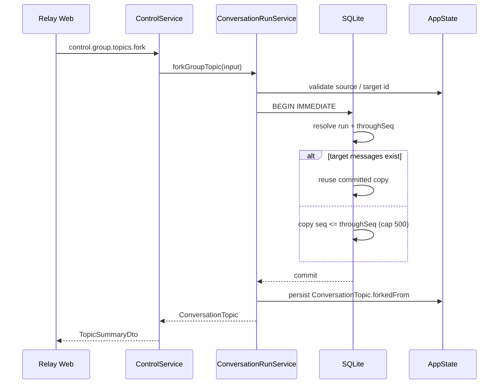

# Conversation Topic Fork（会话分叉）技术方案
- 状态：Accepted；已实现（#571 `83526ba5`；e2e 覆盖、孤儿重试与重放计数一致性补于 #572）
- 日期：2026-11-10
- 范围：xacpx Group Topic 的应用层 fork；Direct / 普通 Session / 原生 Agent Session fork 不在本期
- 参考：t3code 的 `thread.fork`（应用层引用式 fork + provider native fork 两级模型）

## 0. 结论

xacpx 可以借鉴 t3code 的**两级 fork**思路，但当前不能照搬它的原生 session fork：

- t3code 的 app thread fork 只写两条记录（target thread + pending context transfer），不复制消息/运行；时间线读取时把源 thread 的旧 rows 作为 inherited 前缀并进来。第一条消息到达时再决定 `native_fork` 还是 `portable_context`。
- xacpx 锁定的 `acpx/runtime` 0.19.5（以及本地 0.22.0 源码）都没有暴露 `session/fork`；ACP SDK 虽然已有 `unstable_forkSession`，但不是 xacpx 的现有边界。因此 xacpx 第一期做**应用层 fork**，不做原生 fork。
- xacpx 的 Topic 是硬删除（`deleteTopicRows` 会删消息、Run、MemberTurn）；Topic 消息读取（timeline/history/prompt/router）都按单一 `(conversationId, topicId)` 过滤（`bot_public_memory` 是独立的跨 Topic 投影）。直接采用 t3code 的“读时引用”会把 fork 的生命周期绑到源 Topic 上，并扩散到 timeline/history/prompt/router 四条读取路径。
- 本期选择**消息快照复制**：fork 时把源 Topic 在边界内的公开消息复制到新 Topic，重编 `seq`，清除 Run/MemberTurn 归属；新 Topic 从此完全独立。源 Topic 的 clear/delete 不再影响 fork。

一句话：**借 t3code 的“fork 是独立会话 + 旧历史作为上下文 + 原生能力可降级”语义，不借它的跨 thread 读时引用实现。**

## 1. 目标与非目标

### 1.1 目标

- 用户可以从一个 Group Topic 的某个已结算 Run 分叉出一个新 Topic。
- 新 Topic：
  - 拥有源 Topic 截至该 Run 的公开消息快照；
  - 使用自己的成员 session（空的原生上下文）；
  - 第一条新消息的 prompt 能看到快照历史，模型可以延续讨论；
  - 与源 Topic 完全独立，之后的发言互不影响。
- 源 Topic 可以继续使用、归档、清空或删除，不影响 fork。
- 支持 fork-of-fork。
- 旧 core / 旧 relay-web 不感知该能力时保持现状；新能力通过 capability 设门。

### 1.2 非目标（本期明确不做）

- 原生 Agent session fork（Claude `forkSession`、Codex `thread/fork`、ACP `session/fork`）。
- Direct 会话、普通 `/session`、Bot 私聊的分叉。
- 合并回源 Topic（merge back）。
- 复制 Run、MemberTurn、dispatch、trace、审批、worktree、工具状态或原生上下文。
- 创建新的 git branch/worktree 或独立工作区；fork 仍是会话分支，不是代码分支。
- 在 turn 执行中分叉（只允许已结算 Run 作为边界）。
- 复制 `bot_public_memory` 投影。

## 2. 参考实现：t3code 的两级 fork

t3code 的关键设计（只列与本期相关的部分）：

| 层 | 行为 |
|---|---|
| 命令 | `thread.fork{sourceThreadId,targetThreadId,sourcePoint}`；`sourcePoint = latest_stable | {run} | {checkpoint}` |
| 持久化 | 只写 target thread + `context_transfer(type:"fork", status:"pending")`；不复制 messages/runs/turns |
| 时间线 | 读取时并入源 thread `≤ fork run ordinal` 的 turn items，再插一条 synthetic fork marker；源 thread 后续内容不可见 |
| 上下文 | 第一条新消息时才解析：能原生 fork 就 `session.forkThread`，否则生成 `full_thread_summary` portable handoff |
| 约束 | 源 run 必须“可 fork”（v2：`completed/waiting/failed/interrupted/cancelled`；in-progress / rolled-back 拒绝）；源忙/跨 provider/无强 native ref → 强制 portable；`targetThreadId` 由调用方提供，命令幂等 |
| 边界 | app thread 的 `forkedFrom{run}` 负责展示；provider thread 的 `forkedFrom{providerThread}` 负责原生续接，二者不混用 |

xacpx 采用其**语义**（独立会话、旧历史进入上下文、能力不足时降级），但落地为快照复制。注意：xacpx 本期只接受**终态** Run（`completed/failed/cancelled/indeterminate`），比 t3code 的 `waiting/interrupted` 更窄，因为 xacpx 的 checkpoint/rollback 语义不同。

## 3. 为什么 xacpx 不采用读时引用

| 约束 | 影响 |
|---|---|
| Topic 硬删除 | `deleteTopicRows`/`deleteTopicHistory` 会删除 `messages/runs/member_turns`。引用式 fork 会因源删除而丢历史，必须额外做删除保护或删除前物化 |
| 单一 Topic 读模型 | `listTimeline`、`listHistory`、`frozenGroupTranscript`、`ConversationRouterEngine.buildRoutingInput` 都只读一个 `topicId`；引用式需要四条读取路径都支持跨 Topic 合并 |
| `seq` 分页 | 每个 Topic 的 `topic_seq` 独立；引用式需要初始化新 Topic 的 `seq` 起点并保证与源边界不冲突，分页要跨两段 |
| 稳定性 | 快照复制后，所有既有读取路径无需改动；fork 的生命周期与源解耦 |

代价是消息内容重复存储。通过 500 条上限和“只复制公开消息”控制成本。

## 4. 术语与用户语义

- **源 Topic**：被分叉的 Group Topic。
- **fork Topic**：新建的 Topic。
- **fork 点**：一个已结算的 `ConversationRun`，或 `latest_stable`。
- **快照边界**：`throughSeq`，源 Topic 在该 Run 结束时最后一条消息的 `seq`。
- fork 之后，源 Topic 的新消息不会进入 fork；fork 的新消息也不会进入源。
- fork 不是分支合并：两边独立演进，没有自动 merge。

## 5. 数据模型

### 5.1 `ConversationTopic`（AppState）

```ts
export interface ConversationTopicFork {
  /** 客户端提供，用于幂等重放。 */
  requestId: string;
  sourceConversationId: string;
  sourceTopicId: string;
  /** 创建时的源标题快照；源 Topic 删除后 banner 仍可读。 */
  sourceTitle: string;
  /** 解析后的源 Run；仅当源 Topic 没有任何 Run、走“纯快照 latest”时缺省。 */
  sourceRunId?: string;
  /** 源 Topic 的快照边界，含该 seq。 */
  throughSeq: number;
  /** fork 链的根 Topic；源不是 fork 时等于 sourceTopicId。 */
  rootTopicId: string;
  copiedMessages: number;
  /** 因 500 条上限被丢弃的旧消息数。 */
  omittedMessages: number;
  createdAt: string;
}

export interface ConversationTopic {
  // ...现有字段
  /** 仅 Group Topic 的 fork 记录；普通 Topic 不写。 */
  forkedFrom?: ConversationTopicFork;
}
```

写入方式：`ConversationTopic` 保存在 AppState `state.json`；新增字段是向后兼容的可选字段。

`isConversationTopic`（`src/state/state-store.ts`）需要增加校验：

- `forkedFrom` 必须是对象；
- `requestId/sourceConversationId/sourceTopicId/sourceTitle/rootTopicId/createdAt` 为非空字符串；
- `sourceRunId` 若存在必须为非空字符串；
- `throughSeq/copiedMessages/omittedMessages` 为非负整数；
- 不合法时整条 Topic 按现有策略丢弃（`dropped` 记录），而不是让 daemon 启动失败。

### 5.2 `TopicSummaryDto`

```ts
export interface TopicSummaryDto {
  // ...现有字段
  forkedFrom?: ConversationTopicFork;
}
```

`toTopicSummary` 直接透传 `topic.forkedFrom`。旧客户端会忽略未知字段。

`src/control/conversation-control-dtos.ts` 与 `packages/relay-protocol/src/dtos.ts` 各自声明同名 DTO（协议包不依赖 xacpx）；两处都必须带上可选字段，漏一处会静默丢字段。`ThreadForkSourcePointDto` 只在协议包声明，core 直接复用。

### 5.3 `messages` 新列

新增可空列：

```sql
ALTER TABLE messages ADD COLUMN forked_from_message_id TEXT;
CREATE UNIQUE INDEX IF NOT EXISTS idx_messages_fork_source
  ON messages (topic_id, forked_from_message_id)
  WHERE forked_from_message_id IS NOT NULL;
```

- `forked_from_message_id` 指向**直接源消息** id（fork-of-fork 指向上一跳的 row）。
- 用途：
  1. 幂等：同一目标 Topic 重放复制时不会插入第二遍；
  2. 前端可标记“继承消息”；
  3. 排查来源。
- 迁移沿用现有 `ensure("messages", ...)`/`PRAGMA table_info` 模式（`sqlite-conversation-store.ts` 的 schema 迁移段）。
- `ConversationMessage` 增加可选 `forkedFromMessageId?: string`，`mapMessage` 透传；`ConversationMessageDto` 同步。

### 5.4 不新增的表

- 不新建 `topic_forks` 表：fork 元数据在 AppState，消息复制在 SQLite。
- 不复制 `topic_seq`：新 Topic 的消息从 `seq = 1` 开始，由现有 `allocateSeq` 分配。

## 6. 创建流程



### 6.1 请求

Control RPC：

```text
control.group.topics.fork
```

Payload：

```ts
{
  conversationId: string;
  sourceTopicId: string;
  targetTopicId: string;          // 客户端生成，重试必须复用
  requestId: string;              // 幂等键
  sourcePoint?:
    | { type: "latest_stable" }
    | { type: "run"; runId: string };
  title?: string;                 // 缺省 "<source title> fork"
}
```

规则：

- `sourcePoint` 缺省为 `latest_stable`。
- `targetTopicId` 必须是普通 Topic id（`topic_` 前缀且不是保留的 `topic_peer_`）；已存在时：
  - 若同一 `requestId` 且是 fork → 返回已有 Topic（幂等）；
  - 否则 `topic_exists`。
- `conversationId` 必须是 Group；`sourceTopicId` 必须属于该 Group。
- 源 Topic 状态必须是 `active` 或 `archived`；`deleting`、不存在或带 `peerScope` 时拒绝。
- 不允许把 `targetTopicId` 指向源 Topic 自己。

### 6.2 解析 fork 点

`latest_stable`：

1. 取源 Topic 中最后接受（按 `runs.created_at ASC, runs.rowid ASC`，与 `listRuns` 一致）的终端 Run
   （`completed | failed | cancelled | indeterminate`）；
2. 若没有终端 Run：
   - 仅当源 Topic 本身是 fork（`forkedFrom` 存在）、没有非终态 Run 且已有消息时，
     允许“纯快照 latest”：边界取当前最大 `seq`；
   - 若 Topic 为空 → `topic_fork_empty`；
   - 其他情况（存在非终态 Run，或普通 Topic 无 Run）→ `topic_fork_source_unsettled`。

显式 `{type:"run",runId}`：

- Run 必须属于源 Topic，且状态终态；否则 `topic_fork_source_unsettled`。
- `latest_stable` 只认终端 Run：若之后还有 `queued/running/waiting-human/paused` 的 Run，它们整体被排除在快照外；UI 在确认框中展示实际选中的 Run。

`throughSeq` 计算（在复制事务内）：

```text
requestSeq = messages[run.requestMessageId].seq
runMaxSeq  = MAX(messages.seq WHERE run_id = run.id)
throughSeq = max(requestSeq, runMaxSeq)
```

复制谓词（总量与最近 500 条窗口使用同一谓词）：

```sql
seq <= throughSeq
AND (run_id IS NULL OR run_id IN (
  SELECT id FROM runs
  WHERE conversation_id = ? AND topic_id = ?
    AND rowid <= (SELECT rowid FROM runs WHERE id = ?)
))
```

边界 Run 之后才接受的排队 Run，即使其请求 `seq` 低于边界 Run 的回复，也不会被复制；纯快照边界（无 Run）只按 `seq <= max(seq)`。`omittedMessages` 等于谓词过滤后的总数减去实际复制数，绝不是原始 seq 总数。

### 6.3 复制事务

复制在**单个 SQLite 事务**内完成，顺序如下：

1. 重新读取源 Topic 的 Run 和 request 消息，确认仍在同一会话/主题且状态终态；
2. 计算 `throughSeq`；
3. 读取 `seq <= throughSeq` 的消息，按 `seq ASC`；
4. 若超过 `MAX_FORK_MESSAGES = 500`，只取**最后 500 条**，记录 `omittedMessages`；
5. 为每条消息分配新 `seq`（从 1 开始，`allocateSeq`），插入目标 Topic；
6. 记录 `copiedMessages/omittedMessages` 到返回值；
7. 提交。

幂等：

- 事务开始时按 `forked_from_message_id IS NOT NULL` 统计目标已提交的复制行：
  - 已提交：仅当 AppState 已有该目标 Topic（即重放）时复用这些行，并用同一谓词重算 `omittedMessages = max(0, 过滤总数 - 已提交数)`，不重复插入；没有 Topic 记录的复制行不进入复制事务（见 §6.4）。
  - 目标有普通消息但没有复制行：直接 `topic_exists`，绝不把在线话题当副本；
- 配合 `(topic_id, forked_from_message_id)` 唯一索引，重放不会产生重复行。
- 不依赖 `messages` 的 `id` 复用：目标消息总是新 id。

### 6.4 AppState 持久化

复制提交后，在 `stateMutex` 内：

1. 重新确认目标 Topic 不存在；若同一 `requestId` 的 fork 已存在且消息计数匹配，直接返回该 Topic；目标正在删除（AppState `status = deleting` 或存储删除屏障）时返回 `topic_deleting`，不复用；
2. 创建 `ConversationTopic`：
   - `id = targetTopicId`
   - `conversationId`
   - `title = title?.trim() || "${source.title} fork"`
   - `status = "active"`
   - 复制 `executionTarget`（shared Group 必须有；per-member Group 忽略）
   - 复制 `maxConcurrentMemberTurns`
   - 不复制 `contextGeneration`（新 Topic 从 1 开始）
   - `forkedFrom = { requestId, sourceConversationId, sourceTopicId, sourceTitle: source.title, sourceRunId, throughSeq, rootTopicId, copiedMessages, omittedMessages, createdAt: now }`
   - `createdAt/updatedAt = now`
3. `structuredClone(this.state)` → 写入 `conversation_topics` → `persist(next)`；
4. 发出 `conversations-changed` 与 `conversation-topic-changed` 产品事件。

两个产品事件在 `stateMutex` 之外发出（与 `createGroupTopic` 一致），锁内只做目标复查、复制与持久化。生命周期屏障在锁外与锁内各检查一次：`assertConversationNotDeleting` 加上源 Topic 的 `isTopicDeleting` / `isTopicResetting`，与 `acceptGroupPrompt` 同码（`conversation_deleting` / `topic_resetting`），避免在拆除中的源 Topic 上提交 fork。

双存储恢复（fail-closed）：

- 复制先于 AppState：崩溃可能留下“目标消息已提交、AppState 无 Topic 记录”的孤儿行。**不自动收养**：重试时若发现目标存在 fork 复制行但没有 Topic 记录，直接返回 `topic_fork_history_missing`。原因是重试会重新解析边界；源 Topic 若已推进，用新边界覆盖旧行的 `sourceRunId/throughSeq` 会悄悄丢掉较新的历史并伪造来源。
- 重放（同一 `targetTopicId + requestId`）只在目标仍持有全部复制行时返回已有 Topic：判定是 `topicForkMessageCount(target) === forkedFrom.copiedMessages`。计数不符（部分行丢失、或 fork Topic 被清空）同样返回 `topic_fork_history_missing`；否则 UI 会对着缺失历史显示“复制了 N 条”的成功 banner。
- 恢复路径只有一条：用**新的 `targetTopicId`** 重新分叉；孤儿行由运维随旧目标一起清理。
- 不会出现“AppState 有 Topic、消息没复制”的正常路径（除非手工改库）；若检测到该状态，同样返回 `topic_fork_history_missing`，不静默创建空历史。
- `topic_fork_history_missing` 是 fail-closed 的人工恢复路径：不自动重建、不自动删除损坏的 AppState 记录；运维先删除该目标 Topic，再用新的 `targetTopicId` 重新分叉。
- Web 端 `ForkTopicDialog` 收到该错误时立即重铸 `targetTopicId` 与 `requestId`，并显示“再次分叉即重新开始”的提示；其他错误仍复用原 id，保证普通重试的幂等。

### 6.5 源 Topic 并发变化

- 复制事务使用写锁，源 Topic 的 accept/clear/delete 会被串行化。
- 复制只读取 `seq <= throughSeq`，源 Topic 之后的新消息不会进入 fork。
- 若复制事务发现 request/Run 行已消失（并发 clear/delete），返回 `topic_fork_source_changed`，不创建空 fork。

### 6.6 错误码

| 错误码 | 触发 |
|---|---|
| `topic_not_found` | 源/目标 Group 或源 Topic 不存在 |
| `conversation_not_group` | `conversationId` 不是 Group |
| `topic_fork_empty` | 源 Topic 没有可复制的消息 |
| `topic_fork_source_unsettled` | 指定 Run 非终态，或 `latest_stable` 无法解析稳定边界 |
| `topic_fork_source_changed` | 复制时源 Run/request 已被并发清除 |
| `topic_fork_history_missing` | 目标有复制行但没有 AppState Topic 记录（崩溃孤儿行），或 AppState 已有 fork 但目标消息缺失；两种都要求换新的 `targetTopicId` |
| `topic_deleting` | 目标 Topic 正在删除（AppState `status` 或存储屏障），重放也不复用 |
| `conversation_deleting` | 源会话/源 Topic 正在拆除（`assertConversationNotDeleting` / 存储删除屏障） |
| `topic_resetting` | 源 Topic 正在重置上下文 |
| `topic_exists` | `targetTopicId` 已被其他请求占用 |
| `invalid-payload` | RPC 字段缺失/类型错误；`targetTopicId` 形状不合法；`requestId` 为空 |

## 7. 消息复制规则

| 字段 | 处理 |
|---|---|
| `id` | 新生成 |
| `conversation_id` | 相同 |
| `topic_id` | `targetTopicId` |
| `seq` | 目标 Topic 内从 1 连续分配 |
| `role` | 原样保留（`human` / `bot` / `system`） |
| `sender_bot_id` | 原样保留；即使该 Bot 已移出群，历史仍显示原 id |
| `content` | 原样复制 |
| `media_json` | 原样复制引用（不复制文件） |
| `created_at` | 原样保留（保留原始时间） |
| `run_id` | `NULL` |
| `member_turn_id` | `NULL` |
| `source_turn_json` | `NULL` |
| `handoff_json` | `NULL`（正文保留，结构化信封不复制） |
| `group_say_json` | `NULL`（正文保留，marker 不复制） |
| `input_metadata_json` | `NULL`（peer/Direct 元数据不适用于新 Topic） |
| `forked_from_message_id` | 源消息 id |

说明：

- 复制的是**公开消息历史**，不是 Run 历史。目标 Topic 不会出现源 Run 的 activity、status bar、RoundStrip、notice、trace 或审批。
- handoff / group_say 的结构化语义不复制，避免指向目标 Topic 中不存在的 MemberTurn/assignment。正文仍然可见。
- `reply_to`（若未来落库）需要映射到复制后的消息 id；当前 schema 无该列，本期不处理。
- 附件路径原样引用；源消息删除不会删除上传文件（现有语义），但外部清理附件会导致 fork 中的附件失效。文档中明确这一限制。

### 7.1 上限

```ts
export const MAX_FORK_MESSAGES = 500;
```

- 与 `PUBLIC_TRANSCRIPT_MESSAGES` 对齐：prompt 本来就只取最近 500 条，复制更多不会进入首轮上下文。
- 超过上限时复制**最近的** 500 条，`omittedMessages` 记录被丢弃的旧消息数。
- 不生成“历史被截断”的假消息；UI 用 `TopicSummaryDto.forkedFrom.omittedMessages` 显示提示。
- 若未来需要完整历史，可提高上限或改成引用式；本期不为长 Topic 增加大事务。

## 8. 会话、prompt 与路由

### 8.1 新 session

- fork Topic 没有 `bot_runtime_bindings`；首个成员 dispatch 时按现有路径创建：
  - `createScopedGroupMemberBindingId(conversationId, topicId, botId)`
  - 新 `LogicalSession`，`agent_session_id` 为空
- 因此原生 Agent 上下文是空的；fork 的连续性完全来自复制到本 Topic 的消息快照。

### 8.2 Group prompt

`frozenGroupTranscript` 读取当前 Topic 的 `beforeSeq: request.seq`，复制后的消息都是当前 Topic 的普通消息，因此**无需改动**：

- 首轮 prompt 会包含快照内的 human/bot/system 正文；
- 仍受现有 `PUBLIC_TRANSCRIPT_MESSAGES = 500` 的窗口约束（无额外字符预算）；
- `handoff/group_say` 的结构化字段为空，prompt 只看到正文。

### 8.3 Router

`ConversationRouterEngine.buildRoutingInput` 同样读取当前 Topic 的 `beforeSeq: request.seq`；复制后的消息自然进入 Router 的公开 transcript，无需改动。

Router 的公开 transcript 窗口是既有的 `ROUTER_PUBLIC_TRANSCRIPT_MESSAGES = 200`，小于快照上限 500：副本历史足够让 Router 看到近期发言，但 Router 从不读取整段快照。本期不改这两个常量。

### 8.4 公共记忆

**不复制** `bot_public_memory`。

理由：

- 该表是“每个 Bot 最近 20 条公开记忆”，用于 Direct prompt。复制 500 条会挤掉真正较新的跨群记忆，改变 Direct 行为。
- fork Topic 内成员的上下文由 Group prompt 承担，已经包含快照历史。
- 若未来产品要求 fork 历史进入 Direct 记忆，应在 fork 创建时按成员、按窗口有界回填，并单独评估淘汰策略；本期不做。

### 8.5 成员变化

- fork 不复制成员快照；新 Topic 的成员是 Group 当前成员。
- 历史消息中的 `sender_bot_id` 可能已不在群或已删除；UI 按现有 fallback 显示 id/占位名。
- 旧成员的 session 不会因 fork 被恢复；只有当前成员会在新 Topic 首次执行时创建 session。

## 9. 时间线与前端

### 9.1 无需跨 Topic 读取

因为消息已复制到 fork Topic：

- `listTimeline`、`listHistory`、分页、`oldestSeq/newestSeq`、`hasMoreBefore/After` 全部沿用现有逻辑；
- 不需要新的 timeline entry kind，避免旧客户端解码失败；
- 不需要修改 `projectConversationTimeline`。

### 9.2 fork 标识

`TopicSummaryDto.forkedFrom` 是唯一新增的读取面：

- 时间线顶部渲染一条 fork banner：
  - “Forked from <source title>”
  - `copiedMessages` 条历史；`omittedMessages > 0` 时显示 “N older messages omitted”
  - 源 Topic 仍存在时可点击跳转
- 可选：根据 `ConversationMessageDto.forkedFromMessageId` 给复制消息加弱化样式；v1 默认只显示 banner，避免视觉噪声。
- banner 不参与 timeline entries，不改变分页/滚动锚点。

### 9.3 入口

1. **Topic 列表**（`TopicSwitcher`）：每个 Group Topic 的菜单增加 “Fork”。
2. **Run 详情/时间线**：在已结算 Run 的菜单增加 “Fork topic from this run”（显式 `sourcePoint: run`）。
3. 对话框：
   - 标题（默认 `<source title> fork`）
   - 展示 fork 点（Run 的完成时间/摘要）
   - 确认后创建并切换到新 Topic。

创建时客户端生成 `targetTopicId` 与 `requestId`，重试复用；成功后清理草稿。

### 9.4 capability 门控

- 新 capability：`group.topics.fork.v1`
- 旧 core 不返回该 capability → 隐藏入口。
- 旧 web 不认识该 capability → 不显示入口；若直接收到带 `forkedFrom` 的 Topic，会忽略未知字段。
- 不需要新的消息 DTO 联合类型，因此无需提高 relay-protocol 兼容下限。

## 10. Control / Protocol 接入

### 10.1 relay-protocol

`packages/relay-protocol/src/messages.ts`：

```ts
groupTopicsFork: "control.group.topics.fork"
```

`RELAY_CAPABILITIES`：

```ts
groupTopicForkV1: "group.topics.fork.v1"
```

`payload-validators.ts` 增加 `groupTopicsFork` 的 payload 校验（见 6.1）。校验保持 shape-only：必填字符串、可选 title、tagged `sourcePoint`；未知字段不拒绝（与既有 `fields()` 校验一致），语义检查留给 `forkGroupTopic`。

生成物：

- `bun run build:relay-protocol` 更新 `packages/relay-protocol/dist/*`；
- 运行 `assert:relay-protocol`，确保 barrel 未被 tree-shake。

### 10.2 ControlService

新增：

```ts
async forkGroupTopic(input: {
  conversationId: string;
  sourceTopicId: string;
  targetTopicId: string;
  requestId: string;
  sourcePoint?: ThreadForkSourcePointDto;
  title?: string;
}): Promise<TopicSummaryDto>
```

内部调用 `runtime.runs.forkGroupTopic(input)`，直接返回 `this.topicSummary(topic)`（裸 `TopicSummaryDto`）；`{ topic }` 包装由 channel-relay bridge 负责，服务层不重复包装。

新增 feature probe：

```ts
supportsGroupTopicFork(): true
```

### 10.3 channel-relay

- `packages/channel-relay/src/control-bridge.ts` 增加 `MSG.groupTopicsFork` 分支；
- `supportsGroupTopicFork(control)` 同时检查 core probe 与该 connector 的 validator；
- `channel.ts` 的能力列表在两者都通过时 push `group.topics.fork.v1`；
- 能力测试覆盖：旧 core、旧 connector、payload 不合法。

### 10.4 DTO

- `TopicSummaryDto.forkedFrom`
- `ConversationMessageDto.forkedFromMessageId`
- 其余字段不变；不新增 timeline entry 类型。

## 11. 删除、清空与归档

| 操作 | 行为 |
|---|---|
| 清空源 Topic（`retireTopicContext`） | 只删源 Topic 的 rows；fork 的复制消息独立存在，不受影响 |
| 删除源 Topic（`deleteTopicRows`） | 同上；fork banner 的“查看源 Topic”入口消失，但历史仍在 |
| 清空/删除 fork Topic | 与普通 Topic 相同；源 Topic 不受影响 |
| 删除整个 Group | 所有 Topic（含 fork）一起删除 |
| 归档 fork/源 Topic | 只改 `status`，不影响对方 |
| Bot 移除/禁用 | 新 Topic 的后续执行按当前成员策略；历史消息保留 |

因为采用快照复制，不需要为 fork 增加删除保护或引用计数。

## 12. 备选方案与取舍

| 方案 | 做法 | 结论 |
|---|---|---|
| A. t3code 式读时引用 | 新 Topic 存 `forkedFrom`，读取时合并源 rows | 不采用：需改 timeline/history/prompt/router 四条读取路径；源 Topic 硬删除会破坏 fork；`seq`/分页复杂 |
| B. 消息快照复制（本期） | fork 时复制公开消息，重编 seq | 采用：读取路径零改动；fork 独立；实现/迁移/回滚简单 |
| C. 只写摘要消息 | fork 时生成一条 summary | 不采用：丢失可读历史与逐条消息；模型上下文质量依赖摘要 |
| D. 原生 session fork | 复用 provider 原生 fork | 本期不可行：acpx runtime 未暴露 `session/fork`；provider 矩阵复杂 |
| E. 复制 Run/MemberTurn | 连运行历史一起复制 | 不采用：会产生幽灵 dispatch/预算/恢复语义，且没有原生上下文对应 |

方案 B 的代价是消息重复存储与最多 500 条的历史上限；在 xacpx 当前的单 Topic 读模型和硬删除语义下，这是最稳妥的工程选择。

## 13. 实施清单

### P0：核心数据与复制

- `src/conversations/conversation-types.ts`
  - `ConversationTopicFork`、`ConversationTopic.forkedFrom`、`ConversationMessage.forkedFromMessageId`
  - `MAX_FORK_MESSAGES`
- `src/state/state-store.ts`
  - `isConversationTopic` 校验 `forkedFrom`
  - 解析测试
- `src/conversations/sqlite-conversation-store.ts`
  - `messages.forked_from_message_id` 迁移 + 唯一索引
  - `mapMessage` 透传
  - `copyTopicForkMessages(input)`：解析边界、复制、幂等、返回计数
  - `topicMessageCount` / 目标 Topic 复制状态查询
- `src/conversations/conversation-run-service.ts`
  - `forkGroupTopic(input)`：校验、复制、AppState 持久化、事件
  - `latest_stable` 解析、`topic_fork_*` 错误码
- `src/control/conversation-control-dtos.ts`
  - `TopicSummaryDto.forkedFrom`
  - `ConversationMessageDto.forkedFromMessageId`
- `packages/relay-protocol/src/dtos.ts`
  - 同步上述两个可选字段（wire DTO）
- `src/control/control-service.ts`
  - `forkGroupTopic`、`supportsGroupTopicFork`
  - `topicSummary` 透传

### P1：协议与 connector

- `packages/relay-protocol/src/messages.ts`
  - `groupTopicsFork`、`group.topics.fork.v1`
- `packages/relay-protocol/src/dtos.ts`
  - `TopicSummaryDto.forkedFrom`、`ConversationMessageDto.forkedFromMessageId`
- `packages/relay-protocol/src/payload-validators.ts`
  - 请求校验
- `packages/relay-protocol/src/web-dtos.ts`
  - `validTopicSummary` 校验可选 `forkedFrom`；`validConversationMessage` 校验可选 `forkedFromMessageId`
  - 旧字段/未知字段保持宽容，避免版本回退时拒收
- `packages/channel-relay/src/control-bridge.ts`
  - RPC 分支
- `packages/channel-relay/src/channel.ts`
  - capability probe + push
- `bun run build:relay-protocol` + `build:channel-relay`

### P2：Relay Web

- `packages/relay-web/src/stores/groups.ts`
  - `forkTopic` action（生成/复用 targetTopicId、requestId）
  - 新 Topic 插入与选中
- `packages/relay-web/src/components/TopicSwitcher.vue`
  - Topic 菜单 “Fork”
- Run 详情/时间线菜单
  - “Fork from this run”
- 新 `ForkTopicDialog.vue`
- `ConversationTimeline` 顶部 fork banner
- `i18n/messages/en.ts`、`zh-CN.ts`
- capability gating（沿用 `supports*` 模式）

### P3：文档与验证

- `docs/control-module.md`：新增 RPC
- `docs/relay-web-module.md`：UI 入口
- `CHANGELOG.md`
- 测试见第 14 节

## 14. 测试计划

### 14.1 单元 / store

`tests/unit/conversations/topic-fork.test.ts`：

1. `latest_stable` 解析最后终端 Run；边界包含该 Run 的消息与更早历史。
2. 显式旧 Run：后续 Run 的消息不复制。
3. 非终态 Run → `topic_fork_source_unsettled`。
4. 空 Topic → `topic_fork_empty`。
5. 复制顺序、`seq` 从 1 连续、`created_at` 保留、`media` 保留。
6. `run_id/member_turn_id/source_turn_json/handoff_json/group_say_json/input_metadata_json` 全部为 NULL。
7. `forked_from_message_id` 指向源消息；唯一索引阻止重复复制。
8. 超过 500 条：只复制最近 500 条，`omittedMessages` 正确。
9. 同一 `requestId + targetTopicId` 重放：返回同一 Topic，消息数不增长。
10. 目标 Topic 已存在但 requestId 不同 → `topic_exists`。
11. fork-of-fork：复制上一跳快照；`rootTopicId` 保持根。
12. 源 Topic clear/delete 后 fork 消息不受影响。
13. 公共记忆表不新增 fork 行。
14. 源 Topic 在复制后新增消息，不进入 fork。
15. 重放时目标只剩部分复制行（计数与 `forkedFrom.copiedMessages` 不符）→ `topic_fork_history_missing`，不返回受损目标。

### 14.2 执行 / prompt

使用 `tests/unit/conversations/fixtures/concurrency-harness.ts`：

1. fork Topic 的第一条消息：`runner.calls[0].text` 包含快照中的早期发言。
2. 快照中的 handoff/group_say 正文可见，但结构化字段为空。
3. Router 输入包含快照消息（`ConversationRouterEngine` 测试）。
4. 新 Topic 的 session 是新建的（无 `agent_session_id` 继承）。

### 14.3 协议 / connector

- `payload-validators`：合法/非法 payload、未知字段、sourcePoint 变体。
- capability：旧 core 不返回 probe；validator 不通过时 connector 不广告。
- bridge：RPC 路由到 `control.forkGroupTopic`。

### 14.4 Relay Web

- `groups-store`：fork 成功插入并选中；失败不改变当前 Topic；普通失败重试复用 target id。
- `TopicSwitcher`：有 capability 才显示 Fork；无 capability 隐藏。
- `ForkTopicDialog`：默认标题；提交中禁用；`topic_fork_history_missing` 后重铸 id 并在下一次点击用新 id 成功（`src/__tests__/fork-topic-dialog.test.ts`）。
- `ConversationTimeline`：fork banner 内容、omitted 提示、源链接。
- Playwright（`e2e/group-topic-fork.spec.ts`，desktop + mobile）：Topic 菜单 Fork 打开对话框；提交发出带 `sourceTopicId`、`sourcePoint`、`targetTopicId`、`requestId` 的 `control.group.topics.fork`；对话框关闭后新 Topic 出现 `topic-fork-banner`、复制条数与源链接；Run 级入口提交 `{ type: "run", runId }`；`topic_fork_history_missing` 文案可见且第二次点击使用不同 id 并成功（含 omitted 提示）。真实复制、持久化与独立会话仍由 core 测试和 live lane 证明。
- 旧 web 兼容：`forkedFrom` 未知字段不导致解码失败。

### 14.5 CI 命令

```bash
bunx tsc --noEmit -p tsconfig.json
bun test tests/unit/conversations tests/unit/state
bun run --cwd packages/relay-web test
bun run build:relay-protocol && bun run build:channel-relay
bun run build:relay-web
bun run --cwd packages/relay-web test:e2e -- e2e/group-topic-fork.spec.ts
```

## 15. 风险与缓解

| 风险 | 缓解 |
|---|---|
| AppState 与 SQLite 非同一事务 | 复制先提交、AppState 后写；重试识别已复制消息并复用；检测“有 Topic 无消息”时报错而非静默空历史 |
| 目标 Topic id / requestId 冲突 | 客户端生成并复用 `targetTopicId`；同 requestId 幂等返回，不同 requestId 报 `topic_exists` |
| 复制大 Topic 阻塞 SQLite | 500 条上限；事务只做读取+插入，不调用 Agent；CI 压力测试 |
| 历史被截断造成误解 | `omittedMessages` + UI 明确提示；prompt 预算本来也是 500 条 |
| 附件文件被外部清理 | 文档说明 fork 复制引用不复制文件；不承诺跨清理的附件可用性 |
| 旧客户端解码新 DTO | 只增加可选字段，不新增 timeline entry kind；capability 门控入口 |
| 复制后 Bot 被移除 | 历史保留 `sender_bot_id`，UI fallback；不影响新执行 |
| 原生上下文为空被误解为“真 fork” | 文档/CHANGELOG 明确：第一期是消息快照 fork，不是 Agent 原生 session fork |
| fork-of-fork 链过长/重复存储 | 每跳独立快照，`rootTopicId` 仅用于展示；500 条上限限制增长；未来可评估引用式 |
| 源与 fork 共享 `executionTarget` | 明确 fork 不建分支/工作区；shared workspace 下两 Topic 指向同一目录，写冲突由现有 isolation 策略处理，不在 fork 中引入新的并发控制 |

## 16. 后续演进

1. **原生 fork（待 acpx）**
   - 等 `acpx/runtime` 暴露 `session/fork`（ACP SDK 已有 `unstable_forkSession`），或 xacpx 在 adapter 层直接调用 ACP。
   - 新增 `forkedFromProviderSessionId`、源 session busy 检查、同 agent/workspace 门槛；失败回退本期快照方案。
   - 不按 provider 各写一套（Claude/Codex 不走 ACP fork）；只在 acpx 统一边界上做。

2. **Direct / 普通 Session fork**
   - 这些路径的 prompt 不携带历史，需要“portable handoff”：fork 时生成有界摘要/转录，作为首轮 synthetic context 注入。
   - 普通 session 没有 durable 消息，需先让源 Agent 自 summarise；成本和失真更高，单独设计。

3. **引用式历史**
   - 如果消息重复存储成为问题，可评估把快照替换为 `forkedFrom{throughSeq}` + 跨 Topic 读取；前提是先解决 Topic 硬删除和四条读取路径。
   - 本期不预留半成品抽象，避免同时维护两种 fork 模型。

4. **merge back**
   - 需要显式的上下文回传和冲突策略，不能只复制消息；单独设计。

## 17. 验收标准

- [x] `control.group.topics.fork` 可从终端 Run 创建新 Topic，返回 `TopicSummaryDto.forkedFrom`（core：`tests/unit/conversations/topic-fork.test.ts`）。
- [x] 新 Topic 包含源 Topic 截至边界的公开消息快照；消息内容/发送者/时间/附件引用保留，Run/MemberTurn 归属清除（core 快照测试 + e2e 中复制消息不出现 Run 详情入口）。
- [x] 新 Topic 第一条消息的 Group prompt 包含快照历史；Router 输入同样包含（`tests/unit/conversations/topic-fork.test.ts` 末组）。
- [x] fork 与源 Topic 完全独立；源 clear/delete 不影响 fork。
- [x] 同一 `requestId + targetTopicId` 重放不产生重复消息/Topic；目标复制行数少于 `forkedFrom.copiedMessages` 时 fail-closed 返回 `topic_fork_history_missing`（部分复制丢失测试）。
- [x] 超过 500 条时只复制最近 500 条并报告 `omittedMessages`。
- [x] capability `group.topics.fork.v1` 在旧 core / 旧 connector 上不广告，Web 入口隐藏。
- [x] relay-web 可 fork、切换、刷新恢复，并显示 fork banner：committed e2e `e2e/group-topic-fork.spec.ts`（desktop + mobile）覆盖菜单、对话框、RPC 载荷、切换与 banner；刷新恢复由 live lane（真实 daemon + 真实 core）证明。
- [x] `tsc`、conversation/state 单测、relay-web vitest、协议/connector 构建、Playwright 全绿。

补充：mock-hub/e2e 只能证明 UI 接线与 RPC 载荷；真实的消息复制、AppState 持久化、会话隔离与刷新恢复仍以 live lane（`node ./scripts/verify-stack.mjs up --router-ready` 后跑真实 core）为准，core 单测覆盖复制本身。
