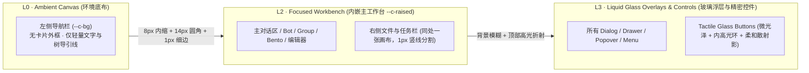

# xacpx-web 全站视觉与材质统一设计方案（V2 · Holistic Surface & Glass Unification）

> **日期**：2026-11-27  
> **基准分支 / Commit**：`feat/web-inset-workbench` @ `95ef57ee`（基于 `main` `c00cb6a2`）  
> **覆盖范围**：`packages/web/src` 全部 **4 个 View** 与 **85 个 Component**  
> **核心目标**：解决 S1–S3 首轮改造后暴露出的**视觉重心失衡（左栏卡片感过重）**、**按钮与玻璃材质脱节**、以及**Bot/Group 视图、文件目录、全部弹窗与抽屉未适配**三大系统性问题，把 `xacpx-web` 打磨为一套处处自洽的 macOS / Raycast 级精密桌面工作台。

---

## 一、 全方位自检诊断：为什么当前界面“一眼看去仍然割裂”？

通过对 `packages/web/src` 全部 89 个 `.vue` 文件与 `style.css` / `tailwind.config.js` 的逐行审计，结合 `:7138` 实机截图，当前界面存在 **6 大系统性症结**：

### 1. 视觉重心倒置：导航栏（L0/L1）抢了主工作区（L2）的“卡片感”
- **现状问题**：
  - 在 `InstanceTree.vue` 中，外层实例被包了一圈 `rounded-lg border border-hairline px-1 py-1`（`data-test="instance-card"`）；
  - 底部「+ 新建会话」又被做成了 `h-8 border border-hairline rounded-sm` 的描边宽卡片按钮；
  - 顶部 `会话 / Bots` 分段控制器（`bg-fill-track` + `bg-raised shadow-select` 滑块）是一块高对比度白卡；
  - 选中的会话行（`bg-raised shadow-select`）又是一块白卡。
- **视觉后果**：232px 宽的左侧栏里塞满了**四层矩形框线与卡片**（分段滑块框 + 实例外框 + 选中行白卡 + 底部描边大按钮）。而侧边栏本应是**退后的导航底布（Ambient Chrome）**，卡片感和视觉重量应当留给右侧真正需要专注的主工作台与核心数据。

### 2. 按钮气质突兀：生硬的高饱和色块，与玻璃/精密质感毫无关系
- **现状问题**：
  - 像 Bento 空状态右上角的 `+ 新建会话`（`EmptySessionState.vue:105`）、弹窗底部的保存/创建按钮（`UiButton.vue`）、文件栏的提交按钮（`FilesPanel.vue`），全部是高饱和实心蓝（`#0071E3`）或生硬白块，且散落着 `20+` 处绕过 `UiButton` 的手写 `<button>`。
  - 当前 `--shadow-btn` 只有 `inset 0 1px 0 rgba(255,255,255,.18)`，没有顶部微渐变光泽（Sheen），也没有半透明内边缘折射；而次级按钮（`secondary`）是纯白实心底（`bg-raised`），放在同样是 `bg-raised` 的内嵌工作台或玻璃弹窗里，要么顺色消失，要么像贴了一块死板的塑料片。
- **视觉后果**：按钮像传统 Bootstrap / 后台模板里的实心贴片，和系统的 Floating Glass（毛玻璃 + 顶部高光渐变 `--glass-sheen` + 细腻折射边）完全是两个时代的产物。

### 3. Bot 与 Group 界面完全“掉队”：背景层级反转 + 顶栏/输入框未对齐
- **现状问题**：
  - **背景反转 Bug**：`DashboardView.vue:630` 把右侧主画布升为了 `lg:bg-raised`（亮色 `#FFFFFF` / 暗色 `#1F2126`），`ChatPane.vue` 根节点是透明的，所以普通会话在白卡上正常显示；但 **`DirectBotPane.vue:702` 和 `GroupPane.vue:667` 根节点硬编码了 `bg-bg`（`#F5F6F8` / `#0E0F12`）**！一旦切到 Bot 或 Group，右侧内嵌大圆角白卡内部瞬间又变成了一块灰底，且顶栏 `header` 硬编码了 `bg-surface/60`（`DirectBotPane.vue:776`、`GroupPane.vue:731`），与 `global-bar` 撞出双层灰条。
  - **Bot 侧栏列表未精修**：切到 `Bots` 标签页后，`bot-row` / `group-row` 既没有会话列表的层级缩进秩序，底部的 `+ 新建 Bot` / `+ 新建群聊` 也是散乱的裸文字链接，与 `Sessions` 模式格格不入。
  - **Bot / Group 空状态与状态栏简陋**：`ConversationTimeline.vue` 的空状态只有一颗孤零零的灰色图标和一行小字；`DirectBotPane` 的命令起步 Chip（`starter-chip`）、`GroupComposer` 的成员切换胶囊与轮数选择器、`ConversationWorktreePanel`（几乎无样式的裸 `
` 和原生 `<button>`）全都停留在毛坯状态。
  - **气泡与输入框反差失调**：暗色模式下 `ConversationComposer` 使用 `bg-surface`（`#16171B`），放在 `#1F2126` 的工作台卡片上陷成了一个黑洞；用户自己的气泡（`ConversationBubble.vue` `own`）用 `bg-accent-soft border-hairline` 显得发灰发闷。

### 4. 右侧栏（文件目录 / Git 改动 / 任务面板）底色断层与树形噪音
- **现状问题**：
  - **底色断层**：`FilesPanel.vue:228`、`ScheduledTasks.vue:60`、`OrchestrationTasks.vue:44` 根节点全部硬编码了 `bg-surface`（`#ECEEF2`）。在 `lg:bg-raised`（纯白）的内嵌工作台卡片右侧，右栏突然变成一块深灰块，破坏了“同一张工作台画布”的整体感。
  - **Tab 语言分裂**：中心 Tab（`CenterTabStrip`）已经改成了优雅的底部指示线，但右侧栏顶部的 `文件 / 任务`（`DashboardView.vue:999`）以及 `FilesPanel` 内部的 `浏览 / 改动`（`FilesPanel.vue:253`）还在用旧的 `bg-accent-soft` 蓝色胶囊块。
  - **文件树缺乏导引与密度节奏**：`FileTreeNode.vue` 展开目录时没有纵向缩进导引线，所有文件夹图标一律用刺眼的警告黄（`text-warn`），`hover:bg-raised` 在白色画布上根本看不见悬停反馈；行内新建/重命名输入框（`bg-surface-2` 无边框）像一块补丁。

### 5. 全部弹窗（14 个 Dialog）与抽屉（3 个 Drawer）：“外壳有玻璃，内胆全是灰泥块”
- **现状问题**：
  - 虽然 `DialogShell.vue` 外壳加了 `bg-glass-strong shadow-glass-float backdrop-blur-glass`，但**所有弹窗内部都没有头部/主体/底部的发丝线分割（Header / Body / Footer Hairline）**，标题、表单和按钮糊成一团。
  - **控件反差崩坏**：在半透明毛玻璃弹窗内，所有 `<input>`、`<textarea>`、`SelectMenu`、`ModelPicker`、单选卡片全部硬编码了 `bg-surface-2`（实心死灰块，且无 `1px` 内边框与顶部微光）。在毛玻璃上贴满实心深灰块，彻底毁掉了玻璃的通透感。
  - **漏网的野生弹窗**：`ConfirmDialog.vue`、`SubagentTraceDialog.vue`、`BotAvatarQuickView.vue`、`TopicSwitcher.vue`（内置了 2 个手写 confirm/isolation 弹窗）根本没有走 `DialogShell`，各自手写遮罩与圆角（甚至 `BotAvatarQuickView` 还在用不透明的 `bg-surface shadow-float`）。
  - **复杂的巨型弹窗杂乱无章**：`BotDialog.vue`（5 大分组全是大号大写标题 + 实心灰块 + `BotAvatarEditor` 的 `bg-bg`/`bg-surface` 套娃）、`GroupDialog.vue`（大段 radio 灰块堆砌）、`ManageInstanceDialog.vue`（3 个 Tab 还是旧胶囊样式，内部 `WorkspacesManager` / `AgentsManager` 满是 `rounded-sm bg-surface-2` 简陋表单）。

### 6. 次级页面与浮层（`/settings`、`/invite`、编辑器、通知中心）风格脱节
- **`SettingsView.vue`**：顶部导航栏与主工作台脱节，列表行没有玻璃或精细卡片分组质感。
- **`InviteView.vue`**：还停留在上古的“复古黑客终端风”（红黄绿假 macOS 窗口圆点 + `font-mono` + `▸` 绿字按钮），与新的 `LoginView.vue` 完全不是一个产品。
- **`FileViewer.vue`**：文件查看/编辑顶栏与 Diff 视图的行号槽（`bg-surface`）在白色工作台上出现色块断层。

---

## 二、 核心设计哲学与材质体系重构（Surface, Glass & Tactile Tokens）

为了从根源上解决上述 6 大问题，我们将视觉体系收敛为 **4 条铁律**：

### 2.1 空间焦点法则：卡片感只给“视觉焦点”，侧边栏彻底“去卡片化”
1. **左侧栏（L0 Ambient Canvas）**：
   - 坐落在 `--c-bg` 环境底布上，**严禁在侧栏里再画外框卡片**。
   - **去掉 `instance-card` 的 `border border-hairline rounded-lg` 外框**！实例标题只是一行干净的 Section Header（带在线绿点、实例名、会话计数与悬停浮现的过滤/新建小图标）。
   - **去掉侧栏底部笨重的描边大按钮**！`+ 新建会话`、`+ 新建 Bot`、`+ 新建群聊` 统一收敛为轻盈的静音动作行（默认 `text-fg-muted`，悬停时浮现极淡的 `bg-fill-hover text-fg`），不再画一圈边框抢夺视线。
   - **选中态降噪**：侧栏选中行（`session-row` / `bot-row` / `group-row`）不再大肆渲染厚重投影，而是采用温润的微光半透明胶囊（亮色 `bg-raised/90 shadow-select ring-1 ring-black/[0.04]`，暗色 `bg-white/[0.08] shadow-select ring-1 ring-white/[0.07]`，保留类名 `bg-raised shadow-select` 兼容单测）。
   - **顶部 `会话 / Bots` 切换器轻量化**：从厚重的滑块槽改为紧贴顶部的轻量分段器（滑块采用半透明玻璃晶片质感，高度从 `32px` 精致收紧到 `28px`）。
2. **右侧主工作台（L2 Inset Workbench）**：
   - 整个右侧（包含顶栏 `global-bar`、中间 `ChatPane / DirectBotPane / GroupPane / EmptySessionState / FileViewer`、右侧 `FilesPanel / TaskPanel`）**共享同一个 `bg-raised` 画布基底**。
   - 内部区域之间**只用 `1px border-hairline` 分割**，严禁某个子面板（如 `DirectBotPane`、`GroupPane`、`FilesPanel`、`TaskPanel`）私自把背景刷回 `bg-bg` 或 `bg-surface`。

### 2.2 按钮与控件的“玻璃精密感”（Tactile Glass Controls）
为什么之前的按钮显得蠢？因为它是“纯色平涂 + 单一外阴影”。真正的 macOS / Raycast 精密按钮靠的是**光学折射边缘（Specular Rim）与微梯度光泽（Micro-Sheen）**：

| 按钮变体 (`UiButton`) | 视觉配方（Light & Dark 自适应） | 适用场景 |
| :--- | :--- | :--- |
| **`primary`（主动作）** | **半透明宝石蓝渐变光泽 + 顶部高光内边**： 背景叠层 `background-image: linear-gradient(180deg, rgba(255,255,255,0.16) 0%, rgba(255,255,255,0) 100%)` 叠在 `bg-accent` 上； 阴影 `--shadow-btn`: `inset 0 1px 0 rgba(255,255,255,0.28), inset 0 0 0 1px rgba(255,255,255,0.12), 0 1px 2px rgba(0,84,168,0.22), 0 4px 10px -2px rgba(0,113,227,0.18)`。 不再是刺眼的扁平蓝块，而是带玻璃顶部折射的精致胶囊（高度 `28px/32px`，字重 `font-medium`）。 | 弹窗确认、空状态「新建会话」、Git 提交、登录 |
| **`secondary`（次级玻璃按钮）** | **磨砂半透明晶片（Tactile Glass Pill）**： 使用 `.ui-btn-glass`：背景 `var(--glass-sheen), var(--btn-glass-bg)`（亮色 `rgba(255,255,255,0.72)` / 暗色 `rgba(255,255,255,0.07)`），边框 `1px solid var(--hairline)`，内高光 `inset 0 1px 0 var(--glass-highlight)`，轻触影 `0 1px 2px rgba(0,0,0,0.03)`，悬停提亮至 `var(--btn-glass-hover)`。 | 弹窗取消、次级操作、Bento 辅助动作、设置页操作 |
| **`ghost`（静音工具按钮）** | 默认全透明 `text-fg-muted`，悬停 `bg-fill-hover text-fg`，按下 `bg-fill-strong active:scale-[0.98]`。 | 顶栏图标、侧栏动作、折叠开关 |
| **`danger` / `danger-ghost`** | `danger` 实心按钮同样叠加顶部 `16%` 白光渐变与内高光边；`danger-ghost` 采用半透明红底薄纱 `hover:bg-danger/10 border border-transparent hover:border-danger/20`。 | 删除确认、危险操作 |

> **统一收敛原则**：全站所有散落的手写按钮（如 `EmptySessionState` 的新建会话、`TopicSwitcher` 的确认按钮、`BotRemovalDialog` 的底部按钮、`GroupDialog` 的删除确认按钮、`FilesPanel` 的提交按钮、`ConversationInteractionForm` 的提交/拒绝/取消按钮）全部接入或对齐这套光学配方。

### 2.3 玻璃浮层内胆规范（Glass Interior Anatomy）
所有弹窗（`DialogShell`）与抽屉（`TraceOverlayDrawer`、`ScheduledTasks` 抽屉、`MobileSheet`）内部必须遵守同一套**玻璃内胆解剖结构**：
1. **三段式发丝线分割**：
   - `Header`：`px-5 py-3.5 border-b border-hairline flex items-center justify-between`（标题 `text-sm font-semibold tracking-tight` + 右上角 `28×28` 静音关闭按钮）。
   - `Body`：`px-5 py-4` 滚动区，分组之间用 `border-t border-hairline pt-4` 或轻量卡片容器分隔，去掉粗鲁的大号大写灰字标题。
   - `Footer`：`px-5 py-3 border-t border-hairline bg-fill-track/30 flex items-center justify-end gap-2`（底部微沉半透明托盘，让操作按钮稳稳坐落）。
2. **玻璃上的表单输入框（`.ui-input` / `SelectMenu` / `ModelPicker`）**：
   - 严禁在玻璃弹窗里用无边框的 `bg-surface-2` 死灰块！
   - 统一升级为**半透明内凹玻璃槽**：`rounded-input border border-hairline bg-bg/55 dark:bg-white/[0.04] shadow-[inset_0_1px_2px_rgba(0,0,0,0.03)] focus:border-accent focus:bg-raised focus:ring-2 focus:ring-accent/20`。
   - 单选/多选卡片（如 `GroupDialog` 的工作区模式、路由策略）统一改为 `rounded-lg border border-hairline bg-bg/40 px-3 py-2.5 transition-colors`，选中态为 `border-accent/50 bg-accent-soft/50`（带精致蓝边与淡蓝玻璃底），告别死灰方块。

### 2.4 亮色模式“灰/白反差”柔化规范（Softened Light-Mode Grey Hierarchy）
在纯白（`--c-raised: #FFFFFF`）的主工作台画布上，任何超过 `8%` 浓度的中性灰块都会像刺眼的“深灰补丁”（尤其是正文中的行内代码 `code`、代码块 `pre`、顶栏面包屑 Chip 以及输入框底色）。为此，亮色模式的灰阶跨度必须全面收窄：

1. **全局灰阶与半透明填充降噪（`style.css`）**：
   - `--c-bg`: `245 246 248` (`#F5F6F8`) → **`247 248 250` (`#F7F8FA`)**（更清透的冷白底布）
   - `--c-surface`: `236 238 242` (`#ECEEF2`) → **`241 243 246` (`#F1F3F6`)**（消除死灰感，且 `--c-fg-muted` 对比度提升至 `5.15:1`）
   - `--c-surface-2`: `229 231 235` → **`235 237 241`**
   - `--fill-hover`: `.10` → **`.065`**
   - `--fill-track`: `.12` → **`.075`**
   - `--fill-strong`: `.14` → **`.11`**
   - `--hairline`: `rgba(60, 60, 67, .11)` → **`rgba(60, 60, 67, .085)`**（更细腻的 1px 边界）
2. **Markdown 行内代码与代码块（`StreamMarkdown.vue`）**：
   - **行内代码 `.stream-md code`**：弃用实心 `rgb(var(--c-surface))`（在白底上发黑），改为 **`background: rgb(var(--c-fg) / 0.045); border: 1px solid rgb(var(--c-border) / 0.07); border-radius: 5px; padding: 0.1em 0.35em;`**（在白底上合成为 `#F7F7F8` 极浅冷灰 + 微边框，温润不抢戏）。
   - **代码块 `.stream-md pre` / `.mmd-viewport` / `.mmd-source`**：弃用 `var(--fill-track)`（12% 灰太重），改为 **`background: rgb(var(--c-bg) / 0.65)`**（暗色 `.dark` 下为 `rgb(255 255 255 / 0.035)`）+ `1px solid var(--hairline)`。
3. **顶栏面包屑 Chip、工具输出框与 `.ui-well`**：
   - `.ui-well` 改为 `background-color: rgb(var(--c-bg) / .5); border: 1px solid var(--hairline); box-shadow: none;`（去掉显得像脏坑的内阴影）。
   - 顶栏面包屑 Chip（`ChatPane` / `DirectBotPane`）与 `ToolDetail.vue` 代码预览框统一使用 `bg-bg/45` ~ `bg-bg/55` + `border-hairline`。

### 2.5 侧边栏收起态（Collapsed Sidebar）原位切换与主体对齐规范
此前左右侧边栏收起后，在 `workbench` 白色圆角卡片内部左右两侧各塞了一条 `w-5 bg-surface/60` 的通高灰色窄柱（图标悬在屏幕垂直 50% 半腰处），导致：
- 主体卡片左侧被一条 20px 的灰条割裂，顶栏 `XACPX HUB` 与下方内容栏 `xacpx-omp-2` 左边缘错位 20px；
- 用户在左上角点击收起后，要跑到屏幕左边缘半腰处才能点回展开，违背“按下去有回应、再按能收回”的原位交互直觉。

**新设计规范（Apple / Linear 顶栏原位切换）**：
1. **移除通高灰条**：彻底移除 `workbench` 内部左右两侧的 `w-5 bg-surface/60` 通高窄条（`expand-left` / `expand-right`），让收起后的 `workbench` 成为一张四角干净、无内部夹层灰条的完整 14px 圆角卡片。
2. **左上角原位切换（`expand-left`）**：当 `leftCollapsed` 为 `true` 时，`expand-left` 作为 `28×28`（`h-7 w-7 rounded-md`）图标按钮直接停靠在 `global-bar` 最左侧（紧贴 `BrandLogo` 左侧），与展开态侧边栏顶部的 `toggle-left` 处于同一水平高度（44px 顶栏），点击原位展开；右侧 `expand-right` 同样收进 `global-bar` 右侧工具区。
3. **200ms 无重排抽屉动效**：`data-drawer="left"` 使用 `transition-[width,opacity] duration-200 ease-ui overflow-hidden`，内部保持 `min-w-[232px]` 定宽裁切，杜绝收起/展开动画途中的文字挤压换行与抖动。

---

## 三、 全站 89 个组件逐区改造清单（6 大工作包）

为了保证不漏掉任何一个角落，我们将全站所有视图与组件划分为 **WP-A 至 WP-F 六个工作包**：

---

### WP-A · 视觉基底、玻璃按钮与表单控件统一（Tokens & Primitives）

| 文件 | 具体改造方案 |
| :--- | :--- |
| [`packages/web/src/style.css`](file:///D:/project/xacpx/packages/web/src/style.css) | 1. 升级 `--shadow-btn` 与 `--shadow-btn-raised`，加入顶部镜面高光 `inset 0 1px 0` 与柔和色彩散射影。 2. 新增 `--btn-glass-bg` / `--btn-glass-hover` 及 `.ui-glass-field`（弹窗与面板通用半透明输入槽配方）。 3. 优化 `.agent-bubble` 与用户气泡在亮/暗色下的对比度与微投影。 |
| [`packages/web/src/components/UiButton.vue`](file:///D:/project/xacpx/packages/web/src/components/UiButton.vue) | 1. `primary` 增加顶部微光泽渐变 `bg-[linear-gradient(180deg,rgba(255,255,255,0.16),rgba(255,255,255,0))]` 与 `shadow-btn`。 2. `secondary` 升级为半透明磨砂玻璃晶片（`border border-hairline bg-raised/75 dark:bg-white/[0.06] shadow-btn-raised backdrop-blur-sm hover:bg-raised dark:hover:bg-white/[0.11]`）。 3. `danger` 增加顶部光泽与细腻内边。 |
| [`packages/web/src/components/SelectMenu.vue`](file:///D:/project/xacpx/packages/web/src/components/SelectMenu.vue) | 触发器从无边框 `bg-surface-2` 升级为 `border border-hairline bg-bg/60 dark:bg-white/[0.04] shadow-press hover:border-hairline-strong hover:bg-fill-hover`（`compact` 模式同样带细腻 `border-hairline`）。 |
| [`packages/web/src/components/ModelPicker.vue`](file:///D:/project/xacpx/packages/web/src/components/ModelPicker.vue) | 模型输入框与推理强度输入框从 `bg-surface-2` 升级为与 `SelectMenu` 完全一致的 `border border-hairline bg-bg/60 dark:bg-white/[0.04]` 玻璃槽；刷新按钮与下拉面板对齐 `DropdownPanel` 规范。 |
| [`packages/web/src/components/DropdownPanel.vue`](file:///D:/project/xacpx/packages/web/src/components/DropdownPanel.vue) [`packages/web/src/components/ContextMenu.vue`](file:///D:/project/xacpx/packages/web/src/components/ContextMenu.vue) [`packages/web/src/components/CompletionMenu.vue`](file:///D:/project/xacpx/packages/web/src/components/CompletionMenu.vue) [`packages/web/src/components/CompletionList.vue`](file:///D:/project/xacpx/packages/web/src/components/CompletionList.vue) | 1. `CompletionList` 高亮行从生硬的 `bg-surface-2` 改为与 `DropdownPanel` 一致的 `bg-fill-strong` / `hover:bg-fill-hover rounded-item`。 2. 搜索框 `dd-search` 增加 `border border-hairline`。 |

---

### WP-B · 左侧导航栏“彻底去卡片化”（Ambient Sidebar De-Cardification）

| 文件 | 具体改造方案 |
| :--- | :--- |
| [`packages/web/src/components/InstanceTree.vue`](file:///D:/project/xacpx/packages/web/src/components/InstanceTree.vue) | 1. **去掉 `instance-card` 外框**：移除 `rounded-lg border border-hairline px-1 py-1`，改为纯粹的垂直章节流 `py-1`（多实例之间仅用顶部间距区分）。 2. **轻量分段切换器（`会话 / Bots`）**：轨道改为 `h-7 rounded-lg bg-fill-track/80 p-0.5 border border-hairline`，滑块保持 `bg-raised shadow-select` 玻璃薄片感。 3. **选中行温润化**：`session-row` / `bot-row` / `group-row` 激活态保留 `bg-raised shadow-select`（满足单测契约），但通过 `--shadow-select` 调优为极轻的 `1px` 内环高光 + `2px` 接触影，不再像突兀的厚白砖。 4. **Bot 列表层级与对齐**：`Bots` 模式下列表同样享受干净的对齐与紧凑间距，头像环 `--avatar-ring` 在桌面上对齐 `rgb(var(--c-bg))`（因为左栏在桌面端是 `bg-bg` 而非 `bg-surface`！修复当前 Bot 头像状态点外圈有灰环的瑕疵）。 5. **底部新建动作去边框化**：将 `data-test="new-session"` 从扎眼的描边宽框还原为与 `+ 新建 Bot` / `+ 新建群聊` 统一语言的**轻量静音动作按钮**（`flex h-7 items-center gap-1.5 rounded-md px-2 text-xs font-medium text-fg-muted hover:bg-fill-hover hover:text-fg`），把视觉重心彻底还给右侧主工作台。 |
| [`packages/web/src/views/DashboardView.vue`](file:///D:/project/xacpx/packages/web/src/views/DashboardView.vue) | 1. 左栏顶部品牌行与底部设置/主题行（`sidebar-footer`）：去掉生硬的分割线噪音，底部 `sidebar-footer` 图标按钮采用轻盈的 `h-7 w-7 rounded-md text-fg-muted hover:bg-fill-hover hover:text-fg`。 2. 顶栏搜索框 `global-search`：采用半透明玻璃胶囊 `lg:rounded-lg lg:border lg:border-hairline lg:bg-bg/50 dark:lg:bg-white/[0.04] lg:hover:bg-fill-hover`，快捷键 `⌘K` 角标用 `rounded border border-hairline bg-raised/60 px-1 font-mono text-[11px]`。 |

---

### WP-C · Bot 界面、Group 界面与对话流全量适配（Bots, Groups & Timeline）

| 文件 | 具体改造方案 |
| :--- | :--- |
| [`packages/web/src/components/DirectBotPane.vue`](file:///D:/project/xacpx/packages/web/src/components/DirectBotPane.vue) | 1. **修复背景层级反转**：根节点从 `bg-bg` 改为 `bg-bg lg:bg-transparent`（桌面端直接透出 Inset Workbench 的 `bg-raised` 纯净画布；移动端保持 `bg-bg`）。 2. **桌面顶栏对齐**：`header[data-conversation-header]` 从 `bg-surface/60 backdrop-blur-md` 改为与 `ChatPane` 一致的 `h-11 border-b border-hairline bg-transparent px-4`！ 3. **元信息行芯片化**：副标题里的 `TopicSwitcher`、角色（Role）、工作区（`<Folder /> workspace`）、Agent、Model 对齐 `ChatPane` 的轻量细边面包屑风格，右侧 `与…对话`（`direct-nav-button`）升级为带 `1px border-hairline` 的轻量玻璃胶囊按钮。 4. **空状态与起步命令 Chip（`starter-chip`）**：当 Direct Bot 无消息时，呈现带 Bot 头像、名称、职责与 `border border-hairline bg-bg/50 hover:bg-fill-hover shadow-press` 玻璃质感起步命令胶囊的精致引导卡。 5. **错误/重试横幅**：统一为 `border-b border-hairline bg-danger/[0.06]` 加上玻璃小按钮。 |
| [`packages/web/src/components/GroupPane.vue`](file:///D:/project/xacpx/packages/web/src/components/GroupPane.vue) | 1. **修复背景层级反转**：根节点改为 `bg-bg lg:bg-transparent`；桌面端 `header[data-conversation-header]` 改为 `h-11 border-b border-hairline bg-transparent px-4`。 2. **零话题空状态（`group-first-topic`）**：升级为带 `1px border-hairline bg-bg/40 rounded-2xl p-6` 的精致居中引导卡，配合新版玻璃质感 `UiButton`。 3. **成员状态提示条（`group-member-status`）**：改为 `border-b border-hairline bg-warn/[0.08] px-4 py-1.5 text-xs`。 4. **暗色头像叠层环修复**：桌面端 `GroupAvatarStack` 的 `--avatar-ring` 对齐 `rgb(var(--c-raised))`。 |
| [`packages/web/src/components/TopicSwitcher.vue`](file:///D:/project/xacpx/packages/web/src/components/TopicSwitcher.vue) | 1. 顶部触发胶囊（`data-test="topic-menu"`）升级为 `rounded-md border border-hairline bg-bg/50 dark:bg-white/[0.04] px-2 py-0.5 text-xs font-medium text-fg hover:bg-fill-hover`。 2. 话题下拉面板内的「+ 新建话题」底部栏增加 `border-t border-hairline`。 3. 内置的 `topic-confirm` 与 `topic-isolation` 两个弹窗同步升级为三段式玻璃内胆 + `UiButton` 玻璃按钮。 |
| [`packages/web/src/components/ConversationTimeline.vue`](file:///D:/project/xacpx/packages/web/src/components/ConversationTimeline.vue) [`packages/web/src/components/TimelineRow.vue`](file:///D:/project/xacpx/packages/web/src/components/TimelineRow.vue) | 1. `topic-fork-banner`：从 `bg-surface-2` 改为清透的 `border-b border-hairline bg-accent-soft/40 px-4 py-1.5`。 2. `timeline-load-older` 按钮：改为玻璃小胶囊 `rounded-full border border-hairline bg-bg/60 px-3 py-1 text-xs shadow-press hover:bg-fill-hover`（同步更新 `MessageList.vue` 里的 `load-older`）。 3. `TimelineRow` 中的 Handoff 交接行、Cancelled 头像叠层环（桌面端 `--c-raised` 适配）。 |
| [`packages/web/src/components/ConversationComposer.vue`](file:///D:/project/xacpx/packages/web/src/components/ConversationComposer.vue) [`packages/web/src/components/PromptInput.vue`](file:///D:/project/xacpx/packages/web/src/components/PromptInput.vue) [`packages/web/src/components/ConversationPromptInput.vue`](file:///D:/project/xacpx/packages/web/src/components/ConversationPromptInput.vue) [`packages/web/src/components/GroupComposer.vue`](file:///D:/project/xacpx/packages/web/src/components/GroupComposer.vue) | 1. **修复暗色模式“黑洞感”**：`ConversationComposer` 的 `composer-surface` 改为 `bg-bg/70 dark:bg-white/[0.045] ring-1 ring-inset ring-hairline shadow-card focus-within:bg-raised dark:focus-within:bg-white/[0.07] focus-within:ring-2 focus-within:ring-accent`（保持 48px 盒高与既有动画不变，亮色是温润的微灰输入舱、聚焦变白；暗色是微亮半透明玻璃舱，彻底消除死黑深井）。 2. **底部控制栏 Chip 统一**：`PromptInput` 的模型/推理强度按钮、`GroupComposer` 的成员选择胶囊（`group-target-chip`）、讨论开关（`group-discuss-toggle`）与轮数选择器（`group-discuss-rounds`）统一为 `rounded-md border border-hairline bg-raised/70 dark:bg-white/[0.04] px-2 py-0.5 text-xs hover:bg-fill-hover`。 3. 发送圆钮增加顶部微光泽 `shadow-btn`。 |
| [`packages/web/src/components/ConversationBubble.vue`](file:///D:/project/xacpx/packages/web/src/components/ConversationBubble.vue) | 用户气泡（`own`）优化为：`rounded-2xl rounded-br-[4px] border border-accent/20 bg-accent-soft px-3.5 py-2 shadow-press`，边缘更清透。 |
| [`packages/web/src/components/ConversationWorktreePanel.vue`](file:///D:/project/xacpx/packages/web/src/components/ConversationWorktreePanel.vue) | 彻底重塑原本无样式的裸 `
`：包裹为 `mx-auto my-2 w-full max-w-3xl px-4`，内部卡片采用 `rounded-xl border border-hairline bg-bg/50 p-3 text-xs`，所有操作按钮（Refresh / Preview / Integrate / Abandon / Cleanup）升级为精细的玻璃小按钮，Diff 预览区采用 `rounded-lg border border-hairline bg-raised p-2.5 font-mono`。 |
| [`packages/web/src/components/PlanPanel.vue`](file:///D:/project/xacpx/packages/web/src/components/PlanPanel.vue) [`packages/web/src/components/QueueStrip.vue`](file:///D:/project/xacpx/packages/web/src/components/QueueStrip.vue) [`packages/web/src/components/ConversationStatusBar.vue`](file:///D:/project/xacpx/packages/web/src/components/ConversationStatusBar.vue) | `PlanPanel` 与 `QueueStrip` 统一补齐 `border border-hairline bg-bg/75 dark:bg-white/[0.04] backdrop-blur-md`；`ConversationStatusBar` 的 `Stop all` 按钮增加微边框 `border border-danger/20 bg-danger/10`。 |

---

### WP-D · 右侧栏（文件目录、Git 改动、任务面板）与文件编辑器精修

| 文件 | 具体改造方案 |
| :--- | :--- |
| [`packages/web/src/views/DashboardView.vue`](file:///D:/project/xacpx/packages/web/src/views/DashboardView.vue)（右栏顶栏） | 右侧栏顶栏（`h-11 border-b border-hairline px-2.5`）的 `文件` / `任务` 两个 Tab，从旧的 `bg-accent-soft` 蓝色色块改为**与 `CenterTabStrip` 一致的底部 `2px` 指示线风格**（或者紧凑的 `border-hairline` 玻璃分段器），让工作台顶栏左右语言完全统一。 |
| [`packages/web/src/components/FilesPanel.vue`](file:///D:/project/xacpx/packages/web/src/components/FilesPanel.vue) | 1. **去掉 `bg-surface` 灰底**：根节点在桌面端改为 `bg-surface lg:bg-transparent`，与工作台融为一体。 2. **工作区标题行与 `浏览 / 改动` 切换**：做成干净的紧凑工具条（`border-b border-hairline px-2.5 py-1.5`），`浏览 / 改动` 采用带 `1px border-hairline bg-fill-track/70 p-0.5 rounded-md` 的微型分段器，激活项为 `bg-raised shadow-select text-fg font-semibold`。 3. **搜索框与过滤区**：Omnibox 搜索框采用 `.ui-glass-field`（`border border-hairline bg-bg/60 dark:bg-white/[0.04]`），`Aa / W / .*` 激活态用 `bg-accent-soft text-accent-text font-semibold`。 4. **Git 改动面板（Changes）与底部提交区**：底部 Commit 区域去掉 `bg-surface`，改为 `border-t border-hairline bg-bg/30 p-2.5`；提交文本框 `git-commit-message` 加上 `rounded-input border border-hairline bg-bg/60 dark:bg-white/[0.04] focus:border-accent focus:bg-raised`；`Stage All` 与 `Commit` 按钮对齐玻璃按钮质感。 |
| [`packages/web/src/components/FileTreeNode.vue`](file:///D:/project/xacpx/packages/web/src/components/FileTreeNode.vue) | 1. **修复悬停反馈消失**：将 `hover:bg-raised`（在白底上不可见）改为 `hover:bg-fill-hover`！ 2. **增加树形纵向缩进导引线**：展开的子目录容器增加左侧 `1px border-hairline` 纵向导引线，一眼看清目录层级。 3. **文件夹图标配色克制化**：去掉刺眼的橙黄色 `text-warn`，文件夹图标改为温润的 `text-accent/80`（展开时 `text-accent`），普通文件图标 `text-fg-muted`，行高调整为舒适的 `h-7`（`py-1`）。 4. **行内新建/重命名输入框**：加上 `rounded-sm border border-accent bg-raised px-1.5 py-0.5 shadow-press outline-none`。 |
| [`packages/web/src/components/FileViewer.vue`](file:///D:/project/xacpx/packages/web/src/components/FileViewer.vue) [`packages/web/src/components/TerminalTab.vue`](file:///D:/project/xacpx/packages/web/src/components/TerminalTab.vue) [`packages/web/src/components/DesktopTab.vue`](file:///D:/project/xacpx/packages/web/src/components/DesktopTab.vue) | 1. `FileViewer` 顶栏加上 `border-b border-hairline bg-transparent px-3 h-11`，Diff 视图左侧行号列改为 `bg-bg/60 border-r border-hairline`。 2. `TerminalTab` 底部虚拟按键条与 `DesktopTab` 顶栏/登录卡片同步补齐 `border-hairline` 与玻璃按钮。 |
| [`packages/web/src/components/TaskPanel.vue`](file:///D:/project/xacpx/packages/web/src/components/TaskPanel.vue) [`packages/web/src/components/ScheduledTasks.vue`](file:///D:/project/xacpx/packages/web/src/components/ScheduledTasks.vue) [`packages/web/src/components/ScheduledTaskRow.vue`](file:///D:/project/xacpx/packages/web/src/components/ScheduledTaskRow.vue) [`packages/web/src/components/OrchestrationTasks.vue`](file:///D:/project/xacpx/packages/web/src/components/OrchestrationTasks.vue) | 1. 去掉 `ScheduledTasks` 和 `OrchestrationTasks` 根节点的 `bg-surface`，改用 `border-b border-hairline` 分隔上下两区。 2. 空状态占位块（`tasks.noScheduled`）从 `bg-surface-2` 死灰块改为 `rounded-lg border border-dashed border-hairline py-3 text-center text-xs text-fg-muted`。 3. 新建定时任务表单（`scheduled-composer`）升级为 `rounded-xl border border-hairline bg-bg/50 p-3`，内部输入框与按钮对齐玻璃规范。 |

---

### WP-E · 全部 14 个弹窗（Dialogs）与 3 个抽屉（Drawers）深度玻璃化

| 弹窗 / 抽屉文件 | 具体改造方案 |
| :--- | :--- |
| [`packages/web/src/components/DialogShell.vue`](file:///D:/project/xacpx/packages/web/src/components/DialogShell.vue) | 面板基础类保持 `ui-panel bg-glass-strong text-fg shadow-glass-float backdrop-blur-glass backdrop-saturate-glass`，确保顶部 `1px` 镜面高光与外圈折射边清晰。 |
| [`packages/web/src/components/BotDialog.vue`](file:///D:/project/xacpx/packages/web/src/components/BotDialog.vue) [`packages/web/src/components/BotAvatarEditor.vue`](file:///D:/project/xacpx/packages/web/src/components/BotAvatarEditor.vue) [`packages/web/src/components/BotAvatarQuickView.vue`](file:///D:/project/xacpx/packages/web/src/components/BotAvatarQuickView.vue) | 1. **Header / Footer 补齐 `border-b` / `border-t border-hairline`**。 2. **五大表单分组精致化**：去掉原本突兀的大号 `text-sm font-semibold uppercase` 标题，改为精致的分组隔线 `border-t border-hairline pt-4` + `text-xs font-semibold tracking-wide text-fg`；所有输入框（名称、角色、指令 `textarea`、专属工作区提示块）从 `bg-surface-2` 升级为 `border border-hairline bg-bg/55 dark:bg-white/[0.04] focus:border-accent focus:bg-raised`。 3. **`BotAvatarEditor` 去套娃**：左侧预览卡从 `bg-bg` + `bg-surface` 双层灰盒改为 `rounded-xl border border-hairline bg-bg/40 p-4`；右侧预设、形状、颜色、表情网格按钮从 `bg-surface-2` 改为 `border border-hairline bg-bg/40 hover:bg-fill-hover`（选中态 `border-accent bg-accent-soft text-accent-text`）。 4. **`BotAvatarQuickView` 玻璃化**：从 `bg-surface shadow-float` 升级为 `bg-glass-strong shadow-glass-float backdrop-blur-glass backdrop-saturate-glass`。 |
| [`packages/web/src/components/GroupDialog.vue`](file:///D:/project/xacpx/packages/web/src/components/GroupDialog.vue) | 1. **Header / Footer 补齐 `border-hairline`**。 2. 标题与描述输入框升级为带 `border-hairline` 的半透明输入槽。 3. **工作区模式 / 公共记忆 / Handoff 记忆 / 默认路由** 4 组单选卡片：从 `bg-surface-2` 实心灰块升级为 `rounded-lg border border-hairline bg-bg/40 px-3 py-2 transition-colors has-[:checked]:border-accent/50 has-[:checked]:bg-accent-soft/40`。 4. 成员勾选列表包裹进 `rounded-xl border border-hairline bg-bg/35 divide-y divide-hairline overflow-hidden`。 5. 删除确认框按钮统一使用 `UiButton`。 |
| [`packages/web/src/components/NewSessionDialog.vue`](file:///D:/project/xacpx/packages/web/src/components/NewSessionDialog.vue) [`packages/web/src/components/DirectoryPicker.vue`](file:///D:/project/xacpx/packages/web/src/components/DirectoryPicker.vue) | 1. **Header / Footer 补齐 `border-hairline`**。 2. 会话来源切换（新建 / 接入原生）与工作区模式切换（已有 / 新路径）从 `bg-accent` / `bg-surface-2` 散装小按钮升级为统一的微型玻璃分段器（`rounded-md border border-hairline bg-fill-track/70 p-0.5`）。 3. 别名输入框、路径输入框、原生会话空状态块全部升级为 `border-hairline bg-bg/55`。 4. `DirectoryPicker` 目录列表区增加 `mx-5 rounded-xl border border-hairline bg-bg/40`，Header/Footer 补齐 `border-hairline`。 |
| [`packages/web/src/components/ManageInstanceDialog.vue`](file:///D:/project/xacpx/packages/web/src/components/ManageInstanceDialog.vue) [`packages/web/src/components/WorkspacesManager.vue`](file:///D:/project/xacpx/packages/web/src/components/WorkspacesManager.vue) [`packages/web/src/components/AgentsManager.vue`](file:///D:/project/xacpx/packages/web/src/components/AgentsManager.vue) | 1. Header 补齐 `border-b border-hairline`；顶部 `通用 / 工作区 / Agents` 3 个 Tab 升级为底部指示线或玻璃分段器风格（告别旧胶囊色块）。 2. 通用页的实例重命名输入框、分组偏好按钮组、自动协作（Router）、JEV 配置折叠块、终端/文件开关行统一为带 `border-hairline` 的分组列表。 3. `WorkspacesManager` 与 `AgentsManager` 的列表增加 `rounded-xl border border-hairline bg-bg/35 divide-y divide-hairline`，新增表单与按钮全部替换为玻璃输入框与 `UiButton`。 |
| [`packages/web/src/components/NewTopicDialog.vue`](file:///D:/project/xacpx/packages/web/src/components/NewTopicDialog.vue) [`packages/web/src/components/GroupTopicDialog.vue`](file:///D:/project/xacpx/packages/web/src/components/GroupTopicDialog.vue) [`packages/web/src/components/ForkTopicDialog.vue`](file:///D:/project/xacpx/packages/web/src/components/ForkTopicDialog.vue) [`packages/web/src/components/AddInstanceDialog.vue`](file:///D:/project/xacpx/packages/web/src/components/AddInstanceDialog.vue) [`packages/web/src/components/BotRemovalDialog.vue`](file:///D:/project/xacpx/packages/web/src/components/BotRemovalDialog.vue) [`packages/web/src/components/GroupMemberDialog.vue`](file:///D:/project/xacpx/packages/web/src/components/GroupMemberDialog.vue) [`packages/web/src/components/ConfirmDialog.vue`](file:///D:/project/xacpx/packages/web/src/components/ConfirmDialog.vue) [`packages/web/src/components/ComposerConfirmDialog.vue`](file:///D:/project/xacpx/packages/web/src/components/ComposerConfirmDialog.vue) [`packages/web/src/components/SubagentTraceDialog.vue`](file:///D:/project/xacpx/packages/web/src/components/SubagentTraceDialog.vue) | 1. 全部统一 `Header / Body / Footer` 间距与 `border-hairline` 分割线。 2. 全部文本输入框（如 `NewTopicDialog`、`GroupTopicDialog`、`ForkTopicDialog`、`AddInstanceDialog` 的 `rounded-2xl bg-surface-2`）统一为 `h-9 rounded-input border border-hairline bg-bg/55 dark:bg-white/[0.04] px-3 text-sm focus:border-accent focus:bg-raised focus:ring-2 focus:ring-accent/20`。 3. `BotRemovalDialog` 底部的手写 `<button>` 替换为 `<UiButton>`。 4. `SubagentTraceDialog` 内部的任务/报告区块补齐 `border border-hairline`。 |
| [`packages/web/src/components/CommandPalette.vue`](file:///D:/project/xacpx/packages/web/src/components/CommandPalette.vue) | 搜索输入行底部补齐 `border-b border-hairline`！让上半部搜索框与下半部结果列表像 Raycast 一样界限分明。 |
| [`packages/web/src/components/TraceOverlayDrawer.vue`](file:///D:/project/xacpx/packages/web/src/components/TraceOverlayDrawer.vue) [`packages/web/src/components/GroupRunDetailHeader.vue`](file:///D:/project/xacpx/packages/web/src/components/GroupRunDetailHeader.vue) [`packages/web/src/components/ConversationRunDetailContent.vue`](file:///D:/project/xacpx/packages/web/src/components/ConversationRunDetailContent.vue) [`packages/web/src/components/ConversationInteractionForm.vue`](file:///D:/project/xacpx/packages/web/src/components/ConversationInteractionForm.vue) | 1. `TraceOverlayDrawer` 左侧边缘补齐 `border-l border-hairline`；`GroupRunDetailHeader` 底部补齐 `border-b border-hairline`，右上角操作按钮（Pause / Stop / Fork / Close）升级为带 `border-hairline` 的玻璃圆角按钮。 2. `ConversationRunDetailContent` 成员列表加 `rounded-xl border border-hairline bg-bg/35 divide-y divide-hairline overflow-hidden`。 3. `ConversationInteractionForm`（Agent 提问/审批卡片）外框升级为 `.agent-bubble` 同族的 `rounded-xl border border-hairline bg-raised/90 p-3.5 shadow-card`，内部的输入框与提交/拒绝按钮全面升级为玻璃规范。 |

---

### WP-F · Bento 空状态均衡化与次级页面（`/settings`、`/invite`）统一

| 文件 | 具体改造方案 |
| :--- | :--- |
| [`packages/web/src/components/EmptySessionState.vue`](file:///D:/project/xacpx/packages/web/src/components/EmptySessionState.vue) | 1. 右上角 `+ 新建会话` 按钮（`data-test="empty-new-session"`）采用新版玻璃光泽主按钮配方（高度收紧为精致的 `h-8 px-3 text-ui font-medium rounded-btn`）。 2. 指标卡与最近会话面板增加极细腻的微渐变底色 `bg-bg/35 dark:bg-white/[0.02]`，在纯白/深灰工作台上更有层次感。 |
| [`packages/web/src/views/SettingsView.vue`](file:///D:/project/xacpx/packages/web/src/views/SettingsView.vue) | 顶栏与分组卡片对齐新的玻璃晶片按钮与材质语言。 |
| [`packages/web/src/views/InviteView.vue`](file:///D:/project/xacpx/packages/web/src/views/InviteView.vue) | 告别旧的“红黄绿假终端窗口”，升级为与 `LoginView.vue` 完全同族的居中精密卡片（`rounded-card bg-surface p-6 shadow-card ring-1 ring-hairline-strong` + 玻璃光泽按钮），保持所有 `data-test` 钩子不变。 |

---

## 四、 自动化与实机视觉验收标准（DoD）

1. **类型与单测零回归**：
   - `bunx vue-tsc --noEmit` 0 错误。
   - `bunx vitest run` 全部 224 个测试文件（3115+ 项单测）100% 通过（特别注意 `design-tokens.test.ts` 的 WCAG AA 对比度断言、`sidebar-design.test.ts` 的 `bg-raised shadow-select` 断言、`toolstepcard.test.ts` 的无边框断言）。
2. **Playwright E2E 全绿**：
   - `desktop-header-layout.spec.ts`、`mobile-sidebar-polish.spec.ts`、`bot-group-dialogs.spec.ts` 等全量桌面与移动端 E2E 通过。
3. **本机 `:7138` 全场景实机截图取证（覆盖此前漏掉的所有界面）**：
   - 构建 `bun run build:channel-web && bun run build:web` 并在 `:7138` 实测截取以下 **8 张全景证据图**：
     1. **会话工作台（亮色 + 右栏文件树展开）**：验证左栏去卡片化、右侧内嵌画布、文件树缩进线与同底色、新版玻璃按钮。
     2. **会话工作台（暗色）**：验证暗色下输入框不再陷成黑洞、左栏与主画布层次分明。
     3. **Bento 概览空状态（亮色）**：验证右上角玻璃质感主按钮与卡片层次。
     4. **Direct Bot 聊天界面（亮色）**：验证背景不再反转为灰底、顶栏单线对齐、话题胶囊与起步命令 Chip。
     5. **Group 群聊界面（亮色）**：验证群聊顶栏、成员头像叠层与讨论模式控制条。
     6. **新建/编辑 Bot 弹窗（`BotDialog`）**：验证毛玻璃弹窗三段式发丝线、半透明输入槽与头像编辑器。
     7. **新建会话 / 实例管理弹窗（`NewSessionDialog` / `ManageInstanceDialog`）**：验证弹窗内部分段器、下拉框与列表质感。
     8. **命令面板（`CommandPalette` `⌘K`）**：验证搜索栏底部分割线与悬浮玻璃质感。
