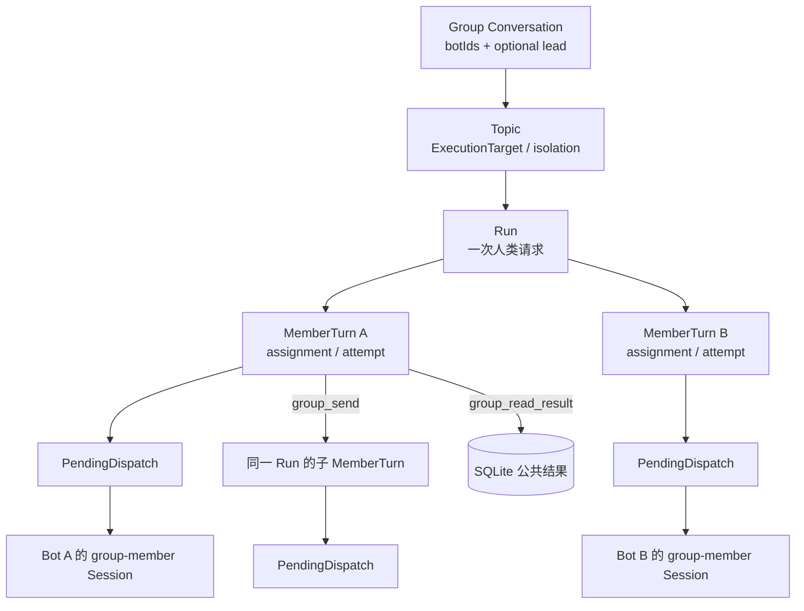
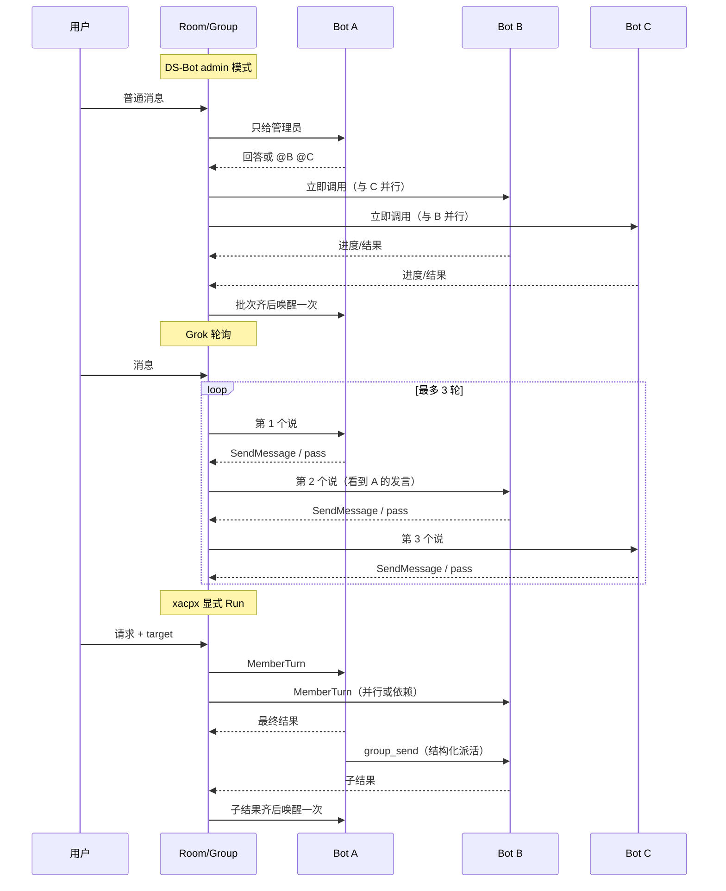
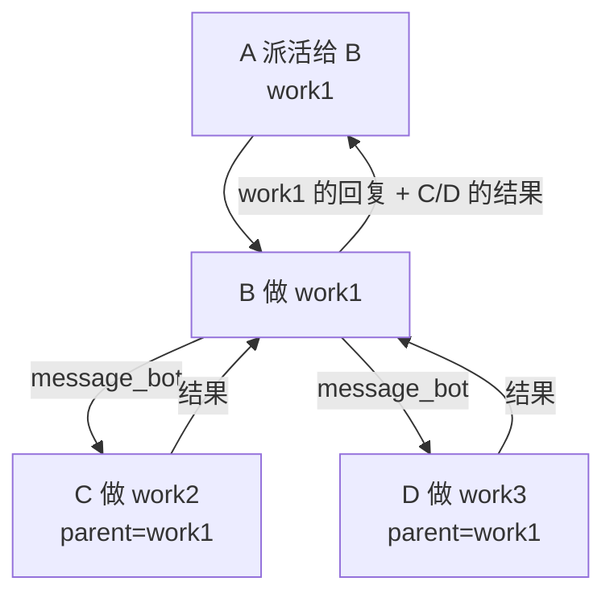
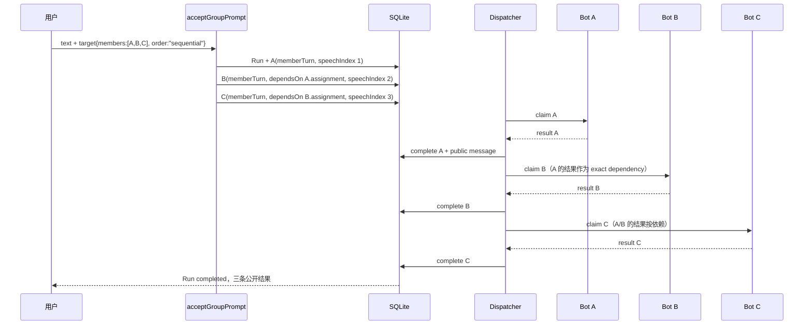

# Bot 群聊调度与协作：DS-Bot / Grok Bot 0.18 对标与 xacpx 落地建议

- 日期：2026-11-06
- 范围：`DS-Bot`（0.2.7，提交 `71d344b`）、`grok-bot-0.18-reconstructed`（0.18.0-reconstructed.1，提交 `a9f633e`）、`xacpx`（0.24.10-beta.11，提交 `87abe30b`）
- 目的：回答三个问题
  1. 群聊里**一条消息之后谁说话、按什么顺序说、什么时候让出**；
  2. Bot 之间**怎么派活、结果怎么回到上游、什么时候允许继续**；
  3. 用户在群里**看到什么**，Bot 的“说话”在实现上到底是什么事件。
- 结论先看第 0 节；落地建议直接看第 7 节。
- 配套可视化：`docs/research/2026-11-06-bot-group-collaboration-benchmark.html`

> **2026-11-06 后续：** 第 7 节的增量建议（`order: sequential` + `dependsOn`、trace 驱动的 thinking bubble）已被更完整的目标架构取代。最新方案见 `docs/design/2026-11-06-bot-conversation-architecture.md`，它采用 Run 的 `shape`、预生成圆桌、claim 顺序和单条时间线。本文保留为对标记录。

> 证据口径：DS-Bot 与 xacpx 是完整实现，按源码与设计文档交叉核对。Grok Bot 仓库是 0.18.0 可发行包的重建工程：`source/host/groups/*`、`source/host/extensions/transcript/*` 是可读的重建运行时，`frontend/src/recovered/*` 是恢复出的前端契约；它不包含 Anysphere 服务端的全部原始源码，因此“共享房间/云中继”的部分只依据仓库中可读的重建实现描述，不外推。

---

## 0. 结论先行

1. **xacpx 已经不是“没有群聊”，而是“任务执行型群聊”**：Group / Topic / Run / MemberTurn / dispatch 都是持久对象；一次用户请求是一个 Run，选中的成员各执行一个 MemberTurn，`group_send` 是公开的、可审计的派活。缺的不是“群”，而是“聊天室感”：连续房间日志、按轮次发言、过程中说话、跳过/插话、Lead 先答再点名。
2. **DS-Bot 的核心是“一个发言位 + 即时 @ + 让出 + 批次回收”**：房间只有一条日志；普通消息在 `admin` 模式只给管理员，在 `everyone` 模式按顺序全员回答；同一条消息 `@` 到的人**立即并行开工**；成员首次工具调用后 15 秒仍在干活就让出本轮，结果晚到也照样发回群；一个成员一轮只答一个调用；Bot 之间的派活是一棵树，结果自动向上收。
3. **Grok Bot 的核心是“有界轮询 + 每人一次 + pass”**：一个群最多 6 个成员，群本身不跑模型，`GroupChatOrchestrator` 最多 3 轮、10 条成员消息、每人每轮最多 2 条；每轮用“自上次用户发言以来的 @”重算响应者，没人被 @ 就全员；成员只看到“自上次自己发言以来”的新消息，回 `(pass)` 可以不说。
4. **xacpx 的调度/恢复/预算比两者都强，交互表达比两者都弱**：它有 durable lease、indeterminate、work graph、per-attempt trace、worktree、路由预算与验证；但没有“连续群聊”的轮次、pass、过程发言、Lead 依次点名。应该借的是**群聊表达层**，不是把 DS-Bot/Grok 的调度器搬进来。
5. **推荐路线（已更新）**：保留一次请求一个 Run；给 Run 加 `shape`（single / fanout / roundtable）；圆桌预生成 MemberTurn，按 claim 顺序发言；`(pass)` 不写消息；fanout 的 `group_send` / wake 不动；UI 收成一条时间线和一个输入框。完整方案见 `docs/design/2026-11-06-bot-conversation-architecture.md`。**不要把 Bot 文本里的 `@` 变成副作用路由**，继续用结构化 `group_send`；不要为群聊新建第二个调度器或 controller session。

---

## 1. 三个系统的心智模型

### 1.1 DS-Bot：房间日志 + 每成员一个“群内会话”

```mermaid
flowchart LR
  U[用户] -->|消息| R[Room<br/>群自己的 Session]
  R -->|group_relay 合成| L[Room log<br/>seq + seen]
  L -->|按规则选人| M1[Bot A<br/>群内 Session]
  L --> M2[Bot B<br/>群内 Session]
  M1 -->|@ / 进度 / 结果| L
  M2 -->|@ / 进度 / 结果| L
  M1 -->|message_bot| H[Handoff tree<br/>state.json works]
  M2 --> H
  H -->|结果回到上游| M1
  B1[Bot A 私聊] -. read_own_chat .-> M1
```

关键事实：

- 群是一个**持久房间**：`room.id`、`members`、`admin`、`mode`、`notice`、`log`、`seen`、`sessions`、`goal` 等都在 `state.json`。群自己有一个 Session，但**不调用模型**：`llm/stream` 钩子把它合成为一次 `group_relay` 工具调用（`ds-bot/src/host/groups.js:1421-1465`）。
- 每个成员在群里有一条**独立的群内 Session**（`bot · room`），不是它的私聊 Session；私聊内容只能通过 `read_own_chat` 被显式读取，且群会看到“它查了自己的聊天”（`groups.js:266-300`、`1028-1081`）。
- 房间日志按 `seq` 递增；每个成员有自己的 `seen` 位置。成员只看到“自上次已读以来”的他人消息（`groups.js:62-66`），自己的话不会重复出现在提示里。
- 群有自己的**工作文件夹/权限**；成员在群里换文件夹只作用于这个群。群文件夹改了，群和成员在下一轮换到新的一段（`docs/plans/2026-10-07-group-chat.md:60`）。
- 群可以有一个**管理员**（admin）和一个**回复模式**（`admin` / `everyone`）；`admin` 是新群默认（`groups.js:503-513`）。

### 1.2 Grok Bot：Group 是一个“没有模型的 agent 文件夹”

```mermaid
flowchart LR
  U[用户] -->|发送到 group session| G[Group agent<br/>group.json memberIds]
  G --> O[GroupChatOrchestrator]
  O -->|第 1 轮 顺序| A[成员 A 的 Session<br/>groupMemberTurn]
  O --> B[成员 B 的 Session<br/>groupMemberTurn]
  O --> C[成员 C 的 Session<br/>groupMemberTurn]
  A -->|SendMessage 文本| T[Group transcript<br/>send-message(author)]
  B --> T
  C --> T
  T --> O
  O -->|下一轮重算 responder| O
  G -->|sharedRoomId| X[Shared room relay<br/>跨用户房间]
```

关键事实：

- 群本身是一个 agent 目录，`group.json` 只存 `memberIds`（最多 6，不能嵌套群，重名/同成员集合会复用已有群）：`source/host/groups/group-store.ts:1`、`source/host/groups/group-chat.ts:1`、`source/host/extensions/transcript/group-chat-glue.ts:90-154`。
- 群不跑模型；用户消息，或 `SendToAgent` 发到群的消息，进入群 Session 后由 `dispatchMirrorOrGroupSend` / `postToGroup` 启动一次 `runGroupTurn`（`source/host/extensions/transcript/send-group-fanout.ts:35-62`、`source/host/extensions/transcript/shared-rooms.ts:51-115`）。
- 成员发言**复用成员自己的 Session**，但用 `createGroupMemberRunner(..., { groupMemberTurn: true })` 注入群系统提示与群轮次覆盖（`group-chat-glue.ts:315-481`、`source/host/host-runner-composition.ts:2616-2625`）。因此 Grok 的成员记忆是“统一会话”：群里的回合以 `[Group chat: ...]` 标签出现在成员历史中（`source/host/agents/agent-messaging.ts:77`）。
- 群 transcript 是唯一公开日志：`send-message` 条目带 `author {id,name}`、`streaming` 标记；`readGroupHistory` 只读取用户消息和未流式的 `send-message`（`group-chat-glue.ts:681-715`）。
- 群可以绑定一个 `sharedRoomId`，成为跨用户共享房间的宿主；远端成员由 `xuser` 中继执行（`group-store.ts`、`source/host/extensions/cross-user-sharing/*`、`source/host/groups/xuser.ts`）。

### 1.3 xacpx：Conversation / Topic / Run / MemberTurn



关键事实：

- Group 是持久 `ConversationRecord`（`kind: "group"`，至少 2 个 Bot，可选 lead）；Topic 有 `ExecutionTarget`；Workspace 模式在创建时固定为 `shared` 或 `per-member`（`docs/conversation-runtime.md:438-461`）。
- 一次用户请求是一个 `Run`；选中的每个成员一个 `MemberTurn`，每个 MemberTurn 有一个 `PendingDispatch`；同一 Topic 同时只有一个活动 Run，后续 Run 排队（上限 64）（`docs/conversation-runtime.md:438-461`、`conversation-store.ts:470-485`）。
- 成员执行在隐藏的 `group-member` Session 中，绑定 `conversationId × topicId × botId`；不像 DS-Bot/Grok 那样复用私聊 Session（`docs/conversation-runtime.md:453`）。
- 成员之间只有一条公开协作通道：`group_send({to, task, expectedOutput?})`，生成一条带 `handoff` 元数据的公共消息 + 子 MemberTurn + dispatch；`group_read_result` 只能读当前 Run、当前 Topic 的已结算公开结果（`src/conversations/group-handoff.ts:19-60`、`docs/conversation-runtime.md:780-834`）。
- 自动协作是可选的 `ConversationRouter`：无状态、受限能力、每次决策从 SQLite 重建公共输入；内置 Jev 策略每次只指派一个成员，产出/验证/返工直到 `complete` 或 `need-human`（`docs/conversation-runtime.md:562-630`、`src/conversations/collaboration-policy.ts`）。

---

## 2. 调度：一条消息之后谁说话

### 2.1 响应者选择规则

#### DS-Bot

`openingCall(room, opener)` 决定“这条消息打开的这一轮有谁回答”（`groups.js:1120-1139`）：

| 开场消息 | 谁回答 | 顺序 |
|---|---|---|
| 新建群、无首条消息 | 管理员（无管理员则无人） | 单发 |
| 用户普通消息，`mode="admin"` 且有管理员 | 管理员 | 单发 |
| 用户普通消息，`mode="everyone"` 或无管理员 | 全体成员 | **有序**，管理员第一，其余按成员顺序 |
| 用户 `@Name` | 被点名者 | **并行** |
| 用户 `@all` / `@everyone` / `@所有人` / `@全体` | 全体成员 | **并行** |
| Bot 的 `post_to_group`（Main/管理员） | 按同上规则；`@all` 只有管理员算数 | 按规则 |
| 普通成员的 `post_to_group` | 只叫它 `@` 点到的成员；没点人则没人回答 | 并行 |
| 成员的进度/迟到回复 | 它 `@` 到的人；否则派活人接 | 并行 |
| `report_back` 的群回报 | 派活人 | 单发 |
| Goal 的 draft / nudge / resume | 管理员 | 单发 |

两个细节：

- `@` 在**消息一发出**就生效：用户消息、成员干活中途说的话、最终回复、Bot 在一轮进行中发的帖，点到的人马上开工，不等说话的人干完（`docs/plans/2026-10-07-group-chat.md:25`、`groups.js:1268-1319`）。
- `@all` 只允许管理员/ Main Bot 在 Bot 消息里用；普通成员写 `@all` 不会叫起全员，防止“一个成员触发一大片”（`groups.js:676-714`）。

#### Grok Bot

`resolveResponders(members, history)` 从**最后一条用户消息**开始扫描到当前历史（`group-chat.ts:10`）：

- 任何成员消息里出现 `@Name` → 把该成员加入 `mentioned`；
- 出现 `@everyone` / `@all` → `everyone = true`；
- `everyone === true` 或 `mentioned.size === 0` → **全体成员**；否则只保留被点名者。

然后 `orderRoundSpeakers(memberIds, round)` 按轮次做**循环移位**，所以第 1 轮从第一个成员开始，第 2 轮从第二个开始，依此类推（`group-chat.ts:3`）。

Grok 的**用户消息**（以及 `SendToAgent` 发到群的消息）会开启一轮；成员在群内的 `@` 不会单独触发一次“即时调用”，而是在**下一轮**重算响应者时生效。它没有 DS-Bot 那种“@ 一发出来就并行开工”的语义。

#### xacpx

xacpx 用**结构化 target**，不解析正文来决定副作用：

```ts
type ConversationTarget =
  | { botId: string }
  | { mode: "members"; botIds: string[] }
  | { mode: "everyone" }
  | { mode: "automatic" };
```

- 无 target 的普通 Group prompt：**默认 lead**；没有 lead 就 `target_required`（`conversation-run-service.ts:1580-1620`）。
- `members`：按 caller 顺序，重复/非成员/超长都拒绝；最多 64（`MAX_GROUP_TARGET_MEMBERS`）。
- `everyone`：接受时展开为当前**启用**成员；禁用成员跳过，但保留席位。
- `automatic`：接受时只快照一个 carrier，不创建 MemberTurn，交给受限 Router 决策。
- 外部频道（Discord/Feishu）绑定：只有**开头**的 `@Name ` 或 `@{Name with spaces} ` 会选成员；没有选择则 lead；名字不唯一/不存在 fail closed（`docs/conversation-runtime.md:1014-1022`）。
- Relay Web 的 composer 支持 `@` 菜单、`@everyone`、多个 `@`，但它在客户端被**换算成结构化 target**；正文里的 `@` 不作为服务端路由依据（`packages/relay-web/src/lib/group-mention.ts`）。

### 2.2 串行、并行与“发言位”

| | DS-Bot | Grok Bot | xacpx |
|---|---|---|---|
| 同一消息点到多人 | 并行开工 | 不存在“同消息并行”；一轮内严格顺序 | 同一批 MemberTurn 并行，受 writer slot / worktree 约束 |
| 普通消息全员回答 | `everyone` 模式**有序**；每个人看到前一个人的发言和位置 | 每轮顺序；每人只看到“自上次自己发言以来”的新消息 | 当前没有“依次发言”的显式模式；`everyone` 是并行 cohort |
| 一人同时回答多个调用 | 不允许；前一个答完/转后台才开始下一个 | 不允许；orchestrator 串行 | 同一 Bot 在同一 Run 的 assignment 串行（保护隐藏 Session） |
| 中途插话 | 用户消息立即入日志并交给应叫的人；Bot 群帖并入当前轮 | 用户消息只在下一轮开始时被读取；DM 可抢占成员群回合 | 新用户消息是一个新 Run，排在当前 Topic 后面；不能插入正在跑的 Run |
| 轮次上限 | 无总轮数/链长/总量上限；只有 6 次 0 工具空转保护 | 3 轮 / 10 条成员消息 / 每人每轮 2 条 | 显式 Run 至少 24 个 MemberTurn 槽位；自动 Run 24；Topic 队列 64 |
| 发言位让出 | 首次工具调用后 15 秒仍在干活就让出；4 分钟完全无动静才算超时 | 不让出；成员回合阻塞本轮，直到成功/失败/被 DM 抢占 | 不让出；成员回合跑到终态；有 lease/取消/隔离恢复 |

**DS-Bot 的“发言位”实现**（`groups.js:594-601`、`720-754`）：

- 每个 round 有 `slots`；每个 slot 有 `waiting / speaking / posted / passed / working / waiting-approval / missed / failed / left`。
- `startable(round, slot)`：同一成员不能同时 speaking；有序 slot 必须等前面的有序 slot 结束。
- `runRound` 是一个事件循环：`nudge()` 唤醒，`drainRoomInbox()` 吸收用户消息，启动所有可启动的 slot，等 turn 结束再检查，直到没有 turn、没有 waiting、没有待处理消息。
- `roomTurn` 把消息投递到成员的群 Session；`touch` 在每次 Session 事件时重置 4 分钟超时；`work()` 在第一次非团队工具调用后启动 15 秒 grace；`approval()` 让出；`say()` 在成员说话时立刻 `postInRound`。
- 成员回合结束后，按 `posted / working / waiting-approval / missed / failed` 更新 slot；`working` 的后台结果通过 `lateRoomReply` 补发。

**Grok 的轮询实现**（`group-chat-orchestrator.ts:31-106`）：

```text
for round in 0..2:
  responders = resolveResponders(members, history)
  for member in orderRoundSpeakers(responders, round):
    if totalMessages >= 10: return
    sent = runOneTurn(member)         # 可能 0..2 条
    for content in sent: postMemberMessage; totalMessages++
  if messagesThisRound == 0: return   # 全员 pass，提前结束
```

`runOneTurn` 取 `messagesSinceMemberLastSpoke(history, member.id)`（共享房间则取最近 24 条），构造 `buildGroupMemberSystemPrompt` + `buildGroupTurnPrompt`，运行成员回合，过滤 `(pass)` 和空文本，最多保留 2 条。

### 2.3 长任务：让出、进度、迟到回复

#### DS-Bot

- 第一次非团队工具调用后 15 秒仍在干活 → 本轮不再等它，slot 标 `working`，群里出现“X started on it”事件；回合继续在群 Session 里跑。
- 干活过程中的第一句话、带 `@` 的话立即发群；间隔不到 30 秒的几句合并成一条；turn 结束时还没发出的行拼到最终回复前（`groups.js:1264-1319`）。
- 成员在回合结束后才完成 → `lateRoomReply` 把最终文本发回群；它 `@` 的人照样被叫；如果它属于某个派活批次，批次还没齐就只标记完成，等齐了再叫派活人（`groups.js:1206-1250`）。
- 调用了工具但回合只回“收到/我去查” → 同一调用上自动续推一次（`turns.js:949-965`）；已经在做/做完的话不续推。
- 连续 6 轮 0 工具、只是重复或客套 → 把下一次调用停在 `room.paused`，群里提示“谁和谁来回 6 次没有进展”，等用户发言后放行（`groups.js:676-714`、`constants.js:81`）。
- 4 分钟超时只在成员的 Session **完全没有事件**时计时；有工具/流事件会不断 `touch`（`groups.js:486-488`、`ROOM_REPLY_TIMEOUT_MS=240000`）。

#### Grok Bot

- 成员回合是阻塞的：一轮内不会因为“15 秒”让出；成员的 `SendMessage` 文本通过 transport 收集，流式文本作为临时预览条目显示，最后只保留 sealed 的文本。
- 成员回合失败视为 **pass**，不会让整轮失败（`group-chat-glue.ts:444-446`）。
- 如果成员回合被私聊（DM）抢占，且本回合没有产出/反应，会重试最多 3 次，并附 `buildGroupRedriveNote()` 说明“房间没看到你的回复，之前在私聊里的内容不算”（`group-chat-glue.ts:380-479`、`group-chat.ts:12`）。
- 没有 DS-Bot 那种“迟到的最终回复”机制：orchestrator 等成员回合结束才继续；失败/被抢占由重试或 pass 处理。

#### xacpx

- 成员回合跑到终态；用户看到的稳定公开结果只有最终 `ConversationMessage`（`persistResult`，`conversation-dispatcher.ts:1920-1974`）。
- 过程（reasoning、text chunk、tool、plan）写入 `member_turn_traces`，按 `(memberTurnId, attempt, seq)` 持久化，支持刷新/重连/重启回放；流式文本在 trace 里，但不成为群历史消息（`docs/conversation-runtime.md:850-887`）。
- 不需要“让出”：`group_send` 后发送者结束本回合，子 assignment 结算后系统恰好唤醒一次；`group_read_result` 在仍有未结算 handoff 时拒绝读取（`docs/conversation-runtime.md:780-848`）。
- 预算、quarantine、indeterminate、lease 恢复、writer slot、worktree 都比 DS-Bot/Grok 严格；代价是“聊天室感”弱。

### 2.4 调度对比图



---

## 3. 协作：Bot 之间怎么派活与回收

### 3.1 DS-Bot：派活树（work tree）

DS-Bot 把“一个 Bot 用 `message_bot` 让另一个 Bot 回复”看作一件 work（`handoffs.js:1-7`、`101-130`）：

- `openWork(id, {from,to,parent,fromRoom,room,name,child})`：新 work 记录在 `state.works`；如果有 `parent`，挂到父 work 的 `open` 列表。
- `closeWork(id, name, text)`：子 work 完成，把结果放进父 work 的 `results`；父 work 的 `open` 里移除。**父 work 的回答要等所有子 work 交回**（`turns.js:989-1001`）。
- `answerText(workId, reply, botName)`：父 Bot 最后一回合的话 + `[Handed back to ...]` + 每个子结果；结果太长时放 `bot/handoff-results/` 文件，`state.json` 只留开头（`handoffs.js:27-37`、`224-237`）。
- `upstreamOf(workIds)`：沿 `parent` 链找出所有上游 Bot。`message_bot` 如果要发给“正在等这件活结果的上游 Bot”，直接拒绝——结果本来就会自动交回，发消息是在绕圈（`handoffs.js:239-250`、`tools.js:225-228`）。
- `request_id`：发送方给这件活起名，`(caller, context, name, payload fingerprint)` 决定同一件活；同名的重复调用返回原回执，不重发；同名不同内容拒绝；结果不确定时不重发（`requests.js`、`tools.js:183-217`）。
- 未读合并：X 发给 Y 的消息 Y 还没读，X 又发一条且属于同一件活（或都不属于）→ 合并成一条，Y 读一次答两条；收件箱每个发件人最多一条未读（`docs/plans/2026-10-16-bot-handoffs.md:51-58`）。
- 状态：`list_bots` 每个 Bot 一行，带“等用户批准 / 换新会话 / 在干活 / 在等别的 Bot / 空闲”，以及未答问题、未读 Bot 消息；状态不写进系统提示（缓存）（`handoffs.js:283-327`、`tools.js:68-93`）。
- 批量与树的区别：群里的 `@B @C` 是一个 **batch**，B/C 并行；派活树是 **消息链**，B 可以再把活交给 C。批次回收和树回收是两套机制，但都汇入“结果回到派活人”这一件事。



### 3.2 Grok Bot：异步消息 + 群调用 + 共享房间

- `SendToAgent` 是异步的：目标 agent 收到一条入站消息，**不会在本回合内回复**；发送方拿到“已发送”回执，必须结束本回合（`source/host/agents/agent-messaging.ts:42-46`、`agent-to-agent-messaging.ts:52-123`）。
- 目标如果是群（`isGroup`），`SendToAgent` 会转成 `postToGroup`：消息进入群，所有成员可见，并立即启动一轮 `runGroupTurn`；群消息目前只支持文本，图片不会投递（`agent-to-agent-messaging.ts:69-86`、`source/host/extensions/transcript/shared-rooms.ts:51-115`）。
- 1:1 入站：发送方 transcript 里有一条 outbound `message`（`toAgent`）；接收方有一个 `pendingAgentInbound` 队列；`priority` 会插到队首并中断目标当前的非用户工作；否则排队（`agent-to-agent-messaging.ts:104-122`、`125-147`）。
- 入站唤醒：`runAgentInboundWake` 用隐藏 prompt `[agent] ...` 在目标 Session 跑一个回合；入站消息作为带 `fromAgent` 的 user message 追加到 transcript；目标可以选择回复（再次 `SendToAgent`），也可以沉默（`agent-to-agent-messaging.ts:169-304`）。
- 没有 DS-Bot 的 work tree、`request_id`、预算或“结果自动向上收”；靠 prompt 规则“不要 ping-pong 确认”和 UI 让用户停止。
- 共享房间：群可以绑定 `sharedRoomId`；远端人类/agent 通过 relay 加入，需房主批准；只有 `SendMessage` 文本被投递到房间，Box/Screenshot/私聊/密钥不出本机；远端成员回合由 `xuser` 代跑，超时 10 分钟、最多 24 条历史、单条 8k 字符（`source/host/groups/xuser.ts`、`cross-user-sharing/*`）。

### 3.3 xacpx：结构化公开 handoff + 工作图

xacpx 的 `group_send` 是**同一 Run 内**的公开派活（`group-handoff.ts:19-60`、`docs/conversation-runtime.md:780-834`）：

```ts
group_send({ to, task, expectedOutput? })
```

- 只在一个正在执行的 Group member 的 xacpx MCP launch 上可用；sender/Run/权限由运行时绑定，模型参数不能指定。
- 提交时在一个 SQLite 事务里写：一条带 `handoff` 元数据的 `system` 公共消息 + 一个 `origin: "handoff"` 的 MemberTurn + 一个 pending dispatch；扩展当前 Run，不新建 Run。
- 目标必须是当前 Group 成员、启用、未 quarantine、当前 Run 未取消；发送者必须处于 live claim。
- idempotency：`(sender sourceTurnId, host MCP invocationId)`；重传返回原回执，不重复扣预算。
- `group_read_result`：只能读当前 Run/当前 Topic 的已结算公开结果；仍有未结算 handoff 时返回 `pending-handoffs` 并要求结束回合；分页 4k 字符。
- 预算：每个 MemberTurn 占一个槽；显式 Run 至少 24 个，自动 Run 24 个；`group_send` 不额外占队列，但占 Run 预算；超预算提交 `budget_exhausted`。
- 唤醒：发送者结束回合后，子 assignment 全部结算时系统**恰好唤醒一次**；work graph（`conversation-work-graph.ts`）检查 6 个条件（active turn、waiting children、wake pending、deciding、lead undecided、fences），不是只看当前 batch。
- 恢复：started unknown side effect 最多一次 read-only 自动重试，否则 `indeterminate` 封存；不是盲目重试。
- 自动 Router：从 SQLite 重建公共输入；`dispatch` 可带多 assignment 和依赖；Jev 策略每次只选一个成员，产出必须独立验证才能 `complete`；`need-human` 停车等待。

### 3.4 协作对比

| 维度 | DS-Bot | Grok Bot | xacpx |
|---|---|---|---|
| 派活载体 | `message_bot` / `post_to_group(report_back)` | `SendToAgent` / 群消息 | `group_send` |
| 作用域 | 私聊或群；群里只在本群 | 本机 agent / 群 / 共享房间 | 同一 Group Topic、同一 Run |
| 结构化程度 | 文本消息 + `request_id` | 文本消息 | `to/task/expectedOutput` + assignmentId |
| 结果回收 | work tree 自动向上收；父等所有子 | 目标以后自己回消息；无树 | 子 assignment 结算后唤醒发送者；work graph |
| 防绕圈 | 拒绝发给“正在等这件活”的上游；6 次空转停 | prompt 规则；无硬约束 | 拒绝 waiting cycle；budget；quarantine；indeterminate |
| 幂等 | `request_id` + 内容指纹 | MCP invocation identity（本仓库） | `(sourceTurnId, invocationId)` |
| 预算/上限 | 无总量/链长；群里 6 次空转 | 3 轮/10 条/2 条/6 人 | 24 自动/至少 24 显式；64 队列；16k task |
| 结果证据 | 结果文本拼到父回答 | 消息历史 | 公共结果行 + 精确 source join；验证门 |
| 恢复 | `state.json` works；handoff-results 文件；重启继续等 | transcript 持久；回合中断靠重试/DM | SQLite + lease + work graph + trace |

---

## 4. 群聊交互：用户看到什么，Bot 怎么“说话”

### 4.1 DS-Bot

**用户看到的**：

- 群聊是一条连续消息流；每个成员的消息是带头像/名字的气泡。
- 一轮的回复由 `GroupReplies` 渲染（`client/cells.js:952-1015`）：
  - 成员消息：`GroupMessage`；多条连续消息按成员堆叠。
  - 事件行：`RelayEvent`（失败、查自己聊天、超时未答、管理员 pass、空转暂停、重启恢复、被停、完成、审批、工作中）。
  - 正在说话的人：底部 `bt-activity` “X is typing…” / “X · 正在跑 bash…”。
- 输入框上方有 `MemberDock` 状态胶囊：忙的成员头像、等审批优先、`+N`、点开群详情；群详情里可“全部停止”（`client/member-status.js:1-140`）。
- 有 Goal 时，顶部胶囊/吊舱变成 Goal 状态屏：当前阶段/总数、进度条、成员头像状态、暂停/终止/继续；对话流里用事件行记录 Goal 变化（`docs/plans/2026-11-01-group-goal.md:81-88`）。
- 审批：需要用户批准的成员会在群里留一行淡色事件；状态胶囊把它排在前面；群详情可“允许一次/拒绝”。

**Bot 怎么“说话”**：

1. 群 Session 收到用户消息 → 合成 `group_relay` 调用（不跑模型）→ `runRound`。
2. `memberTurn` 为每个 slot 取群内 Session，构造 `roomPrompt`：成员名单、群公告、Goal 块、管理员说明、本轮之前的上下文、本轮以来的消息、谁在同时回答、谁还在干活、自己的位置、`ROOM_REPLY` 规则。
3. 投递为 `role: "room"` 的 user message；成员正常跑 agent 回合。
4. 成员每个 assistant text：
   - 非最后一步 → `say()` 立即 `postInRound`（进度）；
   - 最后一步 → 作为最终回复 `postInRound`；
   - 如果回合结束但之前已经说过内容，最终回复可能为空；`[PASS]` 不发布。
5. 回合结束：更新 slot 状态；若还有子 agent/后台工作，标记 `working`，之后 `lateRoomReply` 补发。
6. 任何发布出去的行里的 `@` 都会立刻 `callFrom`，被叫者马上进入本轮 slot（如果还没被叫过）。

### 4.2 Grok Bot

**用户看到的**：

- 群 transcript 是普通消息流；成员发言是 `send-message` 卡片，带 author（`BotAvatar` 用 group 的 memberIds 叠头像）；流式文本先以临时 `streaming` 条目出现，sealed 后替换为正式条目（`group-chat-glue.ts:610-679`）。
- 群聊标题/侧栏用 `GroupAvatar` 叠成员头像；群详情有成员面板（最多 6，可加/移除，`GROUP_MAX_MEMBERS`）。
- 消息支持 reaction；成员可以对群消息 reaction（`applyGroupMemberReaction`，需 messageAddress 且不是自己的消息）。
- 共享房间对话框：邀请链接、待批准请求、People、Your agents、typing 状态；只有房主能批准/移除（`frontend/.../shared-room/view.tsx`）。
- 没有 DS-Bot 的“成员状态胶囊/Goal 吊舱”；状态在侧栏/头像的活动动画里。

**Bot 怎么“说话”**：

1. 用户发到群 Session → `dispatchMirrorOrGroupSend` → `runGroupTurn`。
2. Orchestrator 逐成员 `runOneTurn`：
   - 系统提示：`You are <name>, one participant...` + persona + peers + 共享房间 guardrail。
   - 用户提示：`[Group chat: "<name>" - with ...]` + 自上次自己发言以来的新消息 + “It's your turn... SendMessage or (pass)”。
3. 成员的 `SendMessage` 文本被 transport 收集到 `sent`；`text-delta` 作为流式预览；`(pass)`/空文本被过滤；每人最多 2 条。
4. `postMemberMessage` 把文本写成 group transcript 的 `send-message` 条目，author 是成员；如果群是 shared room，发布到 relay。
5. 回合结束，`finalizeMemberStream` 清理预览；orchestrator 继续下一个成员/下一轮。
6. 成员之间没有“即时 @ 调用”；下一轮 `resolveResponders` 才会根据本轮历史里的 `@` 改响应者。

### 4.3 xacpx

**用户看到的**（Relay Web Group Topic）：

- 用户消息 + 每个 MemberTurn 一行：Bot 头像、名字、任务摘要、`AgentThinkingBubble`（queued/running/done/failed/cancelled/indeterminate），下面才是最终公开回复（`GroupAgentTurnRow.vue`）。
- 一轮多个 handoff 聚合成 `GroupDispatchRow`：叠头像、状态计数、展开详情、单个成员 Stop、Stop all、leader stop（`GroupDispatchRow.vue`、`GroupTranscript.vue:155-240`）。
- 点 thinking bubble 打开 anchored detail：live/history trace（reasoning、tool、plan、final）、attempt、状态、Stop；历史 trace 存在 SQLite，刷新/重连/重启可回放（`docs/conversation-runtime.md:850-887`）。
- 公共 handoff 是一条 `system` 消息，UI 用两个叠头像的紧凑入口；展开看到 sender/target/task/expectedOutput/结果，结果关联必须精确到 MemberTurn + promptRequestId（`docs/superpowers/plans/2026-10-14-group-agent-communication-entry.md`）。
- Composer 有 target picker（Lead / select members / everyone / automatic）和 `@` 菜单；Group/Topic 切换保留各自草稿；`@everyone` 需确认。
- 没有“连续房间日志”的轮次概念；每个用户请求是一个 Run，不同 Run 之间有用户消息和结果，但没有“Bot 们接着聊”的自动轮次。

**Bot 怎么“说话”**：

1. 用户 prompt → `acceptGroupPrompt`：解析 target、拿 Bot lifecycle gate、快照 profile、写 Run + MemberTurns + dispatch（`conversation-run-service.ts:454-690`）。
2. Dispatcher 取 claim → 隐藏 group-member Session → 组装三层 prompt（稳定 contract、动态 snapshot、证据）（`conversation-dispatcher.ts:1690-1780`、`bots/collaboration-prompt.ts`）。
3. 成员跑 agent；过程写入 trace；结束时 `persistResult` 写一条 public `ConversationMessage`（bot role）作为最终回复。
4. 如果成员调用 `group_send`，立即写 public handoff envelope + 子 MemberTurn + dispatch；成员结束回合；所有子 assignment 结算后，发送者被唤醒一次。
5. 用户看到的“说话”= 最终 public message；中途的文本只在 trace/bubble 详情里，不是群消息。

### 4.4 交互对比

| 维度 | DS-Bot | Grok Bot | xacpx |
|---|---|---|---|
| 群历史 | 连续 room log + 每成员 seen | 连续 transcript（send-message author） | 公共消息 + 每 Run/MemberTurn |
| 过程发言 | 立即进群（首句/@ 立即，30s 合并） | 流式预览，sealed 后进历史 | trace 内，群消息只有最终结果 |
| 跳过 | `[PASS]` | `(pass)` | 无显式 pass |
| 多轮讨论 | 即时 @ 接力，无轮数上限 | 最多 3 轮，每轮重算响应者 | 无内建轮询；Lead/组员用 `group_send`，或自动 Router |
| 状态 UI | 成员胶囊、状态动画、审批、Stop all、Goal 吊舱 | 头像活动动画、成员面板、typing、共享房间 | per-member bubble、dispatch row、trace detail、Stop |
| 外部人类 | 无跨用户房间 | Shared rooms（跨用户、批准、typing） | Discord/Feishu 群绑定；无跨用户 agent 房间 |
| 审计 | room log + works + state.json | transcript + shared relay | SQLite + trace + durable receipts，最强 |

---

## 5. 调度与协作的“为什么”

### 5.1 为什么 DS-Bot 让讨论串行、派活并行

DS-Bot 的设计文档把两个根本难题写得很清楚（`docs/plans/2026-10-07-group-chat.md:8-12`）：

- **协调**：让模型自己排序会乱，所以“讨论（全员轮流的普通消息）一次只有一个人说话”；但“派活不能排队”：一条消息点了几个人，他们要同时开工，否则群聊失去多 Bot 一起干活的意义。
- **成本**：每叫一个成员就要带它整个会话上下文跑一次模型，成本随发言人数线性增长。默认“普通消息先给管理员”，由管理员决定点谁（`admin` 模式），是成本优化。

这解释了两个看似矛盾的行为：

1. 普通消息在 `everyone` 模式是**有序**的，因为这是“讨论/报数”，需要看到前一个人；
2. `@` 点到的人是**并行**的，因为这是“派活”，不需要互相等待。

### 5.2 为什么 Grok 用固定轮询 + pass

Grok 的群聊不是“任务执行”，而是“让几个 agent 在一个房间里聊起来”：

- 固定 3 轮、10 条、每人 2 条，保证成本有界；
- `resolveResponders` 每轮从历史重算，允许成员用 `@` 把话题交给别人；
- `(pass)` 让成员可以不说，避免每轮都强行发言；
- 成员回合复用同一 Session，保证记忆连续，但代价是群上下文会进入成员私聊历史（用 `[Group chat: ...]` 标签区分）。

### 5.3 为什么 xacpx 选择 Run/MemberTurn 而不是房间日志

xacpx 的目标是“可远程控制、可审计、可恢复的多 Agent 协作”：

- 一次用户请求必须有 durable Run；每个成员执行必须能关联到 Run、Topic、dispatch、session、attempt；
- 公共结果必须能精确 join，不能靠“同 Bot 后来的一条消息”猜；
- 恢复时必须知道“谁开始了、谁没开始、谁的结果未知”，不能靠聊天记录推断；
- 因此它天然更像“工单/任务执行”，而不是“聊天室”。

这不是缺陷，是产品定位差异。要补的是**群聊表达层**，不是替换执行层。

---

## 6. 对比矩阵

| 维度 | DS-Bot | Grok Bot 0.18 | xacpx |
|---|---|---|---|
| 群身份 | `room.id` + members + admin + mode | group agent + `group.json {memberIds}` | `ConversationRecord(kind=group)` + lead + topics |
| 成员上限 | 12 | 6 | target 64；成员数无硬上限（受 gate/预算） |
| 群自身跑模型 | 否，合成 `group_relay` | 否，orchestrator | 否，dispatcher |
| 成员会话 | 每群每成员独立隐藏 Session | 复用成员自己的 Session（统一历史） | 每群×Topic×成员独立隐藏 Session |
| 默认响应者 | admin（admin 模式） | 全员（无人 @ 时） | lead（无 target 时） |
| 正文 @ 路由 | 是（强规则） | 是（下一轮重算） | 否；结构化 target / `group_send` |
| 同消息多人 | 并行 | 串行（不存在并行） | 并行 cohort |
| 多轮讨论 | 即时 @ 接力，无上限 | 最多 3 轮 | 无内建；Lead/组员 `group_send` 或 Router |
| 过程发言 | 是，进群 | 是，流式预览/最终进历史 | 否，trace 内 |
| 跳过 | `[PASS]` | `(pass)` | 无 |
| 派活 | `message_bot` + work tree | `SendToAgent` 异步 | `group_send` 结构化 assignment |
| 结果回收 | 自动向上收；父等子 | 目标以后回消息 | 子结算唤醒一次；work graph |
| 防绕圈 | 拒绝发上游；6 次空转 | prompt 规则 | waiting cycle + budget + quarantine |
| 幂等 | `request_id` | invocation identity | `(sourceTurnId, invocationId)` |
| 恢复 | state.json + handoff-results | transcript + 重试 | SQLite + lease + trace + indeterminate |
| 审批 | 群内胶囊/详情 | 本地工具权限/auto review | 现有 permission route；群内不做专门 UI |
| 停止 | 全群/单成员/子代理 | 回合中断/DM 抢占 | Run/成员 Stop |
| 跨用户 | 无 | Shared rooms | 无；仅外部频道绑定 |
| 群目标 | `room.goal` 阶段/任务/证据 | 无 | 自动 Router + 验证；无阶段 Goal |

---

## 7. 对 xacpx 的落地建议

> 本节是首轮增量建议，保留作对照。最新实现方案已改为 Run 的 `shape` + 预生成圆桌 + claim 顺序，见 `docs/design/2026-11-06-bot-conversation-architecture.md`。

### 7.1 设计原则（不要破坏现有强项）

1. **保留 Run/MemberTurn/dispatch 作为唯一执行与审计模型**。群聊功能是“如何产生 MemberTurn、如何展示”，不是新的调度器。
2. **保留结构化路由**。Bot 文本里的 `@` 不作为副作用路由；人类输入可以用 `@` 产生结构化 target；Bot 派活继续用 `group_send`。
3. **保留隔离**。每个 Group×Topic×Bot 的隐藏 Session 不合并；不为“聊天室感”牺牲审计/恢复。
4. **保留预算/证据/权限**。任何“聊天”模式都不能绕过 writer slot、worktree、permission provenance、budget、quarantine。
5. **增量、可回退**。新字段 additive，旧客户端默认并行；新 UI 可隐藏。

### 7.2 应该借 / 不应该借

| 借鉴 | 原因 | 做法 |
|---|---|---|
| **依次发言**（DS-Bot ordered / Grok round-robin） | 讨论需要看到前人；当前 xacpx `everyone` 是并行，彼此看不到 | 在显式 target 上增加 `order: "sequential"`；用现有 `dependsOn` 串成链，成员结果走 exact dependency evidence |
| **Lead 先答再点名**（DS-Bot admin） | 省成本、方向可控、用户可预期 | 已有默认 lead；把“Lead 主持”做成产品预设/文案：lead 收到无 target 消息，用 `group_send` 分派；UI 显示 dispatch round |
| **`[PASS]`**（两者） | 讨论中允许不说，避免空洞发言和成本 | 只对 `origin: "discussion"` 的 MemberTurn 识别纯 pass/空文本；记录 `pass`，不产生 public message，不作为成功证据 |
| **过程发言**（DS-Bot） | 长任务黑盒感 | 先做 UI：从 trace 取最新 text/reasoning，节流显示在 thinking bubble；是否持久化为 public message 另行设计 |
| **批次唤醒一次**（DS-Bot #619） | 避免派活人被每个子结果反复唤醒 | xacpx 已用 work graph 做到；补齐“多个 `group_send` 同一回合”的 UI 提示即可 |
| **空转保护**（DS-Bot 6 次 0 工具） | 两个 Bot 客套循环会烧钱 | 可选 P1：对同一 Run 连续无工具、重复文本的 assignment 计数，到阈值转 `waiting-human`；默认关闭或只告警 |
| **群目标/阶段**（DS-Bot goal） | 大任务需要阶段验收 | P2；先复用自动 Router 的验证与 `maxMemberTurns`，不要新建 goal 引擎 |
| **共享房间**（Grok） | 跨用户协作 | P2/后续；需要跨账号信任、隐私、远端执行、滥用防护，不能和本地 Group 混为一谈 |

| 不借 | 原因 |
|---|---|
| 正文 `@` 直接触发 Bot 副作用 | 提示注入/越权/不可审计；xacpx 的 `group_send` 已有 sender/run 绑定 |
| 无预算的 Bot 互相接力 | 成本不可控；xacpx 的 budget/quarantine 是强项 |
| 所有群共用成员私聊 Session | 破坏 Topic 隔离与证据边界；Grok 的“统一历史”适合个人助理，不适合多任务审计 |
| 新建 controller/admin session | xacpx 的 lead 只是成员；自动 Router 无状态。加 controller 会引入第二套生命周期 |
| 把 DS-Bot 的 15 秒让出照搬 | xacpx 的执行是 durable claim；中途让出会让恢复/结果归属复杂化。用“进度预览”替代 |
| 立即做跨用户共享房间 | 安全模型、身份、计费、内容边界都未定义；Grok 也只在共享房间加了严格 guardrail |

### 7.3 推荐分期

#### P0：让群聊“能依次说话、能跳过、能看见过程”

**P0-1 显式目标的 `order`**

- DTO 增量（不破坏旧客户端）：
  ```ts
  type ConversationTarget =
    | { botId: string }
    | { mode: "members"; botIds: string[]; order?: "parallel" | "sequential" }
    | { mode: "everyone"; order?: "parallel" | "sequential" }
    | { mode: "automatic" };
  ```
- 语义：`order` 省略 = 现有并行；`sequential` = 按 `botIds`/成员顺序串成依赖链。
- 服务端：accept 时给第 2..N 个 MemberTurn 写 `dependsOn = [前一个 assignmentId]`，并记录 `speechIndex`/`round`；dispatch 的既有依赖栅栏保证前一个结果存在后才开始下一个（`sqlite-conversation-store.ts:466-472`）。
- Prompt：每个成员拿到原始请求 + 依赖结果（已有 `referencedTranscript` 精确 join）；不需要新 prompt 体系。
- UI：target picker 增加“并行 / 依次发言”开关；transcript 里顺序 row 已经是 per-member，不需要新卡片。
- 验收：3 个成员 sequential 依次执行；第 2 个 prompt 含第 1 个的精确结果；取消/重启/重复 requestId 不重复执行；旧客户端省略 order 行为 byte-for-byte 不变。

**P0-2 讨论轮的 `PASS`**

- 仅对 `origin: "discussion"`（或 `order: "sequential"` 产生的 MemberTurn）识别：
  - 文本 trim 后为 `[PASS]` / `(pass)` / 空；
  - 不写 public bot message；MemberTurn 仍 `completed`，增加 `disposition: "pass"`（或 `noContent: true`）。
- 不把 pass 当作验证/完成证据；依赖 pass 的后续成员仍能看到“前一个没有发言”，而不是空白结果。
- UI：pass 的 row 显示一行淡化“未发言”，而不是空 bubble。
- 验收：全员 pass 的 Run 正常完成；pass 不计入“已完成结果”证据；sequential 链仍能推进。

**P0-3 trace 驱动的实时进度**

- Dispatcher 已有 trace recorder 的 `turn-output` / `turn-thought` 事件；UI 在 thinking bubble 上显示最新 1-2 行（节流 500ms，纯展示）。
- 不新增 public message，不改 prompt；因此不影响证据、预算、历史。
- 验收：刷新/重连仍能从 trace 回放；隐藏 reasoning 不泄漏；移动端不抖动。

#### P1：Lead 主持、轮次投影、空转保护

- **Lead 主持**：产品化现有默认 lead；在 Group 设置里明确“无 target 消息交给 Lead”；Lead 用 `group_send` 分派，多个分派同一回合结束，batch 结果齐后唤醒一次。UI 在 dispatch row 标注“Lead 发起”。
- **轮次投影**：用 `batch` + `dependsOn` 投影出 `round`，在 transcript 里显示“第 N 轮”分隔/标题；不新增表。若需要“多轮直到无人发言”，让 Lead 在唤醒回合决定是否再 `group_send`，而不是加自动轮询。
- **空转保护**：可选策略 `idleRelayGuard`，只对显式 Run 的 handoff 链生效；连续 N 次 assignment 无工具事件且文本重复/纯确认 → Run 转 `waiting-human`，UI 显示原因。默认关闭，避免误伤正常短回答。
- **进度持久化（可选）**：如果产品要求“过程可见且可回放为群消息”，再评估 `messages.visibility = "progress"`；必须从 evidence/prompt baseline 排除，并定义 retention。

#### P2：群目标、共享房间、频道 parity

- **群目标**：在 `ConversationRecord`/`Topic` 上存 objective + acceptance + constraints；每轮作为 request 的一部分或 snapshot fact；复用现有 Router/验证，不新建 goal 引擎。阶段/任务表只在产品明确需要时加。
- **共享房间**：跨用户/跨账号的房间需要独立威胁模型：成员身份、邀请/批准、消息可见性、远端执行权限、计费、滥用、留存。不要把本地 Group 直接暴露成 relay room。
- **频道 parity**：Discord/Feishu 群绑定目前只支持开头 `@Name`；如果要支持正文 @/多目标，仍应转换成结构化 target，而不是让 adapter 解析自由文本。

### 7.4 具体改动清单（P0）

| 层 | 文件/对象 | 改动 |
|---|---|---|
| Protocol | `packages/relay-protocol/src/dtos.ts` `ConversationTargetDto` | 加 `order?`；validator 只允许在 `members`/`everyone` 上 |
| Control | `src/control/conversation-control-dtos.ts`、`public-control.ts` | 透传并校验 `order`；拒绝与 `automatic`/`botId` 混用 |
| Run service | `conversation-run-service.ts` `parseGroupTarget` / `acceptGroupPrompt` | 解析 order；sequential 时生成依赖链；写入 batch/order 元数据 |
| Store | `sqlite-conversation-store.ts` accept | `MemberTurn` 增加 `speechIndex`/`round`（additive）；`dependsOn` 写前一个 assignment id |
| Dispatcher | `conversation-dispatcher.ts` | 依赖结果已精确进入 evidence；pass 检测；trace 预览事件 |
| UI | `GroupComposer.vue` / `groups` store | “并行 / 依次发言”开关；target DTO 透传；pass row；bubble 最新进度 |
| Tests | 新 acceptance | 顺序、依赖 evidence、pass、取消/重启、旧客户端兼容 |

### 7.5 sequential 的一次请求时序



### 7.6 风险与取舍

- **延迟**：sequential 比并行慢；只用于“讨论/依次发言”，派活仍默认并行。
- **成本**：N 个成员仍然 N 次模型调用；sequential 不会更便宜，但能避免“全员同时抢话”的重复。lead-first 才是省钱手段。
- **Prompt 证据**：依赖结果进入 evidence 必须继续用 exact join；不能让“同 Bot 后来的一条消息”成为依赖证据。
- **pass 与验证**：pass 不能当成功证据；自动 Router 的 verification 规则不能被 discussion pass 绕过。
- **UI 复杂度**：不要为“轮次”新增一套 Run 卡片；用现有 per-member row + batch 分隔。
- **兼容性**：所有新字段 additive；旧客户端省略 `order` 得到现有行为；旧 daemon 不认识 `order` 时，Relay 应拒绝而不是静默丢弃（fail closed）。

### 7.7 验收与度量

**验收**

- sequential：A→B→C 严格顺序；B/C 的 prompt 精确包含前序结果；取消 A 后 B/C 不启动；重启后从 durable 依赖继续；重复 requestId 不重复。
- pass：`[PASS]`/空文本不产生 public message；Run 正常完成；不进入证据。
- trace：刷新/重连/重启后 bubble 可回放；不泄漏私有 reasoning。
- 兼容：旧客户端/旧 daemon 的 `order` 行为明确（省略=并行；不支持=拒绝）。

**度量**

- time-to-first-speaker（lead-first vs everyone）；
- 每个用户请求的 member turn 数/成本；
- sequential 完成率与中途取消率；
- 空转检测命中率/误报率；
- 群消息中“过程可见”后用户追问率是否下降。

---

## 8. 代码地图

### DS-Bot

| 主题 | 文件 |
|---|---|
| 群聊调度/轮次/提示/批次 | `ds-bot/src/host/groups.js` |
| 派活树/状态 | `ds-bot/src/host/handoffs.js` |
| turn 路由/唤醒 | `ds-bot/src/host/turns.js` |
| 群成员/会话/CRUD | `ds-bot/src/host/roster.js` |
| 群工具 | `ds-bot/src/host/tools.js` |
| 群 Goal | `ds-bot/src/host/goals.js` |
| 提示词规则 | `ds-bot/src/host/prompt.js` |
| 提及解析 | `ds-bot/src/shared/mentions.js` |
| UI 状态胶囊/群回复 | `ds-bot/src/client/member-status.js`、`cells.js` |
| 设计文档 | `docs/plans/2026-10-07-group-chat.md`、`2026-10-16-bot-handoffs.md`、`2026-11-01-group-goal.md` |

### Grok Bot

| 主题 | 文件 |
|---|---|
| 群聊纯逻辑（响应者/顺序/pass/提示） | `source/host/groups/group-chat.ts` |
| 群配置 | `source/host/groups/group-store.ts` |
| 有界轮询 | `source/host/extensions/transcript/group-chat-orchestrator.ts` |
| 群运行/成员回合/流式/历史 | `source/host/extensions/transcript/group-chat-glue.ts` |
| 用户消息进入群 | `source/host/extensions/transcript/send-group-fanout.ts` |
| Agent 之间消息 | `source/host/extensions/transcript/agent-to-agent-messaging.ts`、`source/host/agents/agent-messaging.ts` |
| 共享房间/跨用户 | `source/host/extensions/transcript/shared-rooms.ts`、`source/host/extensions/cross-user-sharing/*`、`source/host/groups/xuser.ts` |
| 前端成员/共享房间 | `frontend/src/recovered/features/agent-info/group-members/*`、`shared-room/*` |

### xacpx

| 主题 | 文件 |
|---|---|
| Group/Topic/Run 契约 | `src/conversations/conversation-types.ts`、`docs/conversation-runtime.md` |
| 接受 Group prompt / target | `src/conversations/conversation-run-service.ts:454-690` |
| Dispatcher / prompt / trace | `src/conversations/conversation-dispatcher.ts` |
| `group_send` / `group_read_result` | `src/conversations/group-handoff.ts` |
| 工作图/完成判定 | `src/conversations/conversation-work-graph.ts` |
| 自动 Router | `src/conversations/conversation-router-engine.ts`、`collaboration-policy.ts`、`default-router.ts` |
| 三层 prompt | `src/bots/collaboration-prompt.ts` |
| Group UI | `packages/relay-web/src/components/GroupTranscript.vue`、`GroupAgentTurnRow.vue`、`GroupDispatchRow.vue`、`GroupComposer.vue` |
| 成员/trace 持久化 | `src/conversations/group-member-trace-recorder.ts`、`sqlite-conversation-store.ts` |

---

## 9. 术语

- **Room / Group**：用户的群聊房间；DS-Bot 的 room 有日志与 seq，Grok 的 group 是 agent 文件夹，xacpx 的 group 是 Conversation。
- **Round**：一次消息打开的一轮回答；DS-Bot 有 round slots，Grok 有 round robin，xacpx 目前用 Run/batch 表达。
- **Turn**：一个成员的一次模型回合；xacpx 的 MemberTurn 还带 attempt/sourceTurn/dispatch。
- **Handoff**：Bot 之间的派活；DS-Bot 是 work，Grok 是 SendToAgent，xacpx 是 `group_send`。
- **Pass**：成员选择不说话。
- **Lead / Admin**：群的负责人；DS-Bot 叫 admin，Grok 没有，xacpx 叫 lead。

---

## 10. 一句话总结

- **DS-Bot**：把群聊当“有发言位的房间”，用即时 `@` 和派活树把协调问题压到规则里。
- **Grok Bot**：把群聊当“有界轮询的多人会话”，用固定轮数、pass 和统一成员会话换取自然感。
- **xacpx**：把群聊当“可审计的多 Agent 任务执行”，已经赢在持久化、恢复、预算与证据；下一步应该补“依次发言、pass、过程可见”，而不是重写调度器。
