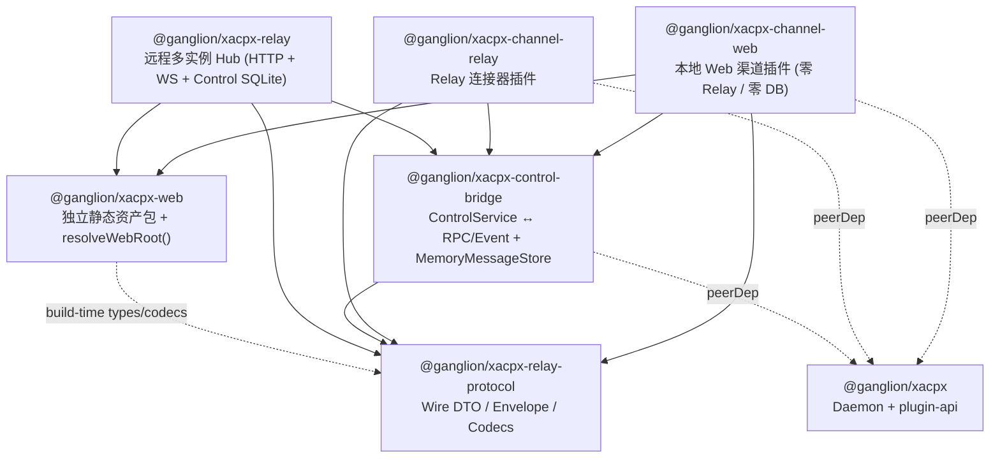

# Web 独立包剥离与本地 Web 插件技术方案

- **状态**：Draft（待确认 3 项架构决策，前置依赖 PR #616 合入 `main`）
- **日期**：2026-11-23
- **关联背景**：
  - 当前 Web 看板：`packages/relay-web`
  - 当前 Relay Hub：`packages/relay`
  - 当前 Relay 连接器：`packages/channel-relay`
  - 前置 PR：**PR #616**（`feat(relay): retire server-side message history, keep transcripts client-side`）

---

## 1. 背景与目标

### 1.1 背景

当前 xacpx 的 Web 看板（`packages/relay-web`）被定义为私有包（`"private": true`），在构建期直接拷贝进 `packages/relay/dist/relay-web` 随 `@ganglion/xacpx-relay` 打包发布。这意味着用户想要使用 Web 界面，必须部署并运行一套完整的 Relay Hub（外加 `channel-relay` 连接器、配对令牌、账号登录等远程多实例基础设施）。

对于只在本机使用 `xacpx` 的个人开发者而言，引入 Relay Hub 过于笨重。我们需要将 Web 界面剥离为独立依赖包，使 `@ganglion/xacpx-relay` 与全新的本地 Web 插件（`@ganglion/xacpx-channel-web`）共享同一套前端资产与交互体验。

### 1.2 核心目标

1. **剥离独立 Web 包**：将现有 Web 看板发布为独立 npm 包（推荐 `@ganglion/xacpx-web`），对外只暴露构建后的静态资产与路径定位入口，且**零运行时第三方依赖**。
2. **Relay 改为依赖 Web 包**：`@ganglion/xacpx-relay` 移除内嵌拷贝逻辑（`bundle:relay-web`），改为通过标准 npm 依赖消费 `@ganglion/xacpx-web`。
3. **同一份前端产物支持双模式**：Build once, serve everywhere——同一份静态 bundle 通过运行时能力探测同时支持 **Relay 多实例模式**与 **Local 单实例模式**，并对旧版 Relay 100% 向后兼容。
4. **落地本地 Web 渠道插件**：新增 `@ganglion/xacpx-channel-web`（`channel type: "web"`），在本地 daemon 进程内启动轻量 HTTP + WS 服务，**零 Relay 依赖、零数据库（基于 PR #616）**，开箱提供本地 Web 控制台。
5. **消除桥接代码重复**：抽离 `channel-relay` 中与 Relay 传输无关的 `PublicControlService ↔ relay-protocol` 桥接层，供 `channel-relay` 与 `channel-web` 共用。

### 1.3 非目标（Non-Goals）

- 不改造 `xacpx` core 的 `src/channels/` 边界（本地 Web 严格作为独立插件包 `packages/channel-web` 落地，符合 `AGENTS.md` 边界要求）。
- 不为 Relay 模式和 Local 模式分别构建两份前端 bundle。
- MVP 阶段不强制捆绑本地 RMUX Terminal 与本地 Desktop（RFB/VNC），留作 Phase 2 增量接入。

---

## 2. 现状盘点与 PR #616 前置影响

### 2.1 当前耦合点盘点

| 维度 | 现状位置 | 耦合表现 |
| :--- | :--- | :--- |
| 构建与分发 | `package.json` (`bundle:relay-web`)、`packages/relay-web/package.json` | `relay-web` 为 `private: true`，构建后被 `cpSync` 进 `packages/relay/dist/relay-web` |
| 静态路径定位 | `packages/relay/src/cli.ts` (`resolveBundledWebRoot`) | 硬编码查找 `cli.js` 同级 `relay-web/index.html` 或 `../../relay-web/dist` |
| 前端接口契约 | `packages/relay-web/src/api/{client,events}.ts`、`packages/relay/src/http/app.ts` | 共约 18 个 HTTP 路由 + `/ws` + `/desktop/observe`；核心业务已集中在 `POST /api/instances/:id/rpc` 与 `/ws`，但登录、邀请码、配对码、Web Push、Relay 版本检查等默认强假设存在 |
| 桥接逻辑 | `packages/channel-relay/src/control-bridge.ts`（1600+ 行）、`tool-presentation.ts`、`relay-interaction.ts` | 全部内聚在 `channel-relay` 包内，本地 Web 插件若直接复制将导致严重漂移 |
| 发布与验证脚本 | `scripts/release-lib.mjs`、`scripts/release.mjs`、`scripts/verify-publish.mjs`、`scripts/verify-stack.mjs` | 将 `packages/relay-web/**` 变更直接归属到 `relay` 包；验证脚本硬编码 `packages/relay/dist/relay-web` |

### 2.2 PR #616 对本方案的关键影响

**PR #616**（`feat(relay): retire server-side message history, keep transcripts client-side`）合入后，对本方案带来三项直接利好与约束：

1. **本地 Web 插件实现彻底 Zero-DB（无需 SQLite）**
   - PR #616 退役了 Relay Hub 的 SQLite `messages` 表，引入纯内存的 `MemoryMessageStore`（`packages/relay/src/stores/messages-memory.ts`，545 行：每会话 500 行环形缓冲、全局 10k 行预算、跨重启有序 ID）。
   - 该模块**仅依赖 `node:crypto` 和 `@ganglion/xacpx-relay-protocol`**，无任何 SQLite 或 Relay 耦合。
   - 聊天历史持久化由前端 IndexedDB（`session-tail-cache.ts`：每会话 1000 行 / 8 MB / 30 天 TTL，全局 64 MB LRU）承担，并以 daemon transcript 为真源。
   - 因此，`@ganglion/xacpx-channel-web` 无需自建任何本地 SQLite 数据库或落盘消息文件，直接复用 `MemoryMessageStore` 即可 100% 对齐前端 `chat.ts` 的历史拉取、分页与合流语义。
2. **`GET /api/config` 契约对齐**
   - PR #616 已将 `/api/config` 扩展为 `{ historyRetention: { mode: "client-side", days: 30, maxPerSession: 2000 } }`，且 `SettingsView.vue` 已根据 `historyRetention.mode === "client-side"` 渲染客户端历史说明。
   - 为避免与 `historyRetention.mode` 语义冲突，顶层宿主模式字段统一命名为 **`hostMode: "relay" | "local"`**。
3. **合入顺序约束**
   - PR #616 改动了 `packages/relay-web/src` 与 `packages/relay/src` 多个核心文件。本方案所有实施 PR（特别是 PR 1 目录/包迁移）**必须在 PR #616 合入 `main` 后再切分支执行**，避免重命名引发大面积冲突。

---

## 3. 目标架构与包依赖拓扑



### 包职责边界

| 包名 | 目录 | 类型 | 职责 |
| :--- | :--- | :--- | :--- |
| `@ganglion/xacpx-relay-protocol` | `packages/relay-protocol` | 协议包（已有） | 跨进程/网络 Wire DTO、Envelope 编解码、常量；保持零 `xacpx` 依赖 |
| `@ganglion/xacpx-web` | `packages/web`（见 §11 决策 1） | 静态资产包（新建/迁移） | 构建后的 Vue SPA + PWA 静态产物，导出 `resolveWebRoot()`；**`dependencies` 为空** |
| `@ganglion/xacpx-control-bridge` | `packages/control-bridge`（见 §11 决策 2） | 公共桥接包（新增） | `PublicControlService ↔ relay-protocol` RPC/事件映射、交互转换、工具展示、以及零依赖的 `MemoryMessageStore` / `compact-history` |
| `@ganglion/xacpx-relay` | `packages/relay` | 远程 Hub（改造） | 多实例网关、账号/令牌/邀请码/Web Push、依赖 `@ganglion/xacpx-web` 托管前端 |
| `@ganglion/xacpx-channel-relay` | `packages/channel-relay` | 渠道插件（改造） | 仅保留 Relay WS 连接、凭证存储、重连与状态镜像，RPC 分发委托给 `control-bridge` |
| `@ganglion/xacpx-channel-web` | `packages/channel-web` | 渠道插件（新增） | 本地单端口 HTTP+WS 服务，消费 `@ganglion/xacpx-web` 与 `control-bridge`，直连本机 `PublicControlService` |

---

## 4. `@ganglion/xacpx-web` 独立包设计

### 4.1 零运行时依赖原则

所有前端框架与 UI 库（`vue`、`pinia`、`vue-router`、`vue-i18n`、`@codemirror/*`、`mermaid`、`@novnc/novnc`、`@xterm/xterm`、`lucide-vue-next`、`markdown-it`、`dompurify` 等）以及构建期使用的 `@ganglion/xacpx-relay-protocol` 在 `vite build` 时均已打包为静态 JS/CSS/字体资源。

发布 `@ganglion/xacpx-web` 时，**所有前端包必须置于 `devDependencies`**，`dependencies` 保持为空对象 `{}`（或省略）：

- 避免用户在安装 `@ganglion/xacpx-relay` 或 `@ganglion/xacpx-channel-web` 时被牵连安装数十 MB 无用的前端 `node_modules`。
- `packages/web/package.json` 结构示例：

```json
{
  "name": "@ganglion/xacpx-web",
  "version": "0.1.0",
  "description": "Web dashboard static assets for xacpx (shared by relay hub and local web channel).",
  "license": "MIT",
  "type": "module",
  "main": "./index.js",
  "types": "./index.d.ts",
  "exports": {
    ".": {
      "types": "./index.d.ts",
      "default": "./index.js"
    }
  },
  "files": [
    "dist",
    "index.js",
    "index.d.ts",
    "README.md"
  ],
  "publishConfig": {
    "access": "public"
  }
}
```

### 4.2 Node 入口契约

在 `packages/web/index.js` 与 `packages/web/index.d.ts` 提供稳定、与全局 bin symlink / pnpm / bun / npm 均兼容的资产定位接口：

```ts
// packages/web/index.js
import { existsSync } from "node:fs";
import { dirname, join } from "node:path";
import { fileURLToPath } from "node:url";

export function resolveWebRoot() {
  const dir = join(dirname(fileURLToPath(import.meta.url)), "dist");
  if (!existsSync(join(dir, "index.html"))) {
    throw new Error(`@ganglion/xacpx-web: built assets missing at ${dir}`);
  }
  return dir;
}

export function tryResolveWebRoot() {
  const dir = join(dirname(fileURLToPath(import.meta.url)), "dist");
  return existsSync(join(dir, "index.html")) ? dir : undefined;
}
```

### 4.3 Relay Hub 侧接入改造

1. `packages/relay/package.json` 新增 `"@ganglion/xacpx-web": "^0.1.0"`。
2. `packages/relay/src/cli.ts` 的 `resolveBundledWebRoot()` 改为优先调用 `tryResolveWebRoot()`（来自 `@ganglion/xacpx-web`），仅当 CLI 传入 `--web-root <dir>` 时覆盖。
3. 根 `package.json`：
   - 删除 `bundle:relay-web` 拷贝脚本；
   - `build:relay` 的 `bun build` 增加 `--external @ganglion/xacpx-web`；
   - 保留 `packages/relay/src/http/app.ts` 的缓存策略（`/assets/*` 非 HTML 响应设 `public, max-age=31536000, immutable`；HTML/SW/manifest 设 `no-cache`；SPA fallback 到 `index.html`）。

---

## 5. 前端运行时多模式适配（Build Once, Serve Everywhere）

### 5.1 运行时配置契约（扩展 `GET /api/config`）

前端启动时先请求未鉴权即可访问的 `GET /api/config`（注意：Relay 侧需确保 `/api/config` 在登录前也能返回非敏感的 `hostMode` / `auth` / `capabilities`，或保留鉴权后返回完整配置，登录前由 `/api/config` 返回最小公开配置）：

```ts
export interface WebRuntimeConfig {
  /** 宿主形态：远程多实例 Relay Hub 或本机单实例 Local Web 插件 */
  hostMode: "relay" | "local";
  auth: {
    /** false 时浏览器无需登录页直接进入看板 */
    required: boolean;
    mode: "token" | "none";
  };
  capabilities: {
    multiInstance: boolean;
    pairing: boolean;
    invites: boolean;
    webPush: boolean;
    relayUpdate: boolean;
    agentDirectory: boolean;
    terminal: boolean;
    desktop: boolean;
  };
  /** local 模式下固定为 "local"，便于前端启动即锁定实例 */
  defaultInstanceId?: string;
  /** 与 PR #616 对齐：mode 始终为 "client-side" */
  historyRetention: {
    mode: "client-side";
    days: number;
    maxPerSession: number;
  };
}
```

**向后兼容降级规则**：若前端连接旧版 Relay（响应中不含 `hostMode` 或未鉴权返回 401），前端自动按如下默认值降级，确保零破坏性：

```ts
const LEGACY_RELAY_FALLBACK: WebRuntimeConfig = {
  hostMode: "relay",
  auth: { required: true, mode: "token" },
  capabilities: {
    multiInstance: true,
    pairing: true,
    invites: true,
    webPush: true,
    relayUpdate: true,
    agentDirectory: true,
    terminal: true,
    desktop: true,
  },
  historyRetention: { mode: "client-side", days: 30, maxPerSession: 2000 },
};
```

### 5.2 路由守卫与认证状态机

涉及文件：`src/router/index.ts`、`src/stores/auth.ts`、新增 `src/stores/runtime.ts`。

| 模式组合 | 路由守卫行为 | `authStore` 行为 |
| :--- | :--- | :--- |
| `hostMode === "relay"` | 保持现有逻辑：未登录跳转 `/login`；允许 `/invite/:code` | 登录/登出走 `/api/login`、`/api/logout` 与 Web Push 订阅所有权转移 |
| `hostMode === "local"` 且 `auth.required === false` | 访问 `/`、`/settings` 直接放行；访问 `/login` 或 `/invite/*` 重定向至 `/` | `fetchMe()` 返回 `{ username: "local" }`；**跳过** Web Push 订阅转移/释放逻辑；不显示登出按钮 |
| `hostMode === "local"` 且 `auth.required === true` | 未登录跳转 `/login`；访问 `/invite/*` 重定向至 `/login` | 走 `/api/login`、`/api/logout`（使用本地配置的 token 换 HttpOnly cookie）；跳过 Web Push 逻辑 |

### 5.3 UI 与 Store 条件渲染清单

| 位置 | Relay 模式 | Local 模式 |
| :--- | :--- | :--- |
| 左侧实例树（`DashboardView.vue` / `Sidebar`） | 展示多实例列表、在线状态点、添加实例按钮、重命名/删除实例菜单 | 自动选中 `defaultInstanceId`（`"local"`），隐藏「添加实例」「配对码」「删除实例」入口 |
| 顶部/设置页登出 | 展示登出按钮 | `auth.required === false` 时隐藏 |
| `SettingsView.vue` | 展示实例接入（`AddInstanceDialog`）、Relay 版本/更新提示、桌面通知（Web Push）、历史保留说明、外观/语言/群组自动协作 | 隐藏实例接入、Relay 更新提示、Web Push 开关；保留历史保留说明（复用 PR #616 `client-side` 文案）、外观、主题、语言、群组自动协作 |
| `LoginView.vue` | 提示 `xacpx-relay add token` | `hostMode === "local"` 时展示本地访问令牌文案，不提及 `xacpx-relay` |
| `stores/instances.ts` | 轮询/拉取 `/api/agent-directory` 与多实例列表 | `capabilities.agentDirectory === false` 时跳过 `/api/agent-directory` 请求，避免无意义 404 |
| `i18n/messages/{en,zh-CN}.ts` | 保持现有文案 | 同步新增 `local.*` 文案，确保 `i18n-parity.test.ts` 全绿 |

---

## 6. 公共层抽取策略（`@ganglion/xacpx-control-bridge`）

为避免 `channel-relay`、`channel-web` 和 `relay` 三端复制粘贴核心逻辑，抽取独立共享包 `@ganglion/xacpx-control-bridge`（位于 `packages/control-bridge`）：

### 6.1 抽取模块清单

1. **Daemon 控制桥接（来自 `packages/channel-relay/src/`）**：
   - `control-bridge.ts`：`createControlBridge()`、`subscribeControlEvents()`、`dispatchControlEvent()`、`CONTROL_RPC_TIMEOUT_MS`、`scheduledTaskToDto()`、`orchestrationTaskToDto()`
   - `tool-presentation.ts`：`toolUseEventToStepDto()`
   - `relay-interaction.ts`：`relayFieldsFrom()`、`parseRelayInteractionOutcome()`
2. **纯内存消息缓冲与投影（来自 `packages/relay/src/`，PR #616 后）**：
   - `MemoryMessageStore`（源自 `packages/relay/src/stores/messages-memory.ts`）
   - `compact-history.ts`（源自 `packages/relay/src/http/compact-history.ts`）
   - 两者均只依赖 `node:crypto` 与 `@ganglion/xacpx-relay-protocol`，零 DB 依赖，天然适合被 `relay` 和 `channel-web` 共同导入。
3. **Phase 2 扩展模块**：
   - `terminal-bridge.ts`、`terminal/*`（RMUX 驱动与运行时）
   - `desktop/*`（RFB/VNC 探测与隧道）

### 6.2 依赖约束

- `@ganglion/xacpx-control-bridge` 依赖 `@ganglion/xacpx-relay-protocol`，对 `xacpx` 仅声明 `peerDependencies`（`optional: true`）与类型引用，不反向依赖 `relay` 或任何特定渠道插件。
- `channel-relay` 改造后直接从 `@ganglion/xacpx-control-bridge` 导入上述符号，对外导出的 public API 保持不变。

---

## 7. 本地 Web 渠道插件设计（`@ganglion/xacpx-channel-web`）

### 7.1 插件定义与 CLI 体验

在 `packages/channel-web` 实现标准 `XacpxPlugin`：

- 插件名：`@ganglion/xacpx-channel-web`
- 渠道类型：`web`
- 在 `src/plugins/known-plugins.ts` 中注册，支持内置发现与安装提示：
  ```bash
  xacpx channel add web
  xacpx channel add web --port 7890 --host 127.0.0.1
  xacpx channel add web --host 0.0.0.0 --port 7890 --token <secret>
  ```
- 配置 Schema（存入 `~/.xacpx/config.json` 对应 channel 配置）：
  ```ts
  export interface WebChannelConfig {
    /** 监听地址，默认 "127.0.0.1" */
    host: string;
    /** 监听端口，默认 7890；传 0 表示随机端口并在日志中输出实际 URL */
    port: number;
    /** 可选访问令牌；当 host 非 loopback 时必填（否则拒绝启动） */
    token?: string;
    /** 本地实例显示名称，默认 os.hostname() */
    name?: string;
    /** Phase 2 预留 */
    terminal?: { enabled?: boolean };
    desktop?: { enabled?: boolean; port?: number };
  }
  ```

### 7.2 单端口服务端架构（Hono + `@hono/node-server` + `ws`）

在 `WebChannel.start(input: ChannelStartInput)` 时启动单端口 HTTP + WebSocket 服务（关闭时在 `stop()` 中优雅释放所有 WS 连接与 HTTP server）：

| 路由 / 通道 | 处理逻辑 |
| :--- | :--- |
| `GET /*` | 通过 `@ganglion/xacpx-web` 的 `resolveWebRoot()` 提供静态资源 + SPA fallback + `Cache-Control` 策略 |
| `GET /api/config` | 返回 `hostMode: "local"`、本地 `auth` 状态、本地 `capabilities`、`defaultInstanceId: "local"`、`historyRetention: { mode: "client-side", days: 30, maxPerSession: 2000 }` |
| `GET /api/me` | 无 token 模式直接返回 `{ username: "local" }`；有 token 模式校验 HttpOnly session cookie |
| `POST /api/login` / `POST /api/logout` | 有 token 模式校验 `token`（常量时间比较 `timingSafeEqual`）签发/撤销内存会话 cookie；无 token 模式返回 `200 { username: "local" }` / `204` |
| `GET /api/instances` | 返回固定单元素：`[{ id: "local", name, online: true, capabilities }]` |
| `PATCH /api/instances/:id` | 仅允许重命名 `"local"`（可选持久化或内存态） |
| `POST /api/instances/:id/rpc` | 校验 `id === "local"`，直接调用 `control-bridge` 分发到 `input.control`（`PublicControlService`）；对 `MSG.prompt` 等同步写入 `MemoryMessageStore` 与 `ActiveTurnTracker` |
| `GET /api/active-turns` | 从进程内 `ActiveTurnTracker` 返回当前活跃 turn、usage、commands、conversationCommands 快照 |
| `GET /api/instances/:id/sessions/:alias/messages` | 由 `MemoryMessageStore` + `compact-history` 响应（含 `view=compact` / `view=pending` / 单条 `/:messageId`） |
| `WS /ws` | 轻量 `LocalWebGateway`：把 `subscribeControlEvents` 产生的 `control-event`、`notice`、`interaction-request` 等封装为 `WebServerEvent` 扇出到所有已连上的本机浏览器 tab |

### 7.3 进程内状态流转与交互闭环

1. **事件与消息流**：
   - `WebChannel.start()` 订阅 `subscribeControlEvents(input.control, ...)`；
   - 收到 `turn-output` / `turn-finished` / `session-usage` / `session-commands` / `conversation-*` 事件时：
     - 更新内存 `ActiveTurnTracker`；
     - 累积并 flush 到 `MemoryMessageStore`（对齐 Relay `server.ts` 行为）；
     - 通过 `LocalWebGateway` 广播给所有 `/ws` 浏览器连接。
2. **权限审批与 Elicitation 闭环**：
   - `WebChannel` 实现 `MessageChannelRuntime` 的 `requestPermission` 与 `requestElicitation`（同时声明 `elicitationModes`）；
   - 触发时生成 `InteractionRequestDto`，存入内存 `InteractionRegistry`（带 `expiresAt` 超时定时器），通过 `/ws` 推送到浏览器；
   - 浏览器通过 `POST /api/instances/local/rpc`（`MSG.interactionRespond`）提交结果后，直接 resolve 对应 Promise 返回 core；
   - `WebChannel.stop()` 时清理所有挂起请求并按取消/超时收敛，防止阻塞 daemon 退出。

### 7.4 Phase 2 扩展（本地 Terminal 与 Desktop）

- **Terminal**：复用 `DefaultRelayTerminalRuntime` + `rmux-bridge` 可选平台包，在 `/ws` 接收 `terminal-open` / `terminal-input` / `terminal-resize` / `terminal-close` 帧，直接在本机运行 PTY，无需跨网转发。
- **Desktop**：在本机直接探测 loopback VNC server，并在同端口暴露 `WS /desktop/observe`，前端 noVNC 零改动即可连接。

---

## 8. 安全设计（本地服务必选防线）

即使不经公网，本机监听在 `127.0.0.1` 的 HTTP/WS 服务仍面临来自浏览器任意第三方网页的 **DNS Rebinding、CSRF 与 CSWSH（Cross-Site WebSocket Hijacking）** 攻击。`channel-web` 必须强制实施以下边界：

1. **Loopback 优先与 Fail-Closed 绑定策略**
   - 默认 `host = "127.0.0.1"`。
   - 若用户将 `host` 配置为非 loopback 地址（如 `0.0.0.0`、局域网 IP）且未设置非空 `token`，**拒绝启动并给出明确错误提示**（禁止无鉴权暴露局域网）。
2. **`Host` 头白名单校验（防 DNS Rebinding）**
   - 每个 HTTP 请求与 WS Upgrade 均校验 `Host` 头，仅放行 `127.0.0.1:<port>`、`localhost:<port>`、`[::1]:<port>`（或用户显式配置的 `<host>:<port>`），其余一律返回 `403 Forbidden`。
3. **`Origin` 头严格同源校验（防 CSRF / CSWSH）**
   - 所有变更型 HTTP 请求（`POST` / `PUT` / `PATCH` / `DELETE`）及 `/ws` Upgrade 握手：若请求携带 `Origin` 头，必须严格匹配允许的本机同源集合（`http(s)://<allowed-host>:<port>`），否则拒绝（`403`）。
   - 同时对 `/api/*` 变更请求要求 `Content-Type: application/json`（阻止简单表单 CSRF）。
4. **会话 Cookie 与令牌安全**
   - 启用 `token` 时，使用 `crypto.timingSafeEqual` 校验；签发的 Cookie 强制设置 `HttpOnly; SameSite=Strict; Path=/`。
   - 令牌与 Cookie 值严禁写入 `~/.xacpx/runtime/app.log`。

---

## 9. 构建、测试与发布流水线改造

### 9.1 根 `package.json` 脚本调整

- 新增 `build:web`（或保留 `build:relay-web` 别名指向它）：`build:relay-protocol` → 清理 `packages/web/dist` → `vite build` → 校验 `dist/index.html` 与 `index.js`。
- 新增 `build:control-bridge`：`build:plugin-api` → 构建 `packages/control-bridge/dist` + `tsc` 类型声明。
- 修改 `build:relay`：移除 `bundle:relay-web` 拷贝步骤，在 `bun build` 中增加 `--external @ganglion/xacpx-web --external @ganglion/xacpx-control-bridge`。
- 修改 `build:channel-relay`：增加 `--external @ganglion/xacpx-control-bridge`。
- 新增 `build:channel-web`：依赖 `build:plugin-api`、`build:control-bridge`、`build:web`，打包 `packages/channel-web`（外部化 `xacpx`、`@ganglion/xacpx-web`、`@ganglion/xacpx-control-bridge`、`@ganglion/xacpx-relay-protocol`、`hono`、`@hono/node-server`、`ws`）。
- 更新 `build:packages` 纳入上述全部包。

### 9.2 Release 自动化波次（`scripts/release-lib.mjs` & `scripts/release.mjs`）

遵循 `docs/release-automation.md` 的静态波次规则。PR 1 落地的是 4 波；`control-bridge` 与 `channel-web` 在后续 PR 加入对应波次：

| 波次 | 发布包 | 说明 |
| :--- | :--- | :--- |
| Wave 1 | `@ganglion/xacpx-relay-protocol` | 底层协议 |
| Wave 2 | `@ganglion/xacpx-web` | 看板静态资产（tag `web-v*`）。后续的 `control-bridge` 也在这一波 |
| Wave 3 | `@ganglion/xacpx-relay`、`@ganglion/xacpx-channel-relay` | hub 依赖已发布的看板。看板发版时 hub 跟着重发，使依赖范围点名该版本 |
| Wave 4 | `@ganglion/xacpx`、其余 channel 包 | 与看板无安装顺序耦合。后续的 `channel-web` 在这一波 |

同步更新脚本与 CI：
- `scripts/release-lib.mjs`：
  - 将 `web` 从 `relay` 的 `sourcePaths` 拆分出来作为独立发布单元；
  - 将 `control-bridge`、`channel-web` 加入 `PROTOCOL_CONSUMERS` 以及 core `minXacpxVersion` / `peerDependencies.xacpx` 联动表。
- `scripts/verify-publish.mjs`：
  - 新增 `@ganglion/xacpx-web` 检查（必填 `dist/index.html`、`index.js`、`index.d.ts`，且断言 `dependencies` 为空）；
  - 移除 `@ganglion/xacpx-relay` 对 `dist/relay-web/index.html` 的旧检查；
  - 新增 `@ganglion/xacpx-control-bridge` 与 `@ganglion/xacpx-channel-web` 的发布产物检查。
- `scripts/verify-stack.mjs` 与 `scripts/verify-group-trace.mjs`：
  - 移除硬编码的 `packages/relay/dist/relay-web`，改用 `packages/web/dist` 或省略 `--web-root` 以验证默认依赖解析。
- `.github/workflows/`：
  - 新增 `publish-web.yml`、`publish-control-bridge.yml`、`publish-channel-web.yml`；
  - 更新 `test.yml` 跑通 `channel-web` 与 `control-bridge` 单测及 `web` Vitest/E2E。

---

## 10. 分阶段实施路线

> **前置条件**：等待 **PR #616** 合入 `main`，基于最新 `main` 依次推进以下 4 个独立 PR。

### PR 1：剥离独立 Web 包 + Relay 改为依赖

- **改动**：
  - 将 `packages/relay-web` 转为可公开发布的 `@ganglion/xacpx-web`（前端依赖迁入 `devDependencies`，新增 `index.js`/`index.d.ts`）。
  - `packages/relay` 改为依赖 `@ganglion/xacpx-web`，移除 `bundle:relay-web` 拷贝。
  - 更新 `release-lib.mjs`、`release.mjs`、`verify-publish.mjs`、`verify-stack.mjs`、`verify-group-trace.mjs` 与发布 workflow。
- **验收标准**：
  - `bun run build:packages`、`npm test`、`bun run test:web`、`node ./scripts/verify-publish.mjs` 全绿；
  - `node ./scripts/verify-stack.mjs up --router-ready` 正常启动并可打开看板；
  - `npm pack --dry-run` 确认 `@ganglion/xacpx-web` 无 runtime `dependencies`、`@ganglion/xacpx-relay` 不再内嵌静态文件副本。

### PR 2：前端多模式适配（`hostMode` + `capabilities`）

- **改动**：
  - Relay `GET /api/config` 输出 `hostMode: "relay"` 与 `capabilities`（保留 PR #616 的 `historyRetention` 结构）。
  - 前端新增 `runtimeStore`，改造 `router/index.ts`、`stores/auth.ts`、`stores/instances.ts`、`DashboardView.vue`、`SettingsView.vue`、`LoginView.vue` 与双语 i18n。
- **验收标准**：
  - 新增 Vitest 单测覆盖：① `hostMode: "local"` 无鉴权自动进入；② `hostMode: "local"` 带 token 登录；③ 旧版 Relay 缺失 `hostMode` 字段时的向后兼容降级；④ `i18n-parity.test.ts` 全绿。

### PR 3：抽取共享层 `@ganglion/xacpx-control-bridge`

- **改动**：
  - 抽取 `control-bridge.ts`、`tool-presentation.ts`、`relay-interaction.ts` 及 `MemoryMessageStore` / `compact-history.ts` 到 `packages/control-bridge`。
  - `packages/channel-relay` 与 `packages/relay` 切换至共享包导入。
- **验收标准**：
  - `tests/unit/packages/channel-relay` 与 `tests/unit/packages/relay` 全部现有测试零回归；
  - `npx tsc --noEmit` 与 `bun run build:packages` 全绿。

### PR 4：实现本地 Web 渠道插件 `@ganglion/xacpx-channel-web`（MVP）

- **改动**：
  - 新增 `packages/channel-web`（单端口 Hono + WS、复用 `control-bridge` + `MemoryMessageStore` + `@ganglion/xacpx-web`、内存 `ActiveTurnTracker` 与 `InteractionRegistry`、Host/Origin/Loopback 安全校验）。
  - 注册到 `src/plugins/known-plugins.ts` 并补齐文档与单测/集成测试。
- **验收标准**：
  - 本地运行 `xacpx channel add web` + `xacpx run` 后，无需启动任何 Relay 即可在 `http://127.0.0.1:7890` 完整使用：会话创建/切换/聊天流、权限与 Elicitation 审批、文件树/Git、任务面板、Direct Bot / Group；
  - 自动化测试验证：跨站 `Origin` 请求返回 403、伪造 `Host` 返回 403、非 loopback 未配 token 拒绝启动；
  - 文档门禁 `node ./scripts/sync-docs-site.mjs check` 与 `node ./scripts/check-doc-i18n.mjs` 全绿。

### 后续迭代（Phase 2）

- 为 `channel-web` 补齐本地 RMUX Terminal 与本地 Desktop（RFB/VNC）接入。

---

## 11. 待确认决策项

在启动 PR 1 前，需确认以下 3 项：

1. **包名与目录名**
   - **选项 A（推荐）**：包名 `@ganglion/xacpx-web`，目录从 `packages/relay-web` 重命名为 `packages/web`（语义彻底去 Relay 化）。
   - **选项 B**：保留目录 `packages/relay-web` 与包名 `@ganglion/xacpx-relay-web`，仅去掉 `private: true` 发布（迁移成本略低，但本地插件依赖 `relay-web` 语义不直观）。
2. **`control-bridge` 是否独立发包**
   - **选项 A（推荐）**：独立为 `@ganglion/xacpx-control-bridge`（`channel-relay`、`channel-web`、`relay` 三端零代码重复）。
   - **选项 B**：暂不新建包，先由 `channel-web` 内部实现并在后续再抽离（前期快，但 PR 4 会复制大量 `control-bridge.ts` 逻辑）。
3. **本地 Web 插件 MVP 范围**
   - **选项 A（推荐）**：MVP 覆盖核心会话聊天、权限/Elicitation、文件/Git、任务面板、Direct Bot/Group；Terminal（RMUX）与 Desktop（VNC）放 Phase 2。
   - **选项 B**：MVP 同步带上本地 RMUX Terminal。
