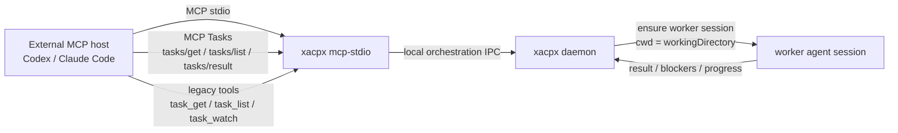
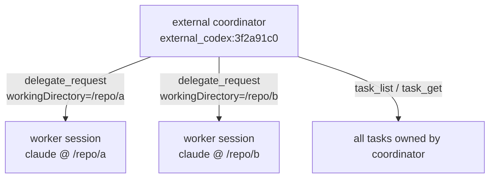
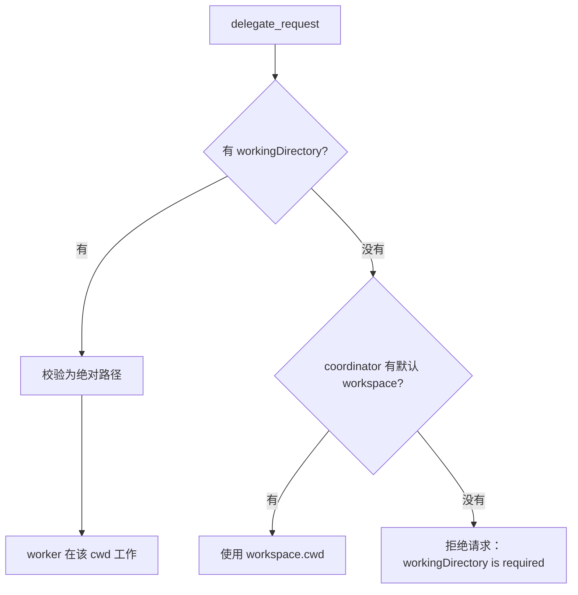
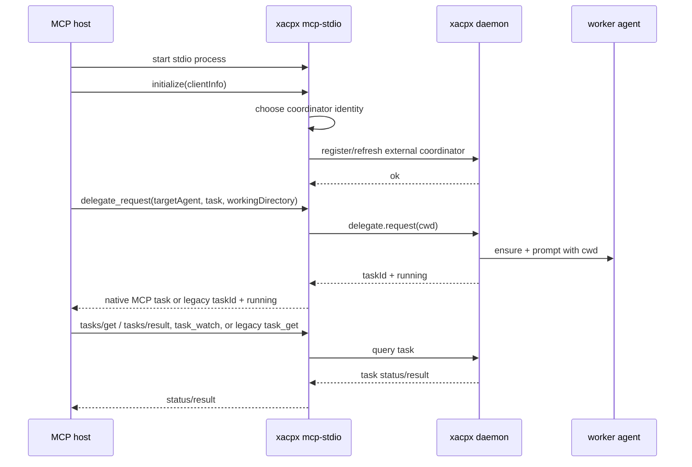

# External MCP coordinator

`xacpx mcp-stdio` 是标准 MCP stdio server。Codex、Claude Code 等外部 MCP host 可以通过它调用 xacpx 的编排工具，例如 `delegate_request`、`task_get`、`task_list`、`task_watch`。如果 host 支持 MCP Tasks，`delegate_request` 和 `task_watch` 也支持原生 task execution：call now、fetch later。

> 说明：定时任务的自然语言管理工具（`scheduled_create` / `scheduled_list` / `scheduled_cancel`）只给 xacpx 当前对话会话内部使用，用于复用当前聊天路由和群聊权限；外部 `xacpx mcp-stdio` 不会暴露这些工具。

核心目标：让“当前正在使用的 coding agent”成为 coordinator，把子任务派给其他 agent，同时让被派出去的 worker 明确知道自己应该在哪个目录工作。

## Agent 消息与任务编排

MCP server 提供两套互相独立的协作模型：

- 当另一个 Agent 拥有一个任务、并应当最终产出结果时，用 `delegate_request` 和 `task_*` 系列工具。
- 当一个已在运行的 Agent 只需要一次对端更新、并继续自己的流程时，用 `agent_list` 和 `agent_send`。

`agent_list` 只返回当前 MCP binding 已授权、且具备接收能力的端点。在初始本地落地范围内，这指的是同一个 coordinator 下的内部 coordinator 与 worker；发送方自身被排除。handle 是不透明的——把返回的 `handle` 原样作为 `agent_send.to` 传回，不要解析它。公开的端点数据从不包含 cwd、PID、OS user、原始 session handle、socket 路径或 provider 原生 session id。

`agent_send` 是单向的，目标 runtime 接收投递后即返回。它从不等待目标模型理解、完成或回复：

```json
{
  "to": "<handle from agent_list>",
  "message": "The auth schema changed; update the refresh-token branch.",
  "mode": "auto"
}
```

本地 queue-first 版本返回：

```json
{
  "messageId": "msg_...",
  "status": "queued",
  "modeUsed": "queue",
  "route": "local"
}
```

`auto` 和 `queue` 都走目标 acpx session 的下一轮队列；`auto` 从不打断。自 Peer Interrupt Delivery v0.4 起，对托管逻辑 session 显式使用 `mode: "interrupt"` 是一个由 xacpx 托管的 **取消请求 + 真实落定 + 优先下一轮** 原语：目标 `TurnQueue` 预留一个 interrupt slot，通过自己的控制平面（AbortController signal + transport cancel，恰好一次）请求取消当前轮次，等待该轮次真正落定，然后让这条打断消息先于普通 FIFO 队列执行。xacpx 保证 lane 顺序且不重叠；底层 runtime 是否真的提前终止活跃的模型轮次由传输层决定——前驱可能以 `cancelled` 或 `completed` 收尾，xacpx 从不会把自然完成改写为取消。不需要 provider 原生 steering 支持。只有声明 `interrupt: true` 的端点（托管逻辑 session）会接受它；worker、external coordinator 和能力已过期的目标会在任何取消之前 fail closed，报 `TARGET_NOT_INTERRUPTIBLE`。已有一个 interrupt 待处理时，再发一个不同的 interrupt 会被拒绝，报 `MESSAGE_QUEUE_FULL`；同一条消息的重复重试会去重。`steer` 仍要求 provider 原生 live-input 支持，且从不会静默降级。离线 store-and-forward 不属于 `agent_send` 的范畴。

目标端会看到一条转义后的 `<xacpx-message>` 信封，其中带服务端派生的 sender handle 和 message id。如果 `replyable="true"`，它可以用一次新的 `agent_send` 调用回复，并把 `replyTo` 设为收到的 id。回复是可选的；Agent 不应制造确认回环。外部 MCP host 可以发送，但标准 MCP 不允许 xacpx 把输入注入回该 host，因此 external coordinator 端点不是接收目标，来自它们的消息使用 `replyable="false"`。

## 一句话模型

- **MCP host / 当前 agent**：coordinator，负责拆任务和看结果。
- **`xacpx mcp-stdio`**：很薄的 stdio shim，只负责把 MCP tool call 转成 xacpx daemon 的本地 RPC。
- **xacpx daemon**：真正保存 coordinator、task、worker binding 等编排状态。
- **Agent Message Router**：推导可信发送方、解析一个已授权端点、强制执行 FIFO 与上限，并返回一条实时投递回执，且不创建 Task。
- **worker agent**：被 `delegate_request` 派出去的 Claude / Codex / opencode 会话。
- **`workingDirectory`**：任务级工作目录。它决定 worker 在哪里工作，不决定 coordinator identity。



## 安全：信任边界是用户账号

编排 IPC 端点自身不做任何认证。访问控制完全基于文件系统：

- 在 macOS / Linux 上，daemon 把 runtime 目录（`~/.xacpx/runtime`）保持在 `0700`，把 unix socket（`orchestration.sock`）保持在 `0600`，因此只有所属用户（和 root）能连接。
- 在 Windows 上，端点是一个命名管道，依赖默认管道 DACL，把访问限制给创建它的用户/会话。

后果：**任何以你的用户账号运行的进程都能驱动你的 agent** —— 用任意工作目录派发 prompt、列出任务，或向一个托管 session 注入一条已授权的对端消息。这与 `ssh-agent` 或 rootless Docker 的立场相同：同一用户 = 可信，其他用户 = 被操作系统拒绝。没有 per-process token 或对端凭据检查，因为同一用户的攻击者反正也能读到任何这类 token。不要放宽 `~/.xacpx/runtime` 的权限，也不要在共享账号上运行 daemon。

## MCP Tasks 进展与输入请求

支持 MCP Tasks 的 host 应优先用 task-augmented `tools/call` 调用 `delegate_request`：

1. `delegate_request` 立即返回 native task handle。
2. 用 `tasks/get` 或 `tasks/list` 轮询；`statusMessage` 会包含任务摘要，以及 worker 输出的最新 `[PROGRESS] ...` 进展。也可以用 task-augmented `task_watch` 创建一个后台 watcher：watcher 自己是一个 native MCP task，达到下一条事件、需处理状态或 terminal 后，通过 `tasks/result` 取回 watch 结果。
3. 任务进入 `input_required` 时，调用 `tasks/result` 会立即返回一个下一步操作包并结束本次 result stream，不会一直阻塞等待 terminal。client 应按包里的建议调用 `task_get` 查看详情，再调用 `task_approve` / `task_cancel`（取消一个尚未批准的任务即拒绝）、`coordinator_answer_question` 或 `coordinator_review_contested_result`；处理后继续 `tasks/get` / `tasks/result`。
4. 任务进入 `completed` / `failed` / `cancelled` 后，再调用 `tasks/result` 获取最终结果。

不支持 MCP Tasks 的 host 使用兼容工具：`delegate_request` → `task_get` / `task_list` / `task_watch` / `task_cancel`。`task_watch` 是推荐的长轮询入口：它会阻塞到下一条事件、任务需要处理、任务结束或超时，并返回 `events` 和 `nextAfterSeq`；用返回的 `nextAfterSeq` 作为下一次 `afterSeq` 继续监听。`task_watch` 超时只表示“仍在运行”，再次调用即可继续等待，也可改用 `task_get` 查看一次性快照。

## 最小配置

先启动 daemon：

```bash
xacpx start
xacpx status
```

然后把 MCP server 配到外部 host：

```json
{
  "mcpServers": {
    "xacpx": {
      "command": "xacpx",
      "args": ["mcp-stdio"]
    }
  }
}
```

这时不需要 `--workspace`。xacpx 会给这个 MCP 子进程生成一个进程级 external coordinator identity，例如：

```text
external_codex-mcp-client:3f2a91c0
```

这个 identity 只表示“这个 MCP 子进程代表哪个 coordinator”，不绑定任何目录。

## 委派任务时传 workingDirectory

外部 MCP host 调用 `delegate_request` 时，应传入当前项目的绝对路径：

```json
{
  "targetAgent": "claude",
  "task": "审查当前改动，找出 3 个高风险点",
  "workingDirectory": "/absolute/path/to/repo"
}
```

Windows 示例：

```json
{
  "targetAgent": "claude",
  "task": "审查当前改动，找出 3 个高风险点",
  "workingDirectory": "C:\\path\\to\\your\\repo"
}
```

要求：

- `workingDirectory` 必须是非空绝对路径。
- 这个路径不要求提前注册为 xacpx workspace。
- xacpx 不用 MCP roots 猜目录，也不会用 daemon 或 MCP 子进程的 `process.cwd()` 兜底。
- 如果 external coordinator 没有默认 workspace，`delegate_request` 不传 `workingDirectory` 会失败。

这是故意的：派遣任务时必须确定 worker 到底在哪里工作，不能靠不确定的 host 行为推断。

## 为什么不把 path 放进 coordinator identity

coordinator identity 和 worker cwd 是两个不同问题：

| 概念 | 作用 | 是否包含 path |
| --- | --- | --- |
| external coordinator identity | 标识“哪个 MCP host / MCP 子进程在当主控” | 默认不包含 |
| `workingDirectory` | 标识“这次派出去的 worker 到哪里工作” | 是 |
| worker session | 标识某个 target agent 在某个 coordinator + cwd 下的工作会话 | 会按 cwd 区分 |

如果把 path 放进 coordinator identity，会有两个问题：

1. 同一个 Codex / Claude Code 会话想派 agent 去另一个目录时，会被迫变成另一个 coordinator。
2. `task_get`、`task_list`、`task_watch` 这类只和 coordinator 相关的查询也会被 path 污染。

所以 xacpx 的规则是：

- coordinator identity 表示主控身份。
- `workingDirectory` 表示任务执行位置。
- worker session 会按 cwd 区分，避免同一个 coordinator 在不同目录派同一个 agent 时互相抢会话。



## 多开 Codex / Claude Code 会不会冲突

默认不会共用同一个 external coordinator。

不传 `--coordinator-session` 时，每个 `xacpx mcp-stdio` 进程会生成一个进程级 identity：

```text
external_<client-name>:<process-instance-id>
```

所以你在不同目录打开多个 Codex / Claude Code，通常每个 MCP stdio 子进程都会是独立 coordinator。它们可以分别在自己的 `workingDirectory` 下派任务。

如果你显式传了同一个 `--coordinator-session`，那就是你主动要求多个 MCP host 共享同一个 coordinator identity。只有在你确实想共享任务列表和编排上下文时才这样做。

## Windows 配置示例

不要把 `node C:\path\to\xacpx\dist\cli.js` 整串写进 `command`。很多 MCP host 会把 `command` 当成文件名执行，从而报：

```text
文件名、目录名或卷标语法不正确。 (os error 123)
```

正确写法：`command` 只放可执行文件；脚本路径和参数放到 `args`。

```json
{
  "type": "stdio",
  "command": "C:\\Program Files\\nodejs\\node.exe",
  "args": [
    "C:\\path\\to\\xacpx\\dist\\cli.js",
    "mcp-stdio"
  ]
}
```

如果全局安装了 `xacpx`，并且 MCP host 能找到它，也可以：

```json
{
  "type": "stdio",
  "command": "xacpx",
  "args": ["mcp-stdio"]
}
```

## 可选：显式 coordinator session

默认进程级 identity 适合大多数场景。如果你希望 MCP host 重启后继续使用同一个 coordinator identity，可以显式指定：

```json
{
  "mcpServers": {
    "xacpx": {
      "command": "xacpx",
      "args": ["mcp-stdio", "--coordinator-session", "codex:daily-review"]
    }
  }
}
```

效果：

- `task_list` 会看到这个固定 coordinator 之前留下的任务。
- 多个 MCP host 如果配置同一个 `--coordinator-session`，会共享同一组任务。
- 仍然建议每次 `delegate_request` 显式传 `workingDirectory`。

注意：不要随手让多个活跃 host 共用同一个 coordinator identity。除非你明确想共享编排上下文，否则默认进程级 identity 更安全。

## 可选：默认 workspace（兼容模式）

`--workspace` 仍然可用，但它只是给这个 MCP server 提供一个默认工作区，不是推荐的外部 MCP 配置方式：

```bash
xacpx mcp-stdio --workspace backend
```

这要求 `backend` 已经存在于 `~/.xacpx/config.json`：

```bash
cd /absolute/path/to/repo
xacpx workspace add backend
```

之后如果 `delegate_request` 没传 `workingDirectory`，xacpx 会使用 workspace `backend` 的 cwd。

这适合旧配置或非常固定的单仓库 MCP 配置；如果你经常在不同项目目录打开 Codex / Claude Code，建议不要在 MCP 启动参数里绑定 workspace，而是在 tool call 里传 `workingDirectory`。

## 为什么不依赖 MCP roots 或 process.cwd()

有些 MCP host 支持 roots，有些不支持；有些会返回多个 roots；有些 roots 只表示“打开的文件夹”，不一定等于当前 agent 真正要工作的目录。

`process.cwd()` 也不是可靠契约：它取决于 MCP host 如何启动 stdio server。某些 host 会在项目目录启动，某些 host 会在固定目录启动，还有些配置会经过 wrapper。

xacpx 的外部 MCP 选择更严格的规则：



这样可以保证派出去的 agent 的工作目录是确定的。

## 启动与调用流程



## 点对点 Agent 消息（`agent_list` / `agent_send`）

除了任务委派（`delegate_request`），xacpx 还提供直接的 Agent-to-Agent 消息能力，带有丰富的发现、会话线程和反滥发护栏（Collaboration v0.2）：

- **`agent_list`**：列出范围内所有可发现、可达的对端 agent 端点，包括它们被指派的角色（`displayName`）、逻辑 `workspace`，以及派生的 `activity`（`status: "idle" | "working" | "waiting"` 和 `summary`）。
- **`agent_send`**：向一个已授权的目标 handle 发送一条高价值的异步对端消息。

### 通信策略

自主 agent 只应在以下情况给对端发消息：

1. 你掌握了关键的带外信息，且它直接改变对端当前的工作（例如破坏性的 schema 更新、API 契约变更、接口接管）。
2. 你需要一个只有对端能提供的、用于解除阻塞的决策。

**禁止的模式：**

- **不要**发送寒暄（"Hello"、"What are you working on?"）。
- **不要**发送确认类消息（"Received!"、"OK"、"Working on it"）。单向通知**不需要 ACK**。

### 示例 MCP 调用

```json
// List reachable peer agents with roles and activities
{
  "name": "agent_list",
  "arguments": {}
}
```

```text
Authorized peer agents:
- agent:node_1:ep_worker1: schema-author [backend] (working: User schema migration to v2; receive=true, queue=true, conversation=true)
- agent:node_2:ep_worker2: api-client [frontend] (idle; receive=true, queue=true, conversation=true)
```

```json
// Send a high-value notification or reply
{
  "name": "agent_send",
  "arguments": {
    "to": "agent:node_2:ep_worker2",
    "message": "User schema updated: field `legacy_token` is removed; use `bearer_token`.",
    "replyTo": "msg_parent_123"
  }
}
```

### 关键护栏

- **会话线程**：根消息自我锚定（`conversationId = messageId`）；带 `replyTo` 的回复继承该会话线程并递增 depth。回复一个未知或已过期的 message id 会 fail closed，报 `REPLY_CONTEXT_UNAVAILABLE`。
- **确定性的循环与滥发防护**：
  - 最大线程深度：6（`CONVERSATION_LIMIT_REACHED`）。
  - 最大会话消息量：12（`CONVERSATION_LIMIT_REACHED`）。
  - 重复抑制窗口：相同内容 30 秒（`DUPLICATE_MESSAGE`）。
  - 对端速率限制：每 10 秒 8 条消息（`MESSAGE_RATE_LIMITED`）。
- **单向投递**：`agent_send` 在目标队列/注入准入后立即返回；它从不等待远端模型回复。
- **转义信封**：投递的消息会被包进 `<xacpx-message id="..." conversation-id="..." from="..." replyable="true" reply-to="...">`。
- **仅元数据留痕**：消息投递尝试与结果记录在一个内存环形缓冲区中（只存内容的 SHA-256 哈希，不存原始文本）。

## 常用工具

外部 coordinator 常用工具：

- `delegate_request`：派出一个子任务。推荐传 `workingDirectory`。支持 MCP Tasks 的 host 可以请求 task execution，让该调用立即返回原生 task handle。
- `task_get`：查看单个任务的摘要、最新进展，以及终态后 worker 的最终结果。默认**不回显**派遣时的原始 prompt（仅 `needs_confirmation` 任务会显示，便于审批者确认将要执行的内容）；需要重读原文时传 `includePrompt: true`。跟随任务优先用 `task_watch`（终态自带结果），`task_get` 主要用于找回任务、查看待处理项或重读 prompt。
- `task_list`：列出当前 coordinator 的任务。
- `task_watch`：长轮询一个任务，直到出现下一条事件、任务需要处理、任务结束或超时。返回 `events` 和 `nextAfterSeq`；继续监听时把 `nextAfterSeq` 作为下一次 `afterSeq`。**终态时直接带上 worker 的最终结果（`- Result:`），attention 时带上待回答的问题（`- Open question:`），所以正常情况下无需再调用 `task_get` 收尾。** 默认最多等待 1 分钟；可传 `timeoutMs` 调整，最大 20 分钟。支持 MCP Tasks 的 host 可以对 `task_watch` 请求 task execution，让 watcher 作为后台 native MCP task 运行，之后用 `tasks/get` / `tasks/result` 取结果。
- `task_cancel`：取消任务。取消一个尚未批准的任务（状态为 `needs_confirmation`）等同于拒绝。取消一个 `queued` 任务（正在等待并行 slot）同样有效，立即生效，适合 coordinator 在任务开始执行前改变主意的场景。
- `delegate_batch`：一次派发多个子任务。传入一个 `tasks` 数组（每个条目含 `targetAgent`、`task`、`workingDirectory`），2 个及以上任务自动归入同一个组，所有任务达到终态后结果一并回注，无需手动维护 groupId 状态机。单个任务失败时带 `error` 字段返回，不影响其余任务。

## `parallel` 字段：并行委派

`delegate_request` 和 `delegate_batch` 的每个任务条目都支持可选的 `parallel: boolean` 字段（默认 `false`）。

- **`parallel: false`（默认）：** 任务复用目标 agent 的现有 session，行为与以往完全一致，多个任务串行执行。
- **`parallel: true`：** 任务在独立的临时 acpx session 中运行，可与同一 agent 的其他 `parallel: true` 任务并发执行。任务到达终态且无待审核项后，该临时 session 会自动关闭（`transport.removeSession` → `acpx <agent> sessions close <name>`）。

并行任务受 `orchestration.maxParallelTasksPerAgent`（默认 `3`）约束：当目标 agent 的并行 slot 已满时，新的 `parallel: true` 任务以 `status: "queued"` 创建，不占用 acpx session；有 slot 释放时自动按创建时间顺序升为 `running` 并开始执行。`queued` 状态的任务可通过 `task_watch` / `task_get` 正常跟踪，到达终态的路径与普通任务相同。注意：`queued` 任务仍计入 `maxPendingAgentRequestsPerCoordinator` 配额。

`delegate_request` 在顶层同样接受 `parallel` 字段，语义与 `delegate_batch` 中的单条任务一致。

`delegate_batch` 示例（`parallel` 逐条独立设置）：

```json
{
  "tasks": [
    { "targetAgent": "claude", "task": "审查 PR A", "workingDirectory": "/repo/a", "parallel": true },
    { "targetAgent": "claude", "task": "审查 PR B", "workingDirectory": "/repo/b", "parallel": true }
  ]
}
```

`task_get` / `task_list` / `task_watch` 不需要 `workingDirectory`，因为它们查的是 coordinator 名下的任务，不是新开 worker。

### MCP Tasks 原生状态映射

当 host 使用 MCP Tasks 时，xacpx 会把内部编排任务映射到协议状态：

| xacpx task status | MCP task status |
|---|---|
| `running` | `working` |
| `queued` | `working` | 任务正在等待并行 slot 释放；slot 可用后自动升为 `running` |
| `needs_confirmation` | `input_required` |
| `blocked` / `waiting_for_human` | `input_required` |
| 有 `reviewPending` 的任务 | `input_required` |
| `completed` | `completed` |
| `failed` | `failed` |
| `cancelled` | `cancelled` |

对应协议方法：

- `tasks/get`：查看状态。
- `tasks/list`：列出当前 coordinator 下的任务。
- `tasks/result`：读取 terminal task 的结果；如果任务处于 `input_required`，会立即返回一个可操作的说明包（例如下一步应调用 `task_get` 后再 `task_approve` / `coordinator_answer_question` / `coordinator_review_contested_result`），不会阻塞等待 terminal。
- `tasks/cancel`：取消任务，内部会转成 xacpx 的 `task_cancel`。

如果 worker 输出 `[PROGRESS] ...` 行，xacpx 会把最近一条进展持久化到 task 上；MCP Tasks 的 `tasks/get` / `tasks/list` 会在 `statusMessage` 中带上 `Latest progress` 和 `Last progress at`，兼容工具 `task_get` 也会显示最新进展。

不支持 MCP Tasks 的 host 仍然可以继续使用 `task_get` / `task_list` / `task_watch` / `task_cancel` 这些兼容工具；`task_watch` 提供长轮询，无需阻塞式的轮询循环。

### 长时间监听任务：`task_watch`

`task_watch` 面向“像 subagent task 一样长期监听”的场景，但仍保持 MCP tool call 可控：

- `mode: "next_event"`：有下一条事件就返回，适合实时刷进展。
- `mode: "until_attention_or_terminal"`：默认模式，忽略普通运行状态，直到任务需要 coordinator 处理、任务结束或超时。
- `afterSeq`：事件游标。第一次可省略或传 `0`；每次把返回的 `nextAfterSeq` 保存起来，下次继续传入，避免重复消费旧事件。
- `includeProgress`：是否包含 worker `[PROGRESS]` 事件；默认包含。
- `timeoutMs`：单次 watch 的最长等待时间，默认 60 秒，最大 20 分钟。

如果 host 支持 MCP Tasks，推荐对 `task_watch` 本身启用 task execution：调用会立即返回一个 watcher task handle，主 agent 可以继续推理；watch 条件满足后，host 可通过该 watcher 的 `tasks/result` 取到事件包。如果 host 不支持 MCP Tasks，就把 `task_watch` 当作长轮询工具，按 `nextAfterSeq` 续查。

watch 的返回已携带完整任务记录，因此 **terminal 停止时直接给出 `- Result:`、attention 停止时直接给出 `- Open question:`**，coordinator 无需再单独调用 `task_get` 收尾——`task_get` 退化为“找回任务 / 重读 prompt / 查看更多细节”的按需工具。要监听“有多久就多久”的长任务，不是把单次 `timeoutMs` 调到无限，而是按 `nextAfterSeq` 续查（总时长不受限，每次调用仍有界），或在支持 MCP Tasks 的 host 上用后台 watcher（无需主 agent 反复发起调用）。

## `sourceHandle` 的复用规则

对 coordinator 侧工具调用来说，如果 MCP host 没有显式绑定 `--source-handle`，xacpx 会把 `coordinatorSession` 复用为 `sourceHandle`。这是有意设计：对于 coordinator 发起的请求，这两个标识本来就指向同一个 session 身份。

只有 worker 侧的 `worker_raise_question` 需要一个单独绑定的 `sourceHandle`；如果 host 没有提供绑定，它会直接失败，而不会静默回退。

## 故障排查

### `cannot infer workspace from MCP roots`

旧版本或旧文档会建议依赖 roots 自动推导 workspace。现在推荐做法是不依赖 roots：

- MCP 启动参数用 `xacpx mcp-stdio`。
- 派任务时传 `workingDirectory`。

### `workingDirectory is required`

说明当前 external coordinator 没有默认 workspace，而 `delegate_request` 没传工作目录。

修法：让调用方补上：

```json
{
  "targetAgent": "claude",
  "task": "...",
  "workingDirectory": "/absolute/path/to/repo"
}
```

### `workingDirectory must be an absolute path`

传入了相对路径。改成绝对路径。

### Windows `os error 123`

`command` 写错了。不要把可执行文件和参数写成一整串；`command` 只写 `node.exe` 或 `xacpx`，其它放 `args`。

### `Cannot find module '...dist\\cli.js'`

脚本路径不存在或写错。先在终端里直接验证：

```powershell
& "C:\Program Files\nodejs\node.exe" "C:\path\to\xacpx\dist\cli.js" "mcp-stdio"
```

如果本地开发版本还没 build，先运行：

```bash
bun run build
```

### 任务创建了但 worker 没结果

先查 daemon：

```bash
xacpx status
xacpx doctor --verbose
```

再查日志：

```bash
# macOS / Linux
 tail -n 200 ~/.xacpx/runtime/app.log

# Windows PowerShell
Get-Content ~/.xacpx/runtime/app.log -Tail 200
```

常见原因：目标 agent 不可用、底层 acpx 启动失败、worker 会话被占用、权限策略阻止执行。

### Windows 上 mcp-stdio 残留进程

`xacpx mcp-stdio` 会监听 stdio 断开、`SIGINT`/`SIGTERM`/`SIGBREAK`，并每 5 秒检查父进程是否仍存活。触发退出时会向 stderr 写一行诊断，例如：

```text
[xacpx:mcp] mcp.stdio.shutdown {"reason":"parent_dead","parentPid":1234}
```

可用 `XACPX_MCP_PARENT_CHECK_INTERVAL_MS` 调整父进程检查间隔（毫秒）；设为 `0` 可关闭父进程轮询，主要用于调试。（遗留名 `WEACPX_MCP_PARENT_CHECK_INTERVAL_MS` 仍作为回退兼容。）

手工验证（Windows PowerShell）：启动一个父 Node 进程，让它创建 `xacpx mcp-stdio`，随后强杀父进程，观察子进程应在一个检查周期后退出。

```powershell
# 替换为你的 node/xacpx 路径；本地开发可用 node .\dist\cli.js
$script = @'
const { spawn } = require("node:child_process");
const child = spawn(process.argv[2], process.argv.slice(3), {
  stdio: ["pipe", "ignore", "inherit"],
  env: { ...process.env, WEACPX_MCP_PARENT_CHECK_INTERVAL_MS: "1000" },
});
console.log(child.pid);
setInterval(() => {}, 1000);
'@
$parent = Start-Process node -ArgumentList "-e", $script, "xacpx", "mcp-stdio" -PassThru -NoNewWindow
Stop-Process -Id $parent.Id -Force
# 等 2-3 秒后确认没有残留 xacpx mcp-stdio 进程。
Get-CimInstance Win32_Process | ? { $_.CommandLine -like "*xacpx* mcp-stdio*" } | Select-Object ProcessId,CommandLine
```

## Direct Bot Agent 消息（Issue #399）

一个不受限的实时 Direct 启动会通过其私有 Direct 执行身份暴露 `agent_list` 和 `agent_send`。发送方由当前持久化执行派生，而不是由模型提供的元数据派生。同一个 registry 同时供给 Web @ 候选、工具目录、准入校验和发送时授权。被选中的引用会告诉 Bot 真正的目标；模型是否选择调用 `agent_send` 仍是模型行为，用 fake adapter 做确定性测试。

V1 列出同一实例上已启用的可接收 Bot，排除发送方，并声明 queue=true、steer/interrupt/conversation/completion=false。`agent_send` 要求恰好一个 handle 和显式 message；只支持 auto/queue，且 completion=none。回执在持久化准入之后才入队，它不是完成，也不是回复。投递通过私有 Conversation 对端 Topic 和现有 dispatcher 运行；它既不注入目标的人类 Direct 历史，也不继承人类审批。ACK/depth/消息预算用于限制循环。被撤销或复制来的启动元数据无法发送。

Group 启动只暴露 `group_say`、`group_send` 和只读的 `group_read_result`。`group_say({text})` 是一条有界的公开发言（每个成员轮次最多 3 条，每条最多 1,000 字符），通过与最终回复相同的公开消息路径写入，因此会像其他公开 Group 消息一样被投影进公开记忆；它不唤醒任何人、不派发任何东西，并会与轮次的最终回复去重。后者列出已落定的 assignment 元数据（每页 16 行）或读取一条已完成的公开结果（每页 4,000 字符），范围限定在本次实时执行的 Run。它唯一的模型参数是 `assignmentId?`、`offset?` 和 `limit?`；按 `nextOffset` 续查直到为 null，以取回被省略的证据。派发过 assignment 的成员会结束自己的轮次，而不是等待、休眠或轮询：runtime 会在该轮次派发的所有 assignment 落定后，恰好唤醒它一次，在一个后续轮次中。在此之前 `group_read_result` 会拒绝每一页并报告待处理的 assignment id，这样拒绝就不会被误当成证据。不接受任何模型提供的 Run、Topic 或 sender 身份。受限的只读启动仍然没有 MCP、skills 或 slash 能力。普通公开 Session 消息保持既有路径；产品自有的隐藏 session 不是普通公开 Endpoint 目标。没有引入 Task/delegate API、离线信箱、跨实例 Bot 投递或 `replyTo` 支持。
